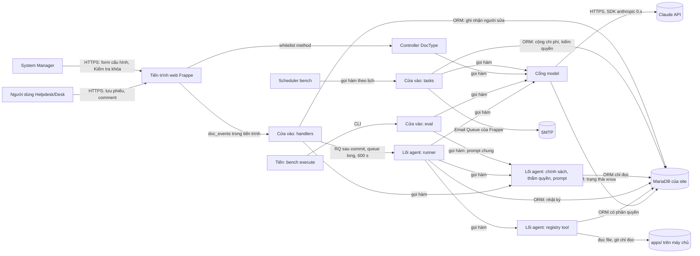

Feature: FEAT-001
Stage: architect
Author-agent: architect
Date: 2026-11-11
Approved-by:
<!-- Cổng: người duyệt điền dòng trên `Approved-by: <tên> <YYYY-MM-DD>`. Không có cổng thì để trống. -->

# Kiến trúc hệ thống

## Bối cảnh
`erp_ai` là một Frappe app, cài chung bench với Helpdesk 15.1.0 trên Frappe 15.126.1 (research `:26-35`). App đưa một AI agent vào HD Ticket:
- phân loại phiếu vào 6 đầu mục A–F;
- ở `L1`: ghi hướng giải quyết và comment;
- ở `L0`: chỉ ghi dự đoán vào nhật ký;
- kèm bộ đánh giá offline để đo độ chính xác phân loại.

Agent là **job nền trong bench, không phải dịch vụ riêng** (guide `:188`). Người dùng và hệ thống ngoài: xem spec mục Người dùng và mục Giao diện / tích hợp.

### Cơ sở khảo sát (tóm tắt, đọc trực tiếp 2026-11-11)
- Repo: khung `bench new-app`, 1 commit, 0 DocType, 0 test. `hooks.py` chỉ có khai báo app (`erp_ai/hooks.py:1-6`). Module duy nhất là `ERP AI agent` → `erp_ai/erp_ai_agent/` (`erp_ai/modules.txt:1`). `pyproject.toml:10-12` chưa khai phụ thuộc nào.
- Bench: có app `helpdesk`, `telephony`, `workflowcore` và 8 app khác (`sites/apps.txt`). Chỉ `helpdesk` gắn `doc_events`/`has_permission` vào HD Ticket (`apps/helpdesk/helpdesk/hooks.py:76`, `:112`, `:120`); không app nào khác hook vào HD Ticket.
- `workflowcore` dùng chung SDK `anthropic` và gom mọi lời gọi AI vào `workflowcore/services/ai_service.py` (`get_ai_client`, `call_claude`). Đây là tiền lệ trong bench cho ADR-002; erp_ai không import app này.
- Đơn vị chạy: `Procfile` có `web` (`bench serve`), `worker` (`bench worker`, không lọc hàng đợi nên phục vụ cả `long`), `schedule`, `redis_queue`, `redis_cache`, `socketio`.
- Frappe `get_traceback(with_context=True)` in biến cục bộ khi `developer_mode` bật (`frappe/utils/__init__.py:345-350`); mặc định thì không in.
- Profile: `deploy.staging`/`deploy.smoke` rỗng. Feature này không deploy (spec Constraints).

## Thành phần
| Thành phần | Trách nhiệm | Công nghệ | Chủ sở hữu |
|---|---|---|---|
| DocType trong module `ERP AI agent` (cấu hình agent + bảng con khóa API, nhật ký từng lượt, báo cáo độ chính xác) | Lưu cấu hình, trạng thái khóa, nhật ký | Frappe DocType/Report, `erp_ai/erp_ai_agent/` (ADR-001) | Ghi theo bảng ADR-004 |
| Cửa vào: handlers | Xét điều kiện kích hoạt, xếp hàng job; ghi nhận người sửa phân loại | `doc_events` trên HD Ticket, HD Ticket Comment (ADR-003) | erp_ai |
| Cửa vào: tasks | Dò lại khóa mỗi giờ; kiểm nâng quyền + cộng chi phí hằng ngày; reset đầu tháng | `scheduler_events` của Frappe | erp_ai |
| Cửa vào: cài đặt | Role, tài khoản agent, trường AI, dòng template, cấu hình mặc định | `after_install` + `after_migrate` (ADR-006) | erp_ai |
| Cửa vào: eval | Xuất phiếu có nhãn, chạy prompt phân loại, in độ chính xác | Python chạy bằng `bench execute`, ngoài job | erp_ai |
| Lõi agent: runner | Chốt tài khoản, kiểm lại mọi chốt, hai bước (phân loại → lập luận), vòng lặp tool có giới hạn, ghi nhật ký | RQ job `long`, `timeout=600` (ADR-003) | erp_ai |
| Lõi agent: chính sách, thẩm quyền, prompt | Điều kiện gửi, mức hiệu lực, giới hạn ngày, người ra lệnh, prompt phân loại + bộ đọc JSON dùng chung với eval | Python thuần trên ORM chỉ đọc (ADR-003, ADR-005) | erp_ai |
| Lõi agent: registry tool | Bộ tool theo mức × thẩm quyền; tool đọc/ghi phiếu, đọc mã nguồn | Python, ORM có phân quyền, `git` qua subprocess (ADR-005) | erp_ai |
| Cổng model | Chọn khóa, cầu dao, header hạn mức, chi phí, giữ bản rõ khóa | `anthropic>=0.103.1,<1`, `max_retries=0` (ADR-002) | erp_ai |
| Helpdesk | HD Ticket, HD Ticket Comment, HD Ticket Template, role `Agent`, permlevel 7/8 | Helpdesk 15.1.0 | app helpdesk (erp_ai chỉ thêm dòng template, ADR-006) |
| Claude API | Mô hình phân loại và lập luận | HTTPS, API `2023-06-01` mà SDK 0.103.1 gửi | Anthropic |

## Luồng dữ liệu chính
1. **Phiếu mới / comment có từ khóa.** Người lưu → handler xét điều kiện (agent bật, không tự kích hoạt, điều kiện gửi, chưa đủ phân loại, từ khóa) → một hàm xếp hàng duy nhất, chạy sau commit (ADR-003). 0 lời gọi model trong request (NFR-1).
2. **Job agent.** Worker `long` → runner: chuyển sang tài khoản agent và kiểm → đọc lại cấu hình → điều kiện gửi → giới hạn ngày (đếm từ nhật ký) → mức hiệu lực → bước phân loại qua Cổng model.
   - `L0`: chỉ ghi nhật ký "chưa áp dụng", không ghi phiếu (ADR-004).
   - `L1`: lượt lập luận với bộ tool theo mức × thẩm quyền (ADR-005). Mỗi lượt một bản ghi nhật ký kèm chi phí do cổng tính (ADR-002).
3. **Người sửa phân loại.** Handler cập nhật phiếu, với user phiên ≠ tài khoản agent → ghi giá trị người sửa vào bản ghi nhật ký gần nhất, đặt "phân loại bởi = Người" (AC-11, ADR-004).
4. **Hằng ngày.** tasks: cộng chi phí từ nhật ký vào "đã dùng tháng"; kiểm nâng quyền; email cảnh báo qua Email Queue (AC-16, AC-18).
   - **Mỗi giờ:** dò lại khóa "Hết hạn mức" qua Cổng model.
   - **Đầu tháng:** reset.
5. **Eval offline.**
   - Xuất phiếu (dùng cùng điều kiện gửi, A-9) → tệp dòng-JSON ngoài repo.
   - Chạy prompt phân loại chung qua Cổng model → in độ chính xác (AC-1..AC-3).

## NFR → giải pháp
| NFR | Giải pháp | ADR |
|---|---|---|
| NFR-1 (0 lời gọi model khi lưu; xếp hàng sau commit) | Handler không import Cổng model; một hàm xếp hàng duy nhất với `enqueue_after_commit=True`; test bằng stub đếm | ADR-001, ADR-003 |
| NFR-2 (600 s, hàng đợi dài) | `queue="long"`, `timeout=600` tường minh; client `max_retries=0` + timeout mỗi lời gọi; runner kiểm thời gian còn lại trước mỗi lượt | ADR-003, ADR-002 |
| NFR-3 (8 lượt, 5 lần chạy/ngày, 10 USD/tháng, sửa trên form) | Giới hạn đọc từ cấu hình; runner kiểm trước lời gọi đầu tiên; số lần chạy và chi phí đếm từ nhật ký; vượt ngân sách → min(mức, `L1`) | ADR-003, ADR-004 |
| NFR-4 (nhóm loại trừ / cờ không dùng AI: 0 byte; không gửi đính kèm) | Một hàm điều kiện gửi, dùng ở handler, runner (kiểm lại lúc chạy) và xuất eval; tool đọc không trả file đính kèm | ADR-003, ADR-005 |
| NFR-5 (khóa mã hóa, không lộ bản rõ) | Trường Password; `get_password` chỉ trong Cổng model; lỗi rời cổng không mang khóa; cấm traceback có biến cục bộ; tool đọc cấm DocType cấu hình/khóa, không trả trường Password; test gieo khóa giả | ADR-002, ADR-005 |
| NFR-6 (≤ 400 dòng, ≤ 40 kết quả, lệnh ngoài 30 s) | Hàm chặn đường dẫn dùng chung; chỉ `git` read-only, `timeout=30`, không shell | ADR-005 |
| NFR-7 (timeout + tối đa `max_key_thu` khóa/lượt) | Cầu dao của app là đường thử lại duy nhất; SDK `max_retries=0` | ADR-002 |
| NFR-8 (nghỉ khi token còn < 20.000) | Cổng đọc header qua `with_raw_response`; header vắng thì bỏ qua (tên header `UNVERIFIED` với API `2023-06-01`) | ADR-002 |
| NFR-9 (≥ 85% phân loại, đo sau G4) | Không phải điều kiện build. Kiến trúc chỉ bảo đảm phép đo đúng: eval và runner dùng chung một prompt + bộ đọc (ADR-001); nhật ký ghi dự đoán và giá trị người sửa (ADR-004) để AC-12 tính được | ADR-001, ADR-004 |

## Ranh giới và phụ thuộc
Chiều duy nhất: **Cửa vào → Lõi agent → Cổng model → (SDK anthropic, ORM Frappe)** (ADR-001).
- Cửa vào = handlers, tasks, cài đặt, eval, method whitelist trong controller DocType.
- Cửa vào gọi thẳng Cổng model chỉ khi: chạy eval, "Kiểm tra khóa", dò khóa mỗi giờ.
- Tool không gọi Cổng model, không gọi runner.
- Lõi agent không biết tới eval, handlers hay tasks.
- erp_ai phụ thuộc `frappe` và `helpdesk` (`required_apps`). Không app nào phụ thuộc ngược vào erp_ai; erp_ai không import `workflowcore`.

### Đơn vị triển khai
| Đơn vị | Chạy gì của erp_ai |
|---|---|
| Tiến trình web (`bench serve` / gunicorn) | handlers, form cấu hình, "Kiểm tra khóa" |
| Worker RQ (phải phục vụ `long`) | runner |
| Scheduler (`bench schedule`) | tasks |
| MariaDB, Redis queue | dữ liệu, hàng đợi (của bench, dùng chung) |

Không có đơn vị mới; cập nhật mã cần `bench restart` (guide `:214`). Môi trường của feature này: chỉ site dev `miyano`. Production và các lệnh `deploy.*`: ngoài phạm vi; G5 và việc của người sau G4.

### Quét các chiều
| Chiều | Kết luận |
|---|---|
| Môi trường và deploy | **Đã quyết:** một app trong bench có sẵn, ba tiến trình như bảng trên, không dịch vụ riêng (giữ đúng guide `:188`; không qua phép thử ADR vì không có phương án khác được đặt ra). **Câu hỏi mở (A-2):** production có worker `long`, có `git`, đúng bản Helpdesk — người kiểm sau G4 |
| Sở hữu dữ liệu | **Đã quyết:** ADR-004 (bảng chủ ghi), ADR-006 (bản ghi Helpdesk chỉ thêm dòng) |
| Đường ghi trạng thái | **Đã quyết:** ADR-003 (job sau commit, chống trùng), ADR-004 (cập nhật từng trường, nhật ký là nguồn sự thật) |
| Lỗi, log, cấu hình | **Đã quyết:** mọi tham số chỉnh được nằm trong cấu hình agent (guide `:646-680`); tool từ chối bằng `ok=false` (ADR-005); lỗi rời Cổng model không mang khóa (ADR-002); nhật ký từng lượt + Error Log của Frappe. **Để designer:** tiêu đề Error Log, chỗ đặt hằng số tên tài khoản/role (một chỗ, STD-DESIGN-4) |
| Xác thực, phân quyền | **Đã quyết:** job chạy dưới tài khoản agent có chốt kiểm (ADR-003); thẩm quyền theo người + bộ tool theo mức (ADR-005); trường AI permlevel 8, tài khoản agent không có System Manager (ADR-006). **Để designer:** quyền chi tiết trên form cấu hình (AC-19 đã định) |
| Tích hợp ngoài | **Đã quyết:** ADR-002 (timeout, thử lại bằng chuyển khóa, không retry SDK). Email qua Email Queue có sẵn của Frappe |

## Rủi ro
- Tên header hạn mức với SDK 0.103.1 / API `2023-06-01` chưa kiểm trên response thật (research `:67`) → cổng chịu được header vắng (ADR-002); người kiểm ở guide `:1518`.
- "Đã dùng tháng" trễ tối đa một ngày nên có thể vượt ngân sách trong khoảng đó; mức vượt bị chặn bởi NFR-3 (ADR-004).
- Helpdesk bản sau có thể bỏ HD Ticket Template → trường AI mất hiển thị, không mất dữ liệu (ADR-006).
- `developer_mode` bật trên `miyano`: traceback có biến cục bộ sẽ in giá trị biến (bộ lọc của Frappe chỉ che theo tên biến) → cấm `with_context=True` (ADR-002).
- Khe trùng job giữa hai request đồng thời vẫn còn sau ADR-003; chi phí bị chặn bởi giới hạn số lần chạy/ngày.
- SDK 0.x cũ (bản mới nhất 2.8.0); vá bảo mật cho 0.x `UNVERIFIED` → nâng SDK thành feature riêng, gộp cả `workflowcore`.
- Tự phản biện — đã thử dựng hai task cùng tuân mọi ADR mà vẫn xung đột:
  - (1) nút "Kiểm tra khóa" lưu cả cấu hình trong khi runner cập nhật trạng thái khóa → đã siết ADR-004: cấm `.save()` cấu hình, trạng thái khóa chỉ ghi trong cổng;
  - (2) handler đếm lần chạy bằng trường trên phiếu, runner đếm bằng nhật ký → ADR-004: chỉ đếm từ nhật ký;
  - (3) tool tạo Task tự đọc mức `L2` từ cấu hình khi runner đã lui về `L1` → ADR-005: tool không đọc mức quyền;
  - (4) tool ghi `ticket_type` kích hoạt handler ghi nhận "người sửa" → ADR-004: phân biệt bằng user phiên;
  - (5) eval có danh sách loại trừ riêng → ADR-003: một hàm điều kiện gửi;
  - (6) tool tự ghi bản ghi nhật ký riêng, runner ghi bản ghi lượt → ADR-004: chỉ runner tạo nhật ký.

  Không còn tổ hợp xung đột nào tìm được.
