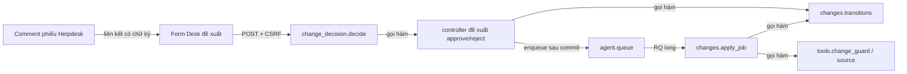

Feature: CHG-001
Stage: architect
Author-agent: architect
Date: 2026-11-14
Approved-by:
<!-- Cổng: người duyệt điền dòng trên `Approved-by: <tên> <YYYY-MM-DD>`. Không có cổng thì để trống. -->

# Đánh giá tác động kiến trúc CHG-001

Chế độ: impact (`--decide`). Đối tượng: code người ra lệnh viết ngoài quy trình, đã nhận vào `develop` (25be823, 6d90e79). Ý định của người là cố định: một lần bấm, làm luôn, ô toàn quyền. Mỗi điểm lệch được phán: **chấp nhận như lệnh** / **chấp nhận kèm biện pháp** (đổi cụ thể + test) / **trả về người**. Chi tiết, căn cứ file:dòng và Ràng buộc: ADR-023.

Căn cứ: đọc trực tiếp từng file đã biết (không qua Explore) — `change_decision.py`, `change_link.py`, `changes/apply_job.py`, `tools/site_api.py`, `tools/registry.py`, `policy.py`, `propose_change.py`, controller đề xuất, `queue.py`, `run_log.py`; mã Frappe 15 đã cài (`app.py:452-457`, `database.py:1200-1215`, `background_jobs.py:168-170`, `synchronization.py:37-45`, `client.py:228-235`, `save.py:16-18`); role tài khoản agent trên `miyano` (đọc `frappe.get_roles`).

## Phán quyết

| # | Điểm lệch | Phán | Tấn công / hỏng hóc được chặn |
|---|---|---|---|
| 1 | ADR-012 QĐ 4: duyệt bằng GET có chữ ký trong comment | Chấp nhận kèm M1 | **Lỗi có thật:** GET không commit (`frappe/app.py:452-457`) → lời xếp job áp dụng bị xóa ở rollback cuối request → đề xuất kẹt "Đã duyệt", không áp dụng. Tải trước/máy quét/`` chứa đường dẫn đã ký (model đọc được `href` qua `site_api` rồi `post_comment`) duyệt thay người có role đang mở phiếu. Phát lại: đã chặn bởi phép chuyển có điều kiện. Hết hạn: không đặt (A-9), cũ thì hết hiệu lực lúc áp dụng. Chuyển tiếp cho người có role: rủi ro còn lại, chấp nhận. |
| 2 | ADR-012 QĐ 7 / ADR-013 QĐ 1: job không kiểm lại role, không kiểm user phiên | Chấp nhận kèm M2 (khôi phục) | Role bị thu khi job còn chờ hàng `long`; job xếp ngoài controller chạy dưới user khác. Thêm lỗi tìm thấy: `LockTimeoutError` ngoài `try` → đề xuất kẹt "Đã duyệt", 0 dòng nhật ký (NFR-6). |
| 3 | ADR-005 QĐ 3: tool ghi nhận tên DocType | Chấp nhận như lệnh, kèm M3 | Tài khoản agent là `System Manager` → danh sách cấm là lớp chặn duy nhất. DocType thứ năm của app sẽ mở ở chế độ toàn quyền vì tập cấm viết tay; sửa `DocType.permissions`/`Role` là đường vòng gán quyền ở chế độ thường. |
| 4a | ADR-011 QĐ 2/6: `_unrestricted_specs` là đường cấp thứ hai | Chấp nhận hành vi, kèm M4 (gộp cấu trúc) | Hai nơi quyết "ai được tool gì" lệch nhau ở lần sửa sau; không đổi tool cấp ra. |
| 4b | `call_method` chặn bằng so chuỗi | Kèm M5 (bắt buộc) + **trả về người** phần còn lại | Vượt chắc chắn: `frappe.desk.form.save.savedocs` / `frappe.client.insert` với `doc` là chuỗi JSON `"ERP AI Setting"` → bot (System Manager) sửa công tắc/nhật ký của chính nó. M5 chặn mọi đường qua controller; đường ghi DB thẳng (System Console, Server Script) và cấp System Manager/khóa API cho người khác cần người chọn (ADR-023 QĐ 6). |

## Biện pháp cho tech-lead (file + đổi + test)

- **M1** — `erp_ai/agent/change_link.py`: `decision_path` trả đường form Desk `/app/erp-ai-change-proposal/<name>?<tham số đã ký>` thay vì `/api/method/…`. `erp_ai/change_decision.py`: `decide` thành `methods=["POST"]`, kiểm chữ ký rồi gọi `approve`/`reject`, trả JSON (bỏ `respond_as_web_page`/chuyển hướng). `erp_ai/erp_ai_agent/doctype/erp_ai_change_proposal/erp_ai_change_proposal.js`: khi mở với `action`+`_signature` và trạng thái "Chờ duyệt" → gọi `decide` một lần, không hộp xác nhận, rồi xóa tham số khỏi địa chỉ và tải lại form. `erp_ai/agent/tools/propose_change.py::_comment`: giữ nhãn Duyệt / Từ chối, đường mới. Test: `test_change_decision` (GET → `PermissionError`; chữ ký sai → không ghi; POST đúng → "Đã duyệt" + 1 job còn sau `frappe.app.sync_database`; 4 loại tài khoản bị từ chối); `test_change_link` (không chứa `/api/method/`); luật kiến trúc "không whitelist GET đổi trạng thái".
- **M2** — `erp_ai/agent/changes/apply_job.py`: đầu `_run` (cả áp dụng và hoàn tác) kiểm người thực hiện không thuộc `NEVER_AUTHORITY`, còn `ERP AI Instructor`, và `frappe.session.user` trùng người đó; sai → `_Stop(Lỗi, lý do)`. Bắt `LockTimeoutError` của `filelock` → phép chuyển "Đã duyệt/Đang hoàn tác → Lỗi" có lý do + 1 dòng nhật ký (hàm chuyển cần có trong `transitions.py`). Test: `test_apply_job` (gỡ role trước job → `Lỗi`, file trùng byte, HEAD không đổi; user phiên khác → `Lỗi`; stub khóa hết giờ → `Lỗi`, 1 dòng nhật ký, 0 tiến trình con).
- **M3** — `erp_ai/agent/tools/site_api.py`: `ALWAYS_DENIED_DOCTYPES` và `DENIED_DOCTYPES` dẫn xuất từ `read.denied_doctypes()` (mọi DocType module app) thay cho tập viết tay; chế độ thường cấm thêm `DocType`, `Role`. Test: `test_site_api` (mỗi DocType module app × mỗi `api_*` × hai chế độ → `ok=false`; chế độ thường sửa `DocType.permissions`, `Role` → `ok=false`).
- **M4** — `erp_ai/agent/tools/registry.py`: bỏ `_unrestricted_specs`, `get_unrestricted_tool_schemas`; thêm đầu vào `unrestricted` cho `_granted_specs`/`get_tool_schemas`/`execute_tool`; hai dòng `GRANT_TABLE` như ADR-023 QĐ 4. `erp_ai/agent/runner.py:587-598`: một lời gọi lấy schema; cờ khối prompt lấy từ kết quả cấp. Test: `test_registry` ma trận (sửa code × toàn quyền × 4 mức × người ra lệnh) trùng ảnh chụp hiện tại; `test_architecture` (một hàm cấp, không có hai tên cũ).
- **M5** — controller của mọi DocType thuộc module app (`erp_ai/erp_ai_agent/doctype/*/…py`): từ chối ghi/xóa/đổi tên/submit khi user phiên là tài khoản agent, trừ `run_log.write_entry` (ERP AI Log) và tool đề xuất (insert đề xuất), đánh dấu bằng cờ cục bộ chỉ đặt trong hai module đó. Test: dưới tài khoản agent, `insert`/`save`/`delete`, `frappe.client.insert` với chuỗi `g`, `savedocs` → từ chối, DB không đổi; hai đường hợp lệ vẫn chạy; luật kiến trúc grep cờ.

## Module bị chạm
| Module | Thay đổi | Mức |
|---|---|---|
| Cửa vào duyệt (`change_decision.py`, `change_link.py`, JS form đề xuất) | GET → form + POST (M1) | Vừa |
| Lõi áp dụng (`agent/changes/apply_job.py`, `transitions.py`) | Kiểm lại người thực hiện; khóa hết giờ → `Lỗi` (M2) | Nhỏ |
| Registry + runner (`tools/registry.py`, `runner.py`) | Gộp bảng cấp (M4), không đổi hành vi | Nhỏ |
| Tool bản ghi (`tools/site_api.py`) | Một nguồn danh sách cấm (M3) | Nhỏ |
| DocType của app (controller) | Kiểm danh tính tài khoản agent (M5) | Vừa |

## Hợp đồng thay đổi
- Đường dẫn trong comment của bot đổi dạng (Desk form thay `/api/method`). Đề xuất cũ đang chờ có liên kết GET cũ: sau M1 liên kết đó trả `PermissionError` — người duyệt bằng form như trước. Không đổi schema DocType. Tool cấp ra cho model không đổi (M4).

## NFR bị ảnh hưởng
| NFR (FEAT-004) | Lời giải |
|---|---|
| NFR-1 0 thay đổi trước duyệt | M1 (không còn duyệt do tải tự động), M2 |
| NFR-2 đúng nội dung đã duyệt | Giữ (dấu nội dung, ADR-012 QĐ 7) |
| NFR-5 0 bí mật ra ngoài | Phụ thuộc ADR-023 QĐ 6 (khóa API qua `call_method`) — chờ người |
| NFR-6 mỗi bước một dòng nhật ký | M2 (khóa hết giờ không còn kẹt im lặng) |
| NFR-3, 4, 7, 8, 9 | Không bị chạm |

## Quét chiều
- Triển khai: không đổi (cùng worker, cùng hàng `long`) — đã quyết.
- Chủ dữ liệu: trạng thái đề xuất chỉ `transitions` ghi (giữ); DocType của app không ghi được bởi tài khoản agent (M5) — đã quyết.
- Đường ghi trạng thái: một cửa POST (M1) — đã quyết.
- Lỗi/nhật ký/cấu hình: khóa hết giờ → `Lỗi` + nhật ký (M2) — đã quyết; câu chữ — designer.
- Xác thực/phân quyền: role ở `_decider` và ở job (M1, M2); role của tài khoản agent — câu hỏi mở cho người.

## Quyết định
- ADR mới: ADR-023 (proposed). Thay một phần ADR-012 QĐ 4; thay ADR-005 QĐ 3 cho `site_admin`/`site_unrestricted`; bổ sung ADR-011 QĐ 2. Dòng trạng thái của ADR-005, ADR-011, ADR-012 cần thêm câu trỏ ADR-023 (architect không có công cụ sửa từng dòng; team-leader thêm, không đổi thân ADR).

## Rủi ro
- Người duyệt không vào được Desk → M1 không dùng được cho họ (ADR-023 QĐ 6).
- Toàn quyền bật + chọn (b) → bot có thể chạm công tắc của chính nó qua đường ghi DB thẳng.
- M5 viết sai đường hợp lệ → chặn chính runner ghi nhật ký; test hai đường hợp lệ là bắt buộc.
- Đã thử tự phản biện: hai task cùng theo ADR — task M4 gộp bảng cấp và task M1 đổi comment — không chạm nhau; task M5 (chặn tài khoản agent ghi đề xuất) và tool đề xuất (insert dưới tài khoản agent) xung đột nếu không có đường hợp lệ → đã ghi đường hợp lệ và cờ vào Ràng buộc ADR-023.

## Để designer quyết
- Tên/nơi đặt method POST; cách form đọc/xóa tham số; câu chữ lỗi và trang thông báo; cơ chế cờ "đường hợp lệ" của M5; danh sách đủ của M3 — không đạt phép thử ngưỡng (không có hai lựa chọn xung đột giữa các task sau khi ADR-023 đã chốt hình dạng).

## Câu hỏi cho người (qua team-leader)
1. `call_method` khi toàn quyền bật: (a) danh sách hàm cho phép trong ERP AI Setting (khuyến nghị) hay (b) gọi tự do, chấp nhận cam kết "bot không tự đổi công tắc" chỉ là cố gắng.
2. Mọi người có `ERP AI Instructor` có vào được Desk không; nếu không: cấp Desk, hay giữ GET (cần researcher về `Sec-Fetch-*`).
3. Tài khoản agent trên `miyano` có `System Manager` và `ERP AI Instructor`: có đúng ý không (khuyến nghị gỡ `ERP AI Instructor`).
