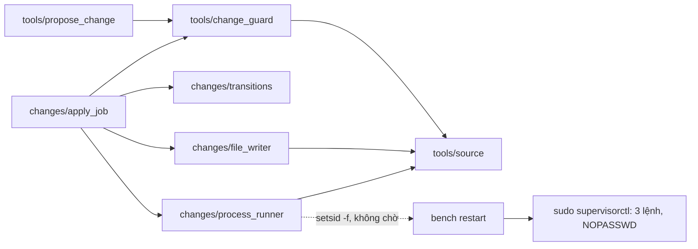

Feature: CHG-002
Stage: architect
Author-agent: architect
Date: 2026-11-15
Approved-by:
<!-- Cổng: người duyệt điền dòng trên `Approved-by: <tên> <YYYY-MM-DD>`. Không có cổng thì để trống. -->

# Đánh giá tác động kiến trúc CHG-002

Đánh giá này đi theo chế độ impact, mode decide; cổng G2 đang tắt. Phạm vi là các điểm 1–7 của bảng intake (`intake.md:30-38`), theo quyết định N-1 của người. Quyết định chi tiết nằm ở `docs/team/adr/ADR-040.md` (proposed). Spec của CHG-002 do analyst viết song song; designer đối chiếu hai bên.

## Module bị chạm
| Module | Thay đổi | Mức |
|---|---|---|
| `erp_ai/agent/tools/propose_change.py` | tool tạo đề xuất dạng khối: nhiều thao tác file và danh sách lệnh | lớn |
| `erp_ai/agent/tools/change_guard.py` | bộ chặn áp cho xóa, đổi tên, thư mục mới; luật "một repo"; hình dạng `restart`; luật `migrate` trước `restart` | lớn |
| `erp_ai/agent/tools/source.py` | một hàm "văn bản cho phép" thay `DUOI_CHO_PHEP` cho cả đọc lẫn ghi | vừa |
| `erp_ai/agent/changes/apply_job.py` | áp dụng và hoàn tác cả khối, một commit, lệnh theo thứ tự, khởi chạy restart | lớn |
| `erp_ai/agent/changes/file_writer.py` | tạo thư mục cha, xóa, gỡ thư mục rỗng do khối tạo, chặn symlink | vừa |
| `erp_ai/agent/changes/process_runner.py` | commit nhiều đường dẫn; lời khởi chạy restart tách rời (`setsid -f`) | vừa |
| `erp_ai/agent/changes/transitions.py` | cạnh `Lỗi → Đang hoàn tác` có điều kiện; dấu phủ dòng con; trường kết quả restart | vừa |
| DocType `ERP AI Change Proposal` cùng một bảng con mới | thao tác file thành dòng con; danh sách lệnh; trường restart; giữ đọc được bản ghi cũ | lớn |
| `erp_ai/constants.py`, `erp_ai/agent/change_text.py`, `erp_ai/agent/changes/result_comment.py` | hằng giới hạn; câu chữ nhiều file; bỏ câu "cần người chạy bench restart" | nhỏ |
| `erp_ai/agent/prompts.py` (khối `CHANGE_TOOLS_BLOCK`) | câu "Mỗi đề xuất là một file hoặc một lệnh" và "chỉ có hiệu lực sau khi người chạy bench restart" (`prompts.py:167`, `:170`) phải đổi. **Ngoài danh sách file của intake**, xem mục Ranh giới FEAT-007 | nhỏ |
| `erp_ai/tests/test_architecture.py` | các luật ở Ràng buộc của ADR-040 | vừa |
| Máy chủ (`/etc/sudoers.d/`) | bước người làm một lần, ngoài repo | — |

Chiều phụ thuộc không đổi: `tools/` không import `changes/`; `changes/` được import bộ chặn trong `tools/` (ADR-011 Ràng buộc).

## Hợp đồng thay đổi
- **Dữ liệu.**
  - `ERP AI Change Proposal` có thêm một bảng con: mỗi dòng là một thao tác file (sửa, tạo, xóa hoặc đổi tên, kèm nội dung trước và sau và dấu). Danh sách lệnh là một danh sách có thứ tự trên bản ghi cha.
  - Thêm trường trạng thái cho kết quả restart.
  - **Tương thích ngược:** đề xuất cũ (trường vô hướng) vẫn đọc được, áp dụng được và hoàn tác được. Designer chọn cách: di trú bằng patch thành một dòng con, hoặc đọc cả hai dạng.
- **Hợp đồng với model.** Schema tool đổi: một khối thay vì một file. Tên tool và hình dạng do designer chọn. Câu từ chối mới cho các luật của ADR-040 Quyết định 4–6.
- **Máy trạng thái** (ADR-012 Quyết định 3):
  - Không thêm trạng thái.
  - Thêm một cạnh `Lỗi → Đang hoàn tác`, chỉ khi có mã commit áp dụng và chưa có mã commit hoàn tác.
  - Đề xuất chỉ có lệnh vẫn không hoàn tác được.
- **Git.** Mỗi lần áp dụng có một commit gồm nhiều đường dẫn (trước đây là một đường dẫn); mỗi lần hoàn tác cũng một commit. Tập git ghi không đổi.
- **Lệnh.** Danh sách lệnh thêm `["restart"]`.

## Các quyết định ADR thay đổi, mối đe dọa mới và cách chặn
| Quyết định cũ | Đổi thành | Mối đe dọa mở ra | Cái chặn |
|---|---|---|---|
| ADR-011 QĐ 1: "một lời gọi = một file hoặc một lệnh" | Một khối trong **một** repo app: tối đa 50 thao tác file và tối đa 6 lệnh (ADR-040 QĐ 1, 5) | Người duyệt mệt, một thay đổi xấu lẫn trong khối lớn; khối trải nhiều repo, commit dở dang | Giới hạn đếm được (50 thao tác, 8 MiB, 6 lệnh); một repo nên đúng một commit; dấu lúc duyệt phủ mọi dòng; form liệt kê rõ thao tác xóa và đổi tên |
| ADR-011 QĐ 4: "không phải thao tác xóa hay đổi tên" | Xóa, đổi tên, tạo thư mục cha qua cùng `check_write_path` (ADR-040 QĐ 4) | Xóa hay đổi tên ra ngoài app, vào `erp_ai`, vào `.git`; thư mục mới tạo đường vòng qua symlink hay repo lồng; xóa file không khôi phục được | Mọi đường dẫn, kể cả từng thư mục sẽ tạo, qua cùng một bộ chặn lúc đề xuất và lúc áp dụng; chặn `erp_ai` theo danh tính repo; không thành phần `.git*`; repo gần nhất phải là repo app; không symlink; chỉ xóa file văn bản git đang theo dõi và sạch (nội dung trước được lưu để hoàn tác) |
| ADR-011 QĐ 4 và `source.py:27`: danh sách 8 đuôi | Luật theo nội dung: UTF-8 chặt, không NUL, tối đa 1 MiB, tên không khớp `TEN_CAM`; một hàm dùng chung cho đọc và ghi (ADR-040 QĐ 5) | File nhị phân, file thực thi; model đọc được file văn bản có bí mật dưới tên lạ | Nhị phân bị luật UTF-8/NUL chặn; bot không bao giờ đặt bit thực thi hay tạo symlink; `TEN_CAM` giữ nguyên. Phần còn lại ghi ở mục Rủi ro |
| `constants.py:47-48`: 20 000 ký tự, 10 chỗ sửa | Tối đa 1 MiB mỗi file, 8 MiB mỗi đề xuất, 50 thao tác (ADR-040 QĐ 5) | Một dòng DB quá lớn; form không tải được | Một dòng con tối đa khoảng 2 MiB cộng diff, dưới `max_allowed_packet` 16M; tổng 8 MiB |
| ADR-022 QĐ 1: "đúng 1 commit `--only` đường dẫn đó"; hậu kiểm "1 đường dẫn" | Một commit `--only -- <các đường dẫn của khối>`; hậu kiểm so **tập** đường dẫn (ADR-040 QĐ 2) | Commit cuốn theo file bẩn khác của người (NFR-7) | `--only` cùng danh sách đúng bằng các đường dẫn đã duyệt; từng đích phải sạch; hậu kiểm so tập đường dẫn và từng blob |
| ADR-013 QĐ 6: "gỡ file mới là thao tác xóa duy nhất" | Xóa và gỡ thư mục rỗng do khối tạo, chỉ ở `file_writer` (ADR-040 QĐ 2–4) | Xóa nhầm, xóa ngoài phạm vi | Chỉ `file_writer` thao tác hệ tệp (luật grep giữ nguyên); kiểm lại đường dẫn thật trong khóa; lỗi giữa khối thì trả lại toàn bộ, 0 commit |
| ADR-012 QĐ 3: hoàn tác chỉ từ `Đã áp dụng` | Thêm `Lỗi → Đang hoàn tác` khi có commit áp dụng (ADR-040 QĐ 3) | Hoàn tác chồng lên một lần hoàn tác khác | Điều kiện "chưa có mã commit hoàn tác"; phép chuyển có điều kiện (một bên thắng); kiểm nội dung sau và tổ tiên HEAD trước khi ghi |
| ADR-011 QĐ 4, ADR-022 QĐ 2: 6 lệnh | Thêm đúng `["restart"]`; với khối có file thì phải có `migrate` trước `restart` (ADR-040 QĐ 6) | Bot mở rộng dần sang `execute` hay `console`; restart nạp mã hỏng làm sập site | Danh sách cho phép theo hình dạng chính xác, test liệt kê lệnh cấm; `migrate` trong tiến trình mới bắt lỗi ở hooks và module cấp app trước khi restart; `migrate` lỗi thì không restart |
| ADR-013 Hệ quả (A-10): "người tự restart" và QĐ 3 "diệt cả nhóm khi quá giờ" | Bot khởi chạy `bench restart` tách rời, có `timeout` riêng, sau khi kết quả đã commit DB (ADR-040 QĐ 7) | Leo thang quyền qua supervisor; từ chối dịch vụ (restart liên tục); job và worker chờ nhau; tiến trình mồ côi | sudoers hẹp, đúng 3 lệnh, không ký tự đại diện, không `reread`/`update`/`reload`; không mở socket cho `miyano` (phương án R2 bị bác vì cho leo thang lên root); mỗi lần restart cần một lần duyệt của người và đi qua khóa chung; tách rời qua `setsid -f` với stdin/stdout/stderr `DEVNULL`; tiến trình restart có `timeout -s KILL` riêng |
| ADR-012 QĐ 1: nội dung vô hướng | Thêm dòng con và danh sách lệnh vào phần nội dung và vào dấu (ADR-040 QĐ 1) | Sửa dòng con sau khi duyệt | Controller bất biến phủ cả dòng con; dấu so lại lúc áp dụng (ADR-012 QĐ 7) |

**Vành đai giữ nguyên (N-1).** Không áp dụng nào trong số trên mở các phần sau:
- app `erp_ai`: chặn theo danh tính repo, kể cả đích đổi tên và thư mục mới;
- `TEN_CAM`, `sites/` và cấu hình site (nằm ngoài gốc `apps/`);
- `.git`, push, fetch, đổi nhánh;
- `execute`, `console` và các lệnh ngoài danh sách;
- một lần duyệt của người cho mỗi đề xuất; bot không tự duyệt.

Cụ thể: ADR-011 QĐ 2–3, ADR-012 QĐ 4–5, ADR-022 QĐ 2 (tập git) và ADR-023 không đổi.

## Restart: các phương án, phương án chọn, bước người làm một lần
**Hiện trạng đọc trên máy** (2026-11-15, chỉ lệnh đọc):
- `supervisord` chạy dưới root.
- Socket `/var/run/supervisor.sock` có quyền `0700 root:root`.
- Các chương trình của bench chạy dưới `miyano`.
- `config/supervisor.conf` thuộc `miyano` và được nối symlink vào `/etc/supervisor/conf.d/`.
- bench 5.31.0: `bench restart` chuyển sang `sudo supervisorctl status`, rồi `restart frappe-bench-web:` và `restart frappe-bench-workers:`.

**Các phương án:**

| # | Phương án | Bước người | Kết luận |
|---|---|---|---|
| R1 | sudoers `NOPASSWD` đúng 3 lệnh `supervisorctl`; bot chạy `bench restart` tách rời | Có, một lần | **Chọn** |
| R2 | Đổi socket supervisor sang `chown=root:miyano`, `chmod=0770` | Có, một lần | Bác: `miyano` viết được tệp mà root include, nên `supervisorctl update` thành leo thang lên root |
| R3 | Gửi tín hiệu cho tiến trình của `miyano` và dựa vào `autorestart` | Không | Bác: phải tìm PID theo dòng lệnh, dễ diệt nhầm; `schedule` không có `autorestart=true`; bỏ qua supervisor |
| R4 | Người restart tay | — | Bác (trái N-1); vẫn là đường lui |
| R5 | Đổi đơn vị chạy (systemd user unit, `bench start`) | Lớn | Bác: thay hạ tầng, ngoài phạm vi |

**Bước người làm một lần (R1).** Đây không phải câu hỏi, cũng không phải lựa chọn không đảo được: xóa tệp là gỡ.
- Dùng `sudo visudo -f /etc/sudoers.d/erp-ai-restart` tạo tệp cho phép user `miyano` chạy `NOPASSWD` đúng ba lệnh:
  - `/usr/bin/supervisorctl status`
  - `/usr/bin/supervisorctl restart frappe-bench-web:`
  - `/usr/bin/supervisorctl restart frappe-bench-workers:`
- Không thêm lệnh con nào khác, không ký tự đại diện.
- Kiểm bằng `sudo -n -l` dưới user `miyano`.
- Dòng sudoers chính xác (cách thoát dấu `:`) do devops hoặc designer viết vào design; người dán.
- Chưa làm bước này thì restart lỗi vì `sudo` không hỏi được mật khẩu khi không có terminal. Thay đổi vẫn được áp dụng; kết quả restart ghi "lỗi" hoặc "chưa xác nhận"; người restart tay như hôm nay.

**Vì sao tách rời.** `bench restart` restart cả nhóm worker, gồm long worker đang chạy chính job áp dụng. rq 1.15.1 gặp SIGTERM thì chờ job xong. Nếu job chờ restart thì hai bên chờ nhau tới `stopwaitsecs=1560`. Vì vậy:
- kết quả được commit DB trước;
- job khởi chạy restart qua `setsid -f` rồi trả về;
- worker dừng sạch sau khi job xong.

## NFR bị ảnh hưởng
Spec CHG-002 chưa có; dưới đây đối chiếu với NFR của FEAT-004. Analyst có thể thêm NFR mới; designer đối chiếu lại.

| NFR (FEAT-004) | Lời giải trong CHG-002 |
|---|---|
| NFR-1: không gì đổi trước khi duyệt | Tool vẫn chỉ tạo bản ghi; job chỉ chạy đúng danh sách đã nằm trong dấu; không tự chèn lệnh (ADR-040 QĐ 2, 6) |
| NFR-2: nguyên tử, một bên thắng | Phép chuyển có điều kiện giữ nguyên; lỗi giữa khối thì trả lại cả khối, 0 commit; cạnh mới có điều kiện |
| NFR-3: thời gian | Dùng chung ngân sách 540 s của job; số đo `migrate` 39,8 s, `build hrms` 18,4 s; build `frappe`/`helpdesk` chưa đo (dev đo). Restart chạy ngoài ngân sách nhờ tách rời, có `timeout` riêng |
| NFR-4: đầu ra tối đa 400 dòng | Giữ cho mỗi lệnh; restart không thu đầu ra |
| NFR-5: không lộ bí mật | `TEN_CAM` giữ nguyên cho mọi đường dẫn; `env` tối thiểu cho restart; không đọc cấu hình site |
| NFR-6: một dòng nhật ký mỗi bước | Giữ; kết quả restart ghi vào trường trạng thái và nhật ký bước áp dụng/hoàn tác (designer chọn dòng) |
| NFR-7: git chỉ chạm đích | `--only` với đúng danh sách đã duyệt; hậu kiểm so tập đường dẫn |
| NFR-8: không lộ danh tính | Không đổi (danh tính bot, thông điệp dựng từ trường server) |
| NFR-9: cô lập test | Helper repo tạm của ADR-022 QĐ 8 dùng cho mọi test khối; test restart dùng stub, **không** chạy `bench restart` thật |

**Quét theo chiều:**
| Chiều | Tình trạng |
|---|---|
| Triển khai | Đã quyết: không thêm đơn vị chạy; một tệp sudoers do người cài (production `UNVERIFIED`) |
| Ai sở hữu dữ liệu | Đã quyết: tool tạo đề xuất và dòng con (nội dung); `changes/transitions` ghi trạng thái (ADR-012 bảng chủ ghi, không đổi) |
| Đường ghi | Đã quyết: hệ tệp chỉ qua `file_writer`; tiến trình con chỉ qua `process_runner`; enqueue chỉ ở `queue.py` (vẫn 2 lời gọi) |
| Lỗi, nhật ký, cấu hình | Đã quyết: lỗi giữa khối thì trả lại; lệnh lỗi thì `Lỗi` và hoàn tác được; restart lỗi không đổi kết quả. Giới hạn là hằng, **không** thêm trường cài đặt (không chạm `erp_ai_setting.json` của FEAT-007). Câu chữ để designer |
| Quyền | Đã quyết: không đổi role hay phân quyền DocType; bảng con không có quyền riêng; M5 của ADR-023 phủ qua controller cha |

## Quyết định
- ADR mới: **ADR-040** (`proposed`). Số 030–037 là bản nháp của FEAT-007 trong checkout này; 038–039 để trống.
- ADR-040 thay hoặc sửa các quyết định đã liệt kê ở bảng trên. Thân ADR-011, 012, 013, 022 không sửa; dòng trạng thái của chúng có thể ghi "xem ADR-040" khi G2 hoặc người duyệt.

## Rủi ro
- **Khóa ngoài vì mã hỏng.** Mã hỏng mà `migrate` không bắt được có thể làm site lỗi sau restart; khi Desk không mở được thì không hoàn tác qua form được.
  - Đường cứu: `git revert <mã commit>` (mã có trong comment phiếu và `git log --author=erp-ai-agent@bot.invalid`), rồi `bench restart` do người chạy. Designer nên ghi đường cứu này vào comment kết quả.
- **Từ chối dịch vụ.** Mọi tiến trình `miyano` restart được bench không cần mật khẩu. Được chặn bởi: chỉ 3 lệnh; mỗi restart của bot cần một lần duyệt của người.
- **Restart dừng mọi site trên bench.** Hôm nay chỉ có `miyano`. Long worker chờ job đang chạy, tối đa 600 s.
- **Phần DB không hoàn tác.** Hoàn tác không gỡ phần DB do `migrate` đã làm (cột, DocType đã đồng bộ).
- **Luật đọc mở rộng.** Tool đọc thấy mọi file văn bản dưới `apps/` không khớp `TEN_CAM`; nếu repo app có bí mật dưới tên khác thì model đọc được.
- **Tốn công duyệt.** Khối trải hai app phải duyệt hai lần.
- **Thời gian chưa đo.** Build `frappe`/`helpdesk` chưa đo; một khối nhiều lệnh có thể vượt 540 s. Khi đó thành `Lỗi` quá giờ; cần ADR mới nếu đó là nhu cầu thật.
- **Xung đột với FEAT-007** khi gộp nhánh: xem mục dưới.

## Ranh giới FEAT-007 và touchpoint ngoài intake (báo team-leader)
- **`erp_ai/agent/tools/source.py`.** Nhánh `team/FEAT-007` đã sửa file này: tách `resolve_safe_path` thành `_base_resolve` (có kiểm đuôi) cộng `resolve_manual_path`. Luật "văn bản cho phép" của ADR-040 QĐ 5 thay đúng phần kiểm đuôi trong `_base_resolve`, nên designer phải viết trên hình dạng của FEAT-007 hoặc hẹn thứ tự gộp.
- **`erp_ai/constants.py`.** FEAT-007 thêm một khối ở cuối file; hằng của CHG-002 đặt ở khối riêng, ít xung đột.
- **`erp_ai/agent/prompts.py`.** File này không có trong danh sách của intake. FEAT-007 (design-addendum-1-U1 mục 3.5) tái cấu trúc cách ghép prompt nhưng cam kết "thân các khối của FEAT-004 không đổi". CHG-002 cần đổi **thân** `CHANGE_TOOLS_BLOCK` (`prompts.py:167`, `:170`). Ảnh chụp prompt của AC-14 FEAT-004 phải cập nhật theo.
- **`erp_ai/tests/test_architecture.py`.** Cả hai nhánh đều thêm luật vào file này.
- **Không đụng:** `site_api.py`, `registry.py` (tool mới vẫn vào qua `propose_change.TOOLS`, `registry.py:38`, `:86`), `policy.py`, `runner.py`, `erp_ai_setting.json`.

## Để designer quyết
- Tên bảng con, tên trường, nhãn; cách hiện nhiều file, thao tác xóa và đổi tên trên form Desk và trong comment phiếu.
- Hình dạng tool: một tool "khối", hay giữ ba tool cũ cộng một tool khối. Tool sửa nhận `find`/`replace` hay nội dung đầy đủ, và giới hạn số chỗ sửa nếu có.
- Di trú đề xuất cũ: patch thành một dòng con, hoặc đọc hai dạng.
- Cơ chế xác nhận restart: thời điểm khởi động của tiến trình thuộc hai nhóm so với thời điểm gửi lệnh, đọc `/proc` (chỉ đọc), không thêm chỗ enqueue. Giá trị `RESTART_TIMEOUT_S`. Dòng nhật ký nào mang kết quả restart.
- Thứ tự trả lại khi lỗi giữa khối (ngược), và việc gỡ thư mục rỗng do khối tạo.
- Câu chữ: các câu từ chối mới, `change_text.proposal_notes`, `result_comment`, khối prompt.
- Có tự đề xuất `migrate` và `restart` cho model khi khối có file `.py` hay không. Đây là câu chữ hướng dẫn model; bộ chặn chỉ kiểm.
- Dòng sudoers chính xác, cùng devops.
- Các việc cần nguồn: researcher xác nhận `git commit --only -- <đường dẫn đã xóa>` trên git 2.43; dev đo `bench build --app frappe|helpdesk`.

## Căn cứ: tóm tắt Explore (2026-11-15)
- **Job áp dụng** (`apply_job.py`):
  - khóa `filelock("erp_ai_change", timeout=30, is_global=True)` (`:37-38`, `:141`); quá giờ thì `Lỗi` (`:143-149`);
  - `_recheck` (`:215-264`);
  - `_apply_code`: kiểm dấu, rồi kiểm trước git, ghi nguyên tử, `add` khi là file mới, `commit --only`, hậu kiểm `summary.paths == (rel,)` (`:359`), rồi `Đã áp dụng` (`:376-448`);
  - `_apply_command` chạy một lệnh (`:649-667`);
  - `_undo_code` (`:548-616`).
- **Phép chuyển trạng thái** (`transitions.py`): `request_undo` chỉ từ `Đã áp dụng` và cấm với lệnh (`:188-199`); `FINISH_EDGES` (`:64-71`).
- **DocType:** không có bảng con; mọi trường `read_only`; `CONTENT_FIELDS` gồm 20 trường (`controller:13-34`); `DIGEST_FIELDS` gồm 14 (`transitions.py:45-60`); quyền: Agent được create+read, Instructor và System Manager chỉ read.
- **Chỗ giả định một file:** DocType, `apply_job.py:359`, `transitions.py:45-60`, `result_comment.py:53-56`, `change_text.py:35-51` và `:112`, form JS `:38`, `:73`, `propose_change.py:142-152`, `process_runner.py:95-122`, `source.read_git_state(full_path)`.
- **Luật kiến trúc** (`test_architecture.py`): `SUBPROCESS_FILES` (`:52`); hình dạng lời gọi (`:707-774`, cấm `Popen`); `check_fs_writes_only_in_file_writer` (`:598`, `:2485-2511`); enqueue đúng 2 lời gọi (`:553-579`, `:143-144`); tập git theo file (`:2652-2661`, `:3237`); lệnh `bench` cấm (`:2753`, `:3597`).
- **Registry và prompt:** registry nạp `propose_change.TOOLS` theo module (`registry.py:38`, `:86`). `prompts.py:157`, `:167`, `:170` nêu tên tool, "một file hoặc một lệnh" và "người chạy bench restart".
- **Số đo** (`FEAT-004/dev-notes.md:26-34`): `migrate` lâu nhất 39,767 s; `build erp_ai` 2,18 s; `build hrms` 18,408 s; `frappe`, `helpdesk`, `erpnext` chưa đo.
- **bench 5.31.0** (`bench/utils/bench.py:328-367`): `supervisorctl status`, gặp `Permission denied` thì dùng `sudo`; restart hai nhóm `-web:` và `-workers:`; chạy dạng list (shlex). `bench setup supervisor` không ghi `supervisord.conf` (`bench/config/supervisor.py:124-169`).
- **rq 1.15.1:** SIGTERM đầu là warm shutdown, chờ horse (`worker.py:1001-1006`); SIGTERM thứ hai là cold (`:954-978`); mỗi job một horse fork (`:1162-1178`). Frappe dùng `rq.Worker` (`background_jobs.py:320`); tiến trình cha chỉ nạp frappe cùng gói và `commands` của app (`bench_helper.py:27`, `:75`).
- **gunicorn 23.0.0 `--preload`:** SIGHUP không nạp lại mã ứng dụng (`app/base.py:64-67`).
- **util-linux 2.39.3:** `setsid -f`, "Always create a new process"; không có `-w` thì không chờ. Có sẵn `/usr/bin/setsid`, `/usr/bin/timeout`, `/usr/bin/supervisorctl`.

## Tự phản biện
Thử dựng hai task cùng tuân ADR-040 mà vẫn xung đột; mỗi cặp dưới đây đã có ràng buộc chặn:
1. Task A xác nhận restart bằng một lời enqueue mới; task B giữ `queue.py` 2 lời gọi. Chặn bằng Ràng buộc "đúng 2 lời gọi, 2 đích như cũ".
2. Task A cho job tự chèn `migrate` trước `restart`; task B để bộ chặn đòi có sẵn. Chặn bằng ràng buộc "danh sách đã chạy trùng danh sách đã lưu" và QĐ 6 "chỉ kiểm, không chèn".
3. Task A xóa file bằng `git rm`; task B xóa bằng `file_writer`. Chặn bằng ràng buộc tập git ghi giữ `{add, commit, rm --cached}` và hệ tệp chỉ ở `file_writer`.
4. Task A đếm đổi tên là 2 thao tác; task B đếm là 1. Chặn bằng QĐ 5 "đổi tên tính là 1 thao tác", hằng định nghĩa một lần.
5. Task A cho khối trải nhiều app; task B commit một repo. Chặn bằng QĐ 1 và test "hai app trong một khối" → `ok=false`.

Không còn cặp nào xung đột sau các ràng buộc này.

## Chế độ system
Không áp dụng (impact). `docs/team/architecture.md` không đổi.
