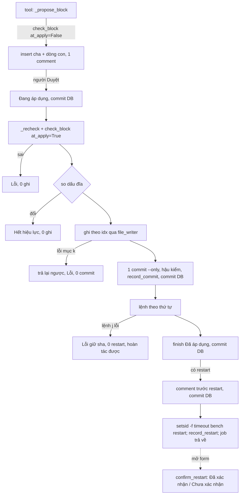

Feature: CHG-002
Stage: design
Author-agent: designer
Date: 2026-11-15
Approved-by:
<!-- Cổng: người duyệt điền dòng trên `Approved-by: <tên> <YYYY-MM-DD>`. Không có cổng thì để trống. -->

# Design CHG-002 — Đề xuất code dạng khối: nhiều file, xóa, đổi tên, thư mục mới, một lần duyệt, restart tự động; vành đai giữ nguyên

Kết quả: **DESIGN_CONFLICT ở 1 điểm hẹp** (C-1, mục 1.4). Mọi phần khác đã thiết kế đầy đủ để tech-lead chia task. C-1 không chặn việc chia task: phán quyết chỉ đổi giá trị một hằng và một hàng test. Mọi khác biệt giữa spec (FEAT-004 Amd-4) và `arch-impact.md`/ADR-040 có phán quyết ở mục 1.5. File ngoài ranh giới intake, phần chồng với `team/FEAT-007` và thứ tự gộp ở mục 1.6.

## 1. Bối cảnh

### 1.1 Vấn đề
- Hôm nay một thay đổi N file cần N đề xuất và N lần duyệt.
- Không tạo được thư mục mới, không xóa hay đổi tên được file.
- File bị giới hạn ở 8 đuôi, file mới tối đa 20 000 ký tự, mỗi lần sửa tối đa 10 chỗ.
- Sửa `.py` xong phải có người restart.

Nguồn: spec CHG-002 (con trỏ tới FEAT-004 Amendment 4, Q-1..Q-9) và `arch-impact.md`.

### 1.2 Phạm vi (chép từ spec)
**Trong phạm vi** (FEAT-004 Amd-4, Q-3 mục 20–27):
- một đề xuất gồm nhiều mục thuộc một app, duyệt một lần;
- xóa file; đổi tên file trong cùng app;
- tạo file kèm thư mục cha mới;
- bỏ ba giới hạn cũ;
- mọi file văn bản UTF-8;
- lệnh `restart` và restart tự động;
- kiểm cú pháp `.py` và `.json`.

**Ngoài phạm vi:**
- phần dữ liệu (FEAT-007);
- sửa app `erp_ai`;
- lệnh bench ngoài danh sách;
- bí mật, cấu hình site;
- `.git`, push;
- bot tự duyệt;
- duyệt hàng loạt;
- khối nhiều app; đổi tên file giữa hai app;
- file nhị phân;
- xóa thư mục đệ quy;
- hoàn tác lệnh;
- tự phục hồi site;
- bot tự xin quyền hệ điều hành;
- production, PR và CI.

### 1.3 ADR phải tuân
| ADR | Phần áp dụng cho design này |
|---|---|
| ADR-040 (proposed) | QĐ 1–8 và toàn bộ Ràng buộc. Đây là luật chính của design. |
| ADR-011 | QĐ 2, 3, 5, 6. Luật chặn `erp_ai` theo danh tính repo. |
| ADR-012 | QĐ 1 (đã sửa: thêm dòng con và danh sách lệnh), QĐ 2, QĐ 3 (đã sửa: thêm cạnh `Lỗi → Đang hoàn tác`), QĐ 4–7. |
| ADR-013 | QĐ 1, 2 (`queue.py` vẫn đúng 2 lời gọi enqueue), QĐ 3 (cộng ngoại lệ restart tách rời), QĐ 4, 5, 7. |
| ADR-022 | QĐ 2 (tập git ghi `{add, commit, rm --cached}`), QĐ 3–9. QĐ 8 là helper repo tạm. |
| ADR-023 | Toàn bộ. M5 qua `refuse_agent_write`; site_api đóng mọi DocType thuộc module `ERP AI agent`. |

### 1.4 Xung đột cần phán quyết (DESIGN_CONFLICT)
| # | Tiêu chí | ADR hoặc ràng buộc | Vì sao không thể cùng đạt | Đề nghị | Design đang làm |
|---|---|---|---|---|---|
| C-1 | AC-43: "file nguồn 1 MiB cộng 1 byte được tạo, áp dụng…"; trần còn lại phải "khác ba số cũ". A-37. | ADR-040 QĐ 5 và Ràng buộc: mỗi file tối đa 1 MiB, "riêng giới hạn mỗi file dùng `SEARCH_FILE_MAX_BYTES`". | 1 MiB chính là số cũ. Ca "1 MiB + 1 byte" bị ADR từ chối. Designer không được đổi ADR (STD-DESIGN-2). | Architect sửa ADR-040 QĐ 5: giới hạn mỗi file là một hằng riêng `CHANGE_FILE_MAX_BYTES = 2 MiB`, dùng chung cho luật "văn bản cho phép". Nguồn số: `max_allowed_packet = 16M` (đọc ở `/etc/mysql/**`, ghi trong ADR-040 Bối cảnh). Một dòng con tối đa 2 + 2 = 4 MiB cộng tiền tố, dưới 16M; tổng đề xuất vẫn 8 MiB. Architect quyết luôn: tool đọc (`read_source`, `search_source`) dùng cùng hằng mới hay giữ 1 MiB (QĐ 5 đòi một hàm chung cho đọc và ghi). | Mọi chỗ dùng giới hạn mỗi file đọc qua **một** tên, `source.TEXT_MAX_BYTES`. Hôm nay nó bằng `SEARCH_FILE_MAX_BYTES` theo ADR. Phán quyết xong thì chỉ đổi giá trị đó và hàng AC-43 ca 3 ở mục 8.1. |

Giới hạn ghi nhận, không phải xung đột: AC-46 (c) "hệ thống kiểm site trả lời" chỉ được ghi khi có người mở form đề xuất (mục 4.4, phán quyết R-3). Phần này đứng **đầu** thứ tự bỏ (A-44).

### 1.5 Đối chiếu spec (FEAT-004 Amd-4) ↔ `arch-impact.md` và ADR-040: khác biệt và phán quyết
Hai tài liệu viết song song. Khi lệch, ADR là luật (STD-DESIGN-2); chỗ spec đòi một kết quả mà ADR cấm thì là DESIGN_CONFLICT (chỉ C-1).

| # | Spec nói | arch-impact / ADR-040 nói | Phán quyết của designer |
|---|---|---|---|
| R-1 | AC-43: file nguồn 1 MiB + 1 byte phải qua | QĐ 5: mỗi file tối đa 1 MiB | **C-1**, chờ architect (mục 1.4). Design tham số hóa qua `source.TEXT_MAX_BYTES`. |
| R-2 | AC-45, Q-4 Dữ liệu: kết quả restart có giá trị riêng "chưa được cấp quyền restart" | QĐ 7: đúng bốn giá trị (đã gửi, đã xác nhận, chưa xác nhận, lỗi khởi chạy); đầu ra restart là `DEVNULL`; `erp_ai` không gọi `sudo`. QĐ 7 gạch "Chưa có bước người" nói rõ: thiếu tệp sudoers thì kết quả là "chưa xác nhận" hoặc "lỗi" | Theo ADR, vì ADR đã xử lý đúng tình huống này. Không phân biệt được "thiếu quyền" với lý do khác (lỗi của `sudo` không đọc được). Nhãn `Chưa xác nhận` mang nguyên cụm "có thể chưa được cấp quyền restart" và "Việc người còn phải làm: restart bench" (mục 3.7). Ý của AC-45 (phần file giữ, người biết phải restart) đạt. Analyst có thể chỉnh chữ AC-45 ở lần amend sau; không chặn. |
| R-3 | AC-46 (c): sau restart hệ thống kiểm site trả lời; thời gian chờ là số architect đo | QĐ 7: "đã xác nhận" chỉ khi có bằng chứng tiến trình hai nhóm khởi động sau lúc gửi; không thêm chỗ enqueue; job không chờ | Xác nhận lười khi mở form (mục 4.4, D-5). Bằng chứng web là chính gunicorn master đang trả lời request, tức "site trả lời". Thời gian chờ = `RESTART_TIMEOUT_S` = 700 s, dựng từ hằng có sẵn, chưa đo (D-11); qa đo sau G4. |
| R-4 | AC-45: khối có `.py` thì "hệ thống restart" | QĐ 6: job không tự chèn lệnh; restart phải nằm trong danh sách đã duyệt | Bộ chặn đòi: khối có file thì có `.py` ⇔ có `restart` (D-3). Prompt dặn model thêm `migrate` rồi `restart`. Nhờ vậy restart luôn hiện trước khi duyệt (AC-54). |
| R-5 | AC-47: `restart` đơn lẻ hợp lệ | QĐ 6: khối **có thao tác file** và có `restart` thì phải có `migrate` trước | Luật `migrate` trước `restart` chỉ áp khi khối có mục file. Khối chỉ có `["restart"]` hợp lệ. |
| R-6 | AC-48: dòng "sẽ restart" khi và chỉ khi khối có `.py` | Không nói | Dòng hiện khi và chỉ khi danh sách có `restart` (D-4). Với khối có file, hai điều kiện trùng nhau nhờ R-4; khối chỉ có lệnh `restart` cũng hiện dòng này. |
| R-7 | AC-40: xóa file tồn tại, sạch, UTF-8 | QĐ 4: thêm "file thường, không symlink, git đang theo dõi" | Theo ADR (chặt hơn). File chưa được theo dõi có `??` nên đã là "bẩn" theo AC-18. |
| R-8 | AC-44: mọi file văn bản UTF-8 được xóa, đổi tên | QĐ 4: bot không bao giờ đặt bit thực thi | Từ chối xóa và đổi tên file có bit thực thi (D-8): hoàn tác sẽ phải đặt lại bit đó. Sửa file thực thi vẫn được (giữ quyền cũ). Các ca AC-44 liệt kê không bị ảnh hưởng. |
| R-9 | AC-52: "thao tác git thêm (nếu xóa và đổi tên cần) chỉ nhận đường dẫn của khối" | Ràng buộc: tập git ghi giữ `{add, commit, rm --cached}`; cần thêm thì ADR mới; researcher xác nhận `commit --only -- <đã xóa>` trên git 2.43 | Không thêm thao tác git. Bằng chứng có sẵn: hoàn tác file mới hôm nay đã gỡ file khỏi đĩa rồi `git_commit_only` đúng đường dẫn đó (`apply_job.py:586`, `:599`), và test hoàn tác đang xanh trên git 2.43.0. Theo yêu cầu của team-leader, điểm này thành **task test đầu tiên T-0** trên repo tạm (mục 8.0), không phải lượt research. T-0 đỏ thì dừng, ADR mới. |
| R-10 | Q-4 Dữ liệu: lưu "kết quả từng mục" | Không nói | Không lưu riêng: phần file là tất-cả-hoặc-không, nên kết quả từng mục suy ra từ trạng thái cộng `failure_reason` (luôn nêu mục). Comment kết quả in từng mục (mục 3.7). |
| R-11 | NFR-14: thêm repo `erp_ai` thật vào phép so trước và sau | Bảng NFR của arch-impact chỉ nêu NFR-1..9 của FEAT-004 | Thêm `erp_ai` vào `RealCoreReposUntouchedMixin` (`test_utils.py`). |
| R-12 | Ranh giới intake: `agent/constants.py` | Module: `erp_ai/constants.py` | Cùng một file; intake viết nhầm đường dẫn. Hằng đặt ở `erp_ai/constants.py`. |
| R-13 | Spec "Chạm" không có `prompts.py`, `test_architecture.py` | arch-impact: hai file này phải đổi, ngoài intake | Đưa vào touchpoint, báo phiên FEAT-007 (mục 1.6). |
| R-14 | AC-38: số commit do architect chốt (A-34) | QĐ 2: một commit áp dụng, một commit hoàn tác | Một commit. AC-38, AC-42 đo theo tập đường dẫn. |
| R-15 | AC-56, A-36: điều kiện cấp có thể đổi khi FEAT-007 merge | Không đụng `registry.py`, `runner.py`, `policy.py` | Giữ ba tên tool (D-1). FEAT-007 T82 (`grant`) cấp theo tên và nhóm, nên tool khối đi theo điều kiện mới mà không cần sửa gì thêm. `runner.py` chỉ đọc khóa `proposal` của kết quả (`runner.py:72-80`, `:775`), khóa này giữ nguyên. |

### 1.6 File ngoài ranh giới intake, phần chồng với `team/FEAT-007`, thứ tự gộp
Ranh giới intake: `tools/change_guard.py`, `tools/propose_change.py`, `tools/source.py`, `agent/changes/**`, `constants.py` (R-12), `change_text.py`, DocType `ERP AI Change Proposal` và test của chúng.

**File ngoài ranh giới phải đổi** (đủ danh sách):

| File | Vì sao | `git diff --stat develop...team/FEAT-007 -- <file>` (2026-11-15, `team/FEAT-007` @ `70b2df7`, merge-base `1918db2`) | Task FEAT-007 chưa làm cũng sửa file này |
|---|---|---|---|
| `erp_ai/agent/prompts.py` | thân `CHANGE_TOOLS_BLOCK` (AC-56) | trống (0 thay đổi) | T72, T78, T79, T82, T106, T107 (U1: ghép prompt theo cờ; cam kết "thân các khối FEAT-004 không đổi") |
| `erp_ai/tests/test_architecture.py` | luật ADR-040 (mục 8.2) | `1 file changed, 71 insertions(+), 14 deletions(-)` | T56, T89, T105 và nhiều task khác |
| `erp_ai/test_utils.py` | `make_block_proposal`; `RealCoreReposUntouchedMixin` thêm `erp_ai` | `1 file changed, 51 insertions(+)` (`keep_agent_settings`…) | — |
| `erp_ai/agent/test_classification.py` | chuỗi `CHANGE_TOOLS_BLOCK` (AC-14, AC-56) | `1 file changed, 124 insertions(+), 1 deletion(-)` | T78+ chuyển test prompt sang `test_prompts.py` (file mới của FEAT-007) |
| `erp_ai/agent/tools/test_registry.py` | schema tool (tên giữ nguyên) | trống | T82 |
| `erp_ai/agent/test_agent_runner.py` | chỉ khi có assertion so schema hay chữ prompt | `1 file changed, 11 insertions(+)` | T82 |
| `erp_ai/erp_ai_agent/doctype/erp_ai_change_operation/*` (3 file mới) | DocType con | không có ở FEAT-007 | — |
| Trường của `ERP AI Setting` | **không có**; `erp_ai_setting.json` không đổi | (FEAT-007 sửa `erp_ai_setting/`: 3 file, +2643/−12) | — |
| `/etc/sudoers.d/erp-ai-restart` | ngoài repo, người cài (mục 5) | — | — |

**File trong ranh giới mà FEAT-007 cũng sửa** (cùng lệnh, cùng ngày):

| File | Diff stat | Nội dung phía FEAT-007 |
|---|---|---|
| `erp_ai/agent/tools/source.py` | `1 file changed, 31 insertions(+), 3 deletions(-)` | tách `resolve_safe_path` thành `_base_resolve` + `manuals_root` + `resolve_manual_path` + `resolve_safe_path` mới (từ chối đường dẫn trong kho HDSD, T38, T121) |
| `erp_ai/constants.py` | `1 file changed, 29 insertions(+)` | một khối hằng ở cuối file |
| `erp_ai/agent/tools/test_source.py` | `1 file changed, 175 insertions(+), 1 deletion(-)` | `TestManualsExcluded` |
| `erp_ai/agent/tools/test_change_guard.py` | `1 file changed, 21 insertions(+), 1 deletion(-)` | import `frappe`, `keep_agent_settings`; `test_new_file_in_manuals_refused` |
| `erp_ai/agent/tools/propose_change.py`, `test_propose_change.py` | trống | T89 (comment không ký liên kết khi công tắc (5) tắt), T105 (dòng "Chờ duyệt" tại hàm chèn duy nhất) |
| `change_guard.py`, `change_text.py`, `agent/changes/**`, DocType đề xuất | trống | — |

Hệ quả cho CHG-002: vành mới của FEAT-007 (kho HDSD) đi qua `resolve_safe_path`. Vì `check_write_path` của CHG-002 gọi `resolve_safe_path` cho **mọi** đường dẫn, kể cả từng thư mục mới, nên sau khi gộp, xóa, đổi tên và thư mục mới trong kho HDSD cũng bị từ chối mà không cần sửa thêm. Test `test_new_file_in_manuals_refused` của FEAT-007 phải vẫn xanh sau khi gộp.

**Thứ tự gộp đề xuất: CHG-002 vào `develop` trước; sau đó FEAT-007 chạy T56 (gộp `develop` vào `team/FEAT-007`) một lần.**
- Vì: người cần gấp CHG-002; FEAT-007 còn 79/123 task (`team.py status`: 43/123), trong đó T89, T105 (propose_change) và T72..T107 (prompts) chưa build. Các task này được build trên hình dạng mới của CHG-002 sau khi gộp, nên chỉ phải giải xung đột một lần. Ngược lại, CHG-002 chờ FEAT-007 thì chờ 79 task.
- Worktree CHG-002 cắt từ `develop` @ `2fd42ad`, viết `source.py` trên hình dạng của `develop`.
- Cách giải xung đột khi FEAT-007 gộp `develop`:
  - `source.py`: giữ cấu trúc của FEAT-007 (`_base_resolve`, `resolve_manual_path`, `resolve_safe_path` mới). Trong `_base_resolve`, thay hai dòng kiểm `TEN_CAM` và `DUOI_CHO_PHEP` bằng một dòng `if text_refusal(os.path.relpath(full, root)) is not None: return None`. Giữ `text_refusal`, `TEXT_*`, `TEXT_MAX_BYTES` của CHG-002.
  - `constants.py`: giữ cả hai khối, khối FEAT-007 trước, khối "CHG-002" sau.
  - `test_utils.py`, `test_source.py`, `test_change_guard.py`, `test_classification.py`, `test_architecture.py`: hai bên chỉ thêm; giữ cả hai, chạy lại `cmd.test`.
  - Tech-lead FEAT-007 cập nhật T89, T105 (hàm chèn duy nhất nay là `_propose_block`) và T78/T79/T82 (thân `CHANGE_TOOLS_BLOCK` nay là bản ở mục 3.7; dòng đầu "Ở phiếu này bạn có propose_file_change, propose_new_file và propose_bench_command." mà U1 P-1 dẫn tới vẫn giữ nguyên từng chữ).
- Nếu team-leader chọn ngược lại (FEAT-007 gộp trước): CHG-002 phải gộp `develop` vào nhánh của mình trước khi merge, viết lại `text_refusal` trong `_base_resolve`, và chạy lại AC-56 trên `grant()` của T82.

## 2. Mô hình dữ liệu
*(ADR-040 QĐ 1, 5, 7; ADR-012 QĐ 1)*

### 2.1 DocType con mới `ERP AI Change Operation`
`istable = 1`, module `ERP AI agent`. Không có quyền riêng: đi theo bản ghi cha. site_api tự đóng DocType này vì nó đóng mọi DocType của module (`site_api.py:95-97`). Mọi trường `read_only = 1`. Thứ tự áp dụng là `idx`.

| Trường | Kiểu | Ý nghĩa | Ràng buộc |
|---|---|---|---|
| `operation` | Select: `Sửa` / `Tạo` / `Xóa` / `Đổi tên` | loại mục | bắt buộc, `in_list_view` |
| `file_path` | Data | đường dẫn tính từ `apps/`. Đích của Sửa, Tạo, Xóa; **nguồn** của Đổi tên | bắt buộc, `in_list_view` |
| `new_path` | Data | đích của Đổi tên | chỉ có ở Đổi tên, `in_list_view` |
| `content_before` | Code | byte trước dạng UTF-8. Rỗng với Tạo | |
| `content_after` | Code | byte sau. Rỗng với Xóa; bằng `content_before` với Đổi tên | |
| `base_hash` | Data | sha256 của `content_before`. Rỗng với Tạo | |
| `after_hash` | Data | sha256 của `content_after`. Rỗng với Xóa | |

- Không có trường diff riêng cho từng dòng: diff gộp nằm ở trường `diff` có sẵn của bản ghi cha (mục 2.2).
- Không có trường "kết quả từng mục" (R-10). Lý do lỗi luôn nêu mục bị lỗi (STD-DESIGN-5).

### 2.2 Trường thêm trên `ERP AI Change Proposal`
| Trường | Kiểu | Nhóm (ADR-012) | Ý nghĩa |
|---|---|---|---|
| `operations` | Table → `ERP AI Change Operation` | nội dung, nằm trong dấu | các mục file |
| `command_list` | Code (JSON) | nội dung, nằm trong dấu | danh sách argv đúng như đã duyệt, đúng thứ tự, ví dụ `[["--site","miyano","migrate"],["build","--app","hrms"],["restart"]]` |
| `command_results` | Code (JSON) | trạng thái | `[{"args":[…],"exit_code":int\|null,"duration_ms":int,"timed_out":bool,"output":str}]`, mỗi lệnh đã chạy một phần tử |
| `created_dirs` | Code (JSON) | trạng thái | các thư mục do lần áp dụng tạo ra, đường dẫn tính từ `apps/`, theo thứ tự tạo (từ trên xuống) |
| `restart_status` | Select: rỗng / `Đã gửi` / `Đã xác nhận` / `Chưa xác nhận` / `Lỗi khởi chạy` | trạng thái | rỗng nghĩa là "không cần" (ADR-040 QĐ 7: bốn giá trị) |
| `restart_sent_at` | Datetime | trạng thái | thời điểm ghi ngay **trước** lời khởi chạy restart |

Trường có sẵn dùng lại như sau với đề xuất dạng khối:

| Trường | Giá trị |
|---|---|
| `change_kind` | `Thay đổi code` khi có ít nhất 1 mục file; ngược lại `Lệnh bench` |
| `reversible` | 1 khi có mục file |
| `app` | app của khối. Với khối chỉ có lệnh: app của `build --app`, nếu có |
| `target_branch`, `upstream_ref`, `ahead_count`, `is_core_app` | lấy như hôm nay |
| `file_path`, `is_new_file`, `content_*`, `base_hash`, `after_hash`, `command_args` | rỗng |
| `diff` | nối diff của mọi mục theo `idx`. Xóa: so với `/dev/null`. Đổi tên: hai dòng `rename from` / `rename to` |
| `exit_code`, `duration_ms`, `command_output` | kết quả của **lệnh cuối cùng đã chạy** (giữ hợp đồng của `finish`) |

### 2.3 Hai dạng bản ghi; đọc cả hai, không di trú
- **Dạng cũ:** không có dòng con, không có `command_list`. Đọc qua bộ chuyển đổi trong bộ nhớ.
- **Dạng khối:** mọi đề xuất tạo sau CHG-002.
- Phân biệt bằng `block.is_block(doc) = bool(doc.operations) or bool(doc.command_list)`.
- Bộ chuyển đổi nằm ở module mới `erp_ai/agent/changes/block.py`. Mã áp dụng và hoàn tác chỉ có **một** đường, chạy trên kết quả của bộ chuyển đổi:
  - `operations_of(doc) -> tuple[FileOp, ...]`. Dạng cũ thành 1 mục `Sửa` hoặc `Tạo` từ các trường vô hướng.
  - `commands_of(doc) -> list[list[str]]`. Dạng cũ là `[command_args]`.
  - `is_block(doc)`.

### 2.4 Dấu nội dung (ADR-012 QĐ 7, ADR-040 Ràng buộc)
- `transitions.content_digest(doc)`:
  - **Dạng cũ:** công thức giữ nguyên từng byte (JSON của 14 trường). Đề xuất cũ đã duyệt vẫn khớp dấu.
  - **Dạng khối:** giá trị = 14 trường, nối thêm `[[operation, file_path, new_path, base_hash, content_before, content_after, after_hash] cho từng dòng theo idx]`, nối thêm `command_list`.
- `commit_message` (bản xem trước) vẫn nằm trong 14 trường.

### 2.5 Giới hạn
Các giá trị là hằng, định nghĩa một lần trong `erp_ai/constants.py`, ở khối riêng "CHG-002" đặt sau khối của FEAT-007 (ADR-040 QĐ 5).

| Hằng | Giá trị | Đếm thế nào |
|---|---|---|
| `CHANGE_MAX_FILE_OPS` | 50 | số dòng con. Đổi tên tính 1 |
| `CHANGE_MAX_TOTAL_BYTES` | 8 × 1024 × 1024 | tổng `len(utf8)` của `content_before + content_after` mọi dòng |
| `CHANGE_MAX_COMMANDS` | 6 | số phần tử `command_list`, kể cả `restart` |
| `source.TEXT_MAX_BYTES` | `SEARCH_FILE_MAX_BYTES` (1 MiB). **Chờ C-1** | mỗi file, cả trước và sau |
| `RESTART_WEB_STOP_S` | 40 | `stopwaitsecs` của `frappe-bench-frappe-web` (`config/supervisor.conf:13`) |
| `RESTART_TIMEOUT_S` | `JOB_TIMEOUT_S + RESTART_WEB_STOP_S + JOB_SAFETY_MARGIN_S` = 700 | lớn hơn `JOB_TIMEOUT_S` cộng thời gian dừng web (ADR-040 QĐ 7). Long worker chờ job đang chạy tối đa `JOB_TIMEOUT_S` |
| `RESTART_LAUNCH_TIMEOUT_S` | 10 | `timeout=` của `run()` khi khởi chạy `setsid -f`. Lệnh này trả về ngay sau fork |

- Xóa `PROPOSAL_TEXT_MAX_CHARS` và `REPLACE_MAX_ITEMS`. Hai hằng này chỉ được dùng ở `propose_change.py`. Việc này đạt AC-43 ca 1 và 2.
- **Kiểm sức chứa** (đòi hỏi của AC-43):
  - một dòng con tối đa khoảng `2 × TEXT_MAX_BYTES`, dưới `max_allowed_packet` 16M;
  - trường `diff` của bản ghi cha tối đa khoảng `CHANGE_MAX_TOTAL_BYTES` cộng 3% tiền tố dòng, cũng dưới 16M.
- **Tải form:** khối 8 MiB gửi về trình duyệt khoảng 16–17 MiB JSON (nội dung dòng con cộng diff). Thời gian tải chưa đo. Test AC-43 ở mức trần đo và ghi số này vào `acceptance.md`.
- Ghi nhận: một lời gọi tool bị giới hạn thêm bởi số token đầu ra của model, nhỏ hơn nhiều so với 8 MiB. Các trần trên là trần lưu trữ; khối thật lớn cỡ nào do model quyết, hệ thống không cần thêm trần.

## 3. API / hợp đồng

### 3.1 Hợp đồng với model: ba tool, giữ tên, chỉ thêm trường
**Vì sao giữ tên:** `runner.py:72-80` và `:99` ghi cứng ba tên tool trong `WRITE_TOOL_TARGETS` và `PROPOSE_TOOLS`. `runner.py` thuộc FEAT-007 và không được sửa (A-43). Runner chỉ đọc khóa `proposal` của kết quả, không đọc đối số của tool propose. Vì vậy:
- **không** thêm tên tool mới;
- `registry.py` và `policy.py` không đổi (cấp theo nhóm `change_propose`).

Cả ba handler đi về **một** hàm nội bộ `_propose_block(changes, commands, reason, ctx)`.

| Tool | Đầu vào (JSON schema) | Thay đổi so với hôm nay |
|---|---|---|
| `propose_file_change` | `changes`: mảng 1..50 phần tử `{action: "edit"\|"create"\|"delete"\|"rename", path, new_path?, find?, replace?, content?}`; `commands?`: mảng 0..6 phần tử `{command: enum BENCH_COMMANDS, app?}`; `reason` (bắt buộc). Dạng cũ `{path, find, replace, commands?, reason}` vẫn nhận và được hiểu là 1 mục `edit`. | Thêm `changes` và `commands`. `required` chỉ còn `["reason"]`. Bỏ `maxItems` và `maxLength` của `find`/`replace`. |
| `propose_new_file` | `{path, content, commands?, reason}`. `content` cho phép rỗng (`__init__.py`). Thư mục cha có thể chưa có. | Thêm `commands`. `content` bỏ `minLength` và `maxLength`. |
| `propose_bench_command` | `{command, app?, reason}`. `command` thuộc `BENCH_COMMANDS`, đã có `restart`. | Enum thêm `restart`. |

Luật của từng loại `action` (trường thừa hoặc thiếu thì từ chối với `OP_FIELDS`):

| action | Trường bắt buộc | Trường cấm |
|---|---|---|
| `edit` | `path`, `find`, `replace`. Hai mảng cùng độ dài, ít nhất 1 phần tử. Mỗi `find[i]` xuất hiện đúng 1 lần, các đoạn không chồng nhau. Không giới hạn số chỗ sửa. | `content`, `new_path` |
| `create` | `path`, `content` (có thể rỗng) | `find`, `replace`, `new_path` |
| `delete` | `path` | còn lại |
| `rename` | `path`, `new_path` | còn lại. Nội dung giữ nguyên từng byte |

**Đầu ra:**
- Thành công: `{"ok": true, "proposal": <tên>, "status": "Chờ duyệt", "comment": <Comment>, "branch": <nhánh>}`. Không có `branch` khi khối chỉ có lệnh.
- Từ chối: đúng một kiểu lỗi như hôm nay, `{"ok": false, "reason": <câu>}`. Từ chối là của cả khối: 0 đề xuất, 0 comment.
- Lý do gắn với mục: tiền tố `mục {n} ({đường dẫn}): `, n đếm từ 1 theo thứ tự `changes`.
- Lý do gắn với lệnh: tiền tố `lệnh {n}: `.

**Câu từ chối mới** (hằng là hợp đồng với model và test, ADR-040 QĐ 4–6). Phần lớn đặt ở `change_guard.py`; các câu của `TEXT_*` đặt ở `source.py`.

| Hằng | Câu |
|---|---|
| `BLOCK_SHAPE` | `đưa changes hoặc path, không cả hai và không thiếu cả hai` |
| `BLOCK_EMPTY` | `khối không có mục file hay lệnh nào` |
| `BLOCK_TOO_MANY_OPS` | `khối có hơn {CHANGE_MAX_FILE_OPS} mục file` |
| `BLOCK_TOO_LARGE` | `tổng nội dung của khối lớn hơn 8 MiB` (lấy chữ từ hằng) |
| `BLOCK_TOO_MANY_COMMANDS` | `khối có hơn {CHANGE_MAX_COMMANDS} lệnh` |
| `BLOCK_TWO_APPS` | `các mục file thuộc hai app {a} và {b}; mỗi app một đề xuất` |
| `BLOCK_PATH_TWICE` | `đường dẫn trùng hoặc nằm trong đường dẫn khác của cùng khối` |
| `OP_UNKNOWN` | `loại mục phải là edit, create, delete hoặc rename` |
| `OP_FIELDS` | `mục {action} thiếu hoặc thừa trường` |
| `NOT_REGULAR_FILE` | `đường dẫn không phải file thường` (xóa, nguồn đổi tên: thư mục, symlink, không tồn tại) |
| `EXECUTABLE_FILE` | `file có quyền thực thi, bot không xóa hay đổi tên được` |
| `PATH_SYMLINK` | `đường dẫn đi qua symlink` |
| `NESTED_REPO` | `đường dẫn nằm trong một kho git lồng trong app` |
| `GIT_DIR` (sửa chữ) | `không được chạm .git hoặc tên bắt đầu bằng .git` |
| `RESTART_PLACE` | `restart chỉ được một lần và phải là lệnh cuối` |
| `RESTART_NEEDS_MIGRATE` | `khối có file và restart phải có migrate đứng trước restart` |
| `PY_NEEDS_RESTART` | `khối có file .py phải kết thúc bằng migrate rồi restart` |
| `RESTART_WITHOUT_PY` | `khối có file nhưng không có file .py thì không restart` |
| `PY_SYNTAX` | `file .py không biên dịch được: dòng {n}` |
| `JSON_SYNTAX` | `file .json không phải JSON hợp lệ: dòng {n}` |
| `source.TEXT_NOT_UTF8` | `file không phải văn bản UTF-8` |
| `source.TEXT_HAS_NUL` | `file có byte NUL, không phải văn bản` |
| `source.TEXT_TOO_LARGE` | `file lớn hơn 1 MiB` (giữ chữ của `TOO_LARGE`, lấy từ `TEXT_MAX_BYTES`) |
| `source.TEXT_SECRET_NAME` | chữ của `NAME_FORBIDDEN` hiện có (chuyển hằng sang `source.py`; `change_guard.NAME_FORBIDDEN` trỏ tới nó) |

- Giữ nguyên chữ: `PATH_INVALID`, `APP_NOT_ALLOWED`, `APP_FORBIDDEN`, `PATH_GIT_PATTERN`, các câu `CMD_*`, `EXISTS`, `NOT_FOUND`, các câu `EDIT_*` trừ `EDIT_SHAPE`, `NO_CHANGE`.
- Bỏ: `EXT_FORBIDDEN` và `NO_PARENT`.
- `EDIT_SHAPE` thành `find và replace phải cùng số phần tử, ít nhất 1`.

### 3.2 Hợp đồng nội bộ giữa bộ chặn (tools/) và job (changes/)
Chiều import không đổi: `changes/` được import `tools/`; `tools/` không import `changes/`.

**`source.text_refusal(rel_path: str, data: bytes | None = None) -> str | None`.** Đây là **hàm duy nhất** định nghĩa "văn bản cho phép" (ADR-040 QĐ 5). Thứ tự kiểm:
1. `TEN_CAM` khớp đường dẫn tương đối → `TEXT_SECRET_NAME`.
2. Có thành phần bắt đầu bằng `.git` → `GIT_DIR` (`.github` cũng bị chặn: hệ quả chữ của ADR-040).
3. Khi có `data`:
   - `len > TEXT_MAX_BYTES` → `TEXT_TOO_LARGE`;
   - có `b"\0"` → `TEXT_HAS_NUL`;
   - giải mã UTF-8 chặt lỗi → `TEXT_NOT_UTF8`.

Nơi dùng hàm:
- `resolve_safe_path` thay hai dòng kiểm `TEN_CAM` và đuôi (`source.py:128-131`) bằng `text_refusal(rel) is None`. Với FEAT-007, chỗ này nằm trong `_base_resolve` (mục 1.6).
- `read_source` đọc byte rồi gọi `text_refusal(rel, data)`. File nhị phân bị từ chối bằng câu hiện có.
- `search_source` bỏ file không đạt.
- Tham số `extension` đổi từ `enum(DUOI_CHO_PHEP)` thành `{"type":"string","pattern":"^\\.[A-Za-z0-9]{1,10}$"}`.
- `DUOI_CHO_PHEP` bị xóa.

**`change_guard.check_write_path(rel_path, allowed_apps, *, new_file, read_git=True) -> GuardResult`.** Giữ chữ ký. Thứ tự luật mới:
1. Không hợp lệ, hoặc ngoài `apps/` (qua `resolve_safe_path`) → `PATH_INVALID`.
2. App không trong danh sách → `APP_NOT_ALLOWED`.
3. `erp_ai`, xét theo danh tính repo → `APP_FORBIDDEN`.
4. `text_refusal(rel)` (tên bí mật, `.git*`), và `license.txt` → `NAME_FORBIDDEN` / `GIT_DIR`.
5. Có ký tự glob, hoặc bắt đầu bằng `:`/`-` → `PATH_GIT_PATTERN`.
6. **Mới:** `os.path.normpath(join(root, rel_path))` của phần đang tồn tại khác `realpath` → `PATH_SYMLINK`.
7. **Mới:** `.git` gần nhất, đi từ thư mục tồn tại sâu nhất lên tới thư mục app, phải có common dir trùng repo của thư mục app → nếu không, `NESTED_REPO`. Dùng lại `_common_dirs_upward(…, nearest_only=True)`.
8. `read_git_state` như hôm nay (lúc đề xuất).

Thư mục app phải tồn tại, nếu không thì `PATH_INVALID`. Bước kiểm đuôi bị xóa.

**`change_guard.FileOp`** (dataclass, frozen): `kind`, `path`, `new_path`, `before: str | None`, `after: str | None`, `base_hash`, `after_hash`.

**`change_guard.check_block(ops, commands, allowed_apps, site, *, at_apply: bool, legacy: bool = False) -> BlockCheck`.**
- Kết quả: `BlockCheck(reason, app, targets)`.
- Mỗi phần tử của `targets` là `OpTarget(op, full_path, full_new_path, new_dirs, guard)`. `new_dirs` là đường dẫn thật của các thư mục sẽ tạo, theo thứ tự từ trên xuống.
- Hàm này được gọi **ở cả hai thời điểm**.
- Lý do đầu tiên gặp là lý do trả về. Thứ tự kiểm:
  1. Khối rỗng; số mục; số lệnh.
  2. Từng mục theo thứ tự:
     - hình dạng;
     - đường dẫn không trùng và không lồng nhau;
     - `check_write_path` cho mọi đường dẫn của mục (`read_git = not at_apply`);
     - **từng** thư mục trong `new_dirs` qua `check_write_path(dir, new_file=True, read_git=False)`;
     - cùng app với mục 1;
     - `text_refusal` cho tên đích, và cho `before`/`after` mã hóa UTF-8;
     - cú pháp: `compile(after, rel, "exec", dont_inherit=True)` với đích `.py`; `json.loads(after)` với đích `.json`. Áp cho Sửa, Tạo, đích Đổi tên. Lỗi `SyntaxError` hoặc `ValueError` lấy `lineno`. `RecursionError` và `MemoryError` cũng là `PY_SYNTAX`, dòng 0. `compile` không thực thi mã.
  3. Tổng byte.
  4. Lệnh:
     - mỗi argv qua `check_bench_args`;
     - `["restart"]` nhiều nhất 1 lần và ở cuối → `RESTART_PLACE`;
     - **chỉ khi khối có mục file** và `legacy = False`: có `.py` (bất kỳ đường dẫn nào của khối, kể cả nguồn và đích đổi tên) ⇔ có `restart` → `PY_NEEDS_RESTART` / `RESTART_WITHOUT_PY`;
     - **chỉ khi khối có mục file** và có `restart`: phải có `[--site, site, migrate]` đứng trước nó → `RESTART_NEEDS_MIGRATE`. Khối chỉ có lệnh `["restart"]` hợp lệ (R-5, AC-47).
- Việc file có tồn tại và còn đúng nội dung (Hết hiệu lực) **không** nằm ở đây. Tool kiểm việc này khi đọc file; job kiểm ở bước so dấu (mục 4.2 bước 4).

**`change_guard.BENCH_COMMANDS`** thêm `RESTART_COMMAND = "restart"`. Hình dạng duy nhất là `["restart"]`. Có đối số nào khác thì `CMD_NOT_LISTED` hoặc `CMD_TAKES_NO_APP`.

### 3.3 Phương thức whitelisted (form và liên kết)
| Phương thức | Hợp đồng |
|---|---|
| `approve`, `reject` | Không đổi chữ ký và hành vi. Dấu nay phủ cả khối. |
| `undo(name)` | Không đổi chữ ký. Thêm cạnh: chấp nhận cả `Lỗi` khi `change_kind = Thay đổi code`, `apply_commit_sha` có giá trị và `undo_commit_sha` rỗng. Các trường hợp khác giữ câu `Đề xuất đang ở trạng thái {status}, không hoàn tác được`. Khối chỉ có lệnh: `Lệnh bench không hoàn tác được`. |
| **mới** `confirm_restart(name)` (POST) | Người gọi phải có `ERP AI Instructor` hoặc `System Manager`, và không thuộc `NEVER_AUTHORITY`. Sai thì `PermissionError`; không có đề xuất thì `DoesNotExistError`. Chỉ ghi khi `restart_status = Đã gửi` và có kết luận (mục 4.4). Trả `{"name", "restart_status"}`. Tool `call_method` của agent đã chặn mọi `erp_ai.*` (`site_api.py:458`). |

### 3.4 `process_runner`
- `git_commit_only(repo_root, rels: tuple[str, ...], subject, body, limit_s)`:
  - `rels` khác rỗng, không trùng; mỗi phần tử qua luật đường dẫn của `_check_git_write_call`;
  - argv: `[git, *opts, "commit", "--only", "--no-gpg-sign", "--quiet", "-m", s, "-m", b, "--", *sorted(rels)]`;
  - đây là thay đổi phá vỡ chữ ký nội bộ (tham số thứ hai thành tuple). Hai lời gọi trong `apply_job` và các test đổi theo; ADR-040 thay ADR-022 Ràng buộc "`--` trước đúng một đường dẫn".
- `git_add_new` và `git_unstage_new` giữ nguyên: mỗi lần **một** đường dẫn.
- **mới** `launch_restart() -> tuple[bool, str | None]`:
  - `subprocess.run(RESTART_ARGV, cwd=get_bench_path(), env=_minimal_env(), stdin=DEVNULL, stdout=DEVNULL, stderr=DEVNULL, timeout=RESTART_LAUNCH_TIMEOUT_S, start_new_session=True)`;
  - `RESTART_ARGV = ("setsid", "-f", source.TIMEOUT_EXECUTABLE, "-s", "KILL", str(RESTART_TIMEOUT_S), source.BENCH_EXECUTABLE, "restart")`, là hằng mô-đun (tệp thực thi `bench` do server xác định như ADR-013 QĐ 7);
  - kết quả: `(True, None)` khi mã thoát 0; `(False, <tên lớp lỗi>)` khi gặp `FileNotFoundError`, `TimeoutExpired`, `OSError` hoặc mã thoát khác 0;
  - không bao giờ ném lỗi (STD-ERR-1: lý do được trả về và người gọi ghi nhật ký).

### 3.5 `file_writer` (vẫn là nơi duy nhất thao tác hệ tệp)
| Hàm | Hợp đồng |
|---|---|
| `write_atomic(full, content, *, new_file)` | Giữ nguyên. Thêm điều kiện: không thành phần `.git*`; `realpath(dirname) == dirname`. |
| **mới** `make_parents(full_path, app_dir) -> list[str]` | Tạo từng thư mục thiếu nằm giữa `app_dir` (phải đã có) và file, từ trên xuống, bằng `os.mkdir(d, 0o755)`. Sau mỗi thư mục: kiểm `realpath(d) == d`, không phải symlink, không thành phần `.git*`. Sai thì gỡ những thư mục vừa tạo rồi `ValueError`. Trả danh sách đã tạo. |
| `remove_created` → đổi tên thành **`remove_file(full)`** | Chỉ xóa file thường, không xóa symlink; dùng cho cả Xóa và gỡ file đã tạo. |
| **mới** `remove_empty_dirs(dirs) -> list[str]` | Duyệt từ sâu nhất lên. `os.rmdir` chỉ khi thư mục rỗng. Trả danh sách đã gỡ. Thư mục còn file (ví dụ `__pycache__`) được để nguyên. |

### 3.6 `transitions` (vẫn là chủ duy nhất của nhóm trạng thái)
- `STATE_FIELDS` thêm `command_results`, `created_dirs`, `restart_status`, `restart_sent_at`. `prepare_new` xóa trắng các trường này.
- `GIT_RESULT_FIELDS` thêm `created_dirs`.
- `request_undo`: thêm cạnh `Lỗi → Đang hoàn tác` có điều kiện (mục 3.3). `_lock` đọc thêm `apply_commit_sha` và `undo_commit_sha`.
- **mới** `record_commit(name, expected, *, fields) -> bool`:
  - ghi trường git khi đang `Đang áp dụng` hoặc `Đang hoàn tác`;
  - không đổi trạng thái và không ghi dòng nhật ký;
  - trạng thái khác `expected` thì trả `False`.
- `finish(…, command_results=None)`: ghi JSON đó. Hành vi khác giữ nguyên.
- **mới** `record_restart(name, expected, value, sent_at) -> bool`:
  - `expected` thuộc {`Đã áp dụng`, `Đã hoàn tác`};
  - `value` thuộc {`Đã gửi`, `Lỗi khởi chạy`};
  - có điều kiện; không ghi dòng nhật ký.
- **mới** `confirm_restart(name, value) -> bool`:
  - chỉ từ `restart_status = Đã gửi`;
  - `value` thuộc {`Đã xác nhận`, `Chưa xác nhận`}.
- `FINISH_EDGES` không đổi. Không thêm trạng thái.

### 3.7 Hợp đồng câu chữ (người đọc)
**Comment đề xuất trên phiếu** (`propose_change._comment`, AC-48). Câu đầu:

> Đề xuất {tên} đang chờ duyệt: khối {n} mục trong app {app}.

hoặc, với khối chỉ có lệnh:

> …: {m} lệnh bench.

Sau đó là các dòng của `change_text.proposal_notes`, theo thứ tự:
1. `Gồm {a} sửa, {b} tạo, {c} xóa, {d} đổi tên; {m} lệnh.`
2. Mỗi mục một dòng:
   - `sửa {path}`
   - `tạo {path}`
   - `XÓA {path}`
   - `ĐỔI TÊN {path} → {new_path}`
3. Mỗi lệnh một dòng: `lệnh: bench {argv nối bằng dấu cách}`.
4. `Sau khi áp dụng, hệ thống sẽ restart bench (lệnh cuối).`, khi và chỉ khi có `restart`.
5. `Lệnh trong khối không hoàn tác được; hoàn tác chỉ trả lại phần file.`, khi có lệnh.
6. Các câu nhánh, remote, cảnh báo app lõi như hôm nay.
7. Ba liên kết như hôm nay.

Ghi chú: tối đa 50 mục, nên comment luôn chứa mọi đường dẫn. URL remote xuất hiện 0 lần (`_shown`).

**Ghi chú `.py` của dạng cũ:** câu `Sau khi áp dụng cần người chạy bench restart.` chỉ còn cho dạng cũ, vì dạng cũ không có lệnh `restart`.

**Commit message:**
- `apply_message(proposal, ticket, label, approver, operations=None)` và `undo_message(…, operations=None)`.
- `label` là đường dẫn khi khối có đúng 1 mục, `{n} file` khi nhiều hơn.
- Khi có `operations`, thân thêm sau dòng "Phiếu" các dòng `sửa …`, `xóa …`, `đổi tên … → …`.
- `operations=None` cho ra **đúng** chữ cũ, nên bản xem trước của đề xuất cũ vẫn khớp.

**Comment trước restart** (AC-46 b). Hàm mới `result_comment.post_restart_notice(name, action)`, comment kiểu Info:

> Đề xuất {tên} đã {áp dụng\|hoàn tác}: commit {sha12} trên nhánh {nhánh} của app {app}. Hệ thống sắp restart bench. Nếu site không lên sau vài phút: trên máy chủ chạy `git -C apps/{app} revert --no-edit {sha}` rồi `bench restart`.

**Comment kết quả** (AC-49). Đúng 1 comment sau mỗi kết cục; khối có restart thì comment này đến sau comment trước restart. Các dòng nối bằng `; `:
1. `kết quả đề xuất {tên} ({nhãn}): {trạng thái}`.
2. Mỗi mục: `{động từ} {path}: đã áp dụng`, hoặc `chưa áp dụng`; mục nêu trong `failure_reason` có thêm lý do đã che.
3. `commit {sha12}`.
4. Mỗi lệnh đã chạy: `bench {argv}: mã thoát {x}`, hoặc `quá thời gian`.
5. `restart: {đã gửi | lỗi khởi chạy | không cần}`.
6. `việc người còn phải làm: …`, gồm các ý sau khi có, hoặc `không`:
   - `Lỗi khởi chạy` → `restart bench`;
   - có `Đã gửi` → `nếu sau {RESTART_TIMEOUT_S//60} phút form đề xuất chưa ghi "Đã xác nhận" thì restart bench (có thể chưa được cấp quyền restart)`;
   - có file `.js .ts .vue .css .scss .less` mà khối không có `build --app {app}` → `chạy bench build --app {app}`;
   - có file `.json` mà khối không có `migrate` → `chạy bench --site {site} migrate`.

`RESULT_FIELDS` vẫn không có nội dung file hay đầu ra lệnh, nên số khóa và token lọt ra = 0.

**Nhãn trên form** (ghi chú intro, lấy từ `proposal_notes`):

| `restart_status` | Nhãn |
|---|---|
| `Đã gửi` | `Restart: đã gửi lúc {giờ}, chờ xác nhận.` |
| `Đã xác nhận` | `Restart: đã xác nhận, web và worker đã khởi động lại.` |
| `Chưa xác nhận` | `Restart: chưa xác nhận (có thể chưa được cấp quyền restart). Việc người còn phải làm: restart bench.` (R-2) |
| `Lỗi khởi chạy` | `Restart: lỗi khởi chạy. Việc người còn phải làm: restart bench.` |

**Prompt** (`prompts.py`, thân `CHANGE_TOOLS_BLOCK`, AC-56). Dòng đầu của khối giữ nguyên từng chữ (FEAT-007 U1 P-1 dẫn tới nó). Thay hai gạch cuối của khối hiện có bằng:
```
- Một đề xuất là một khối trong MỘT app: propose_file_change nhận nhiều mục (edit, create,
  delete, rename; create tự tạo thư mục cha) và danh sách lệnh bench chạy sau khi ghi file.
  Xóa và đổi tên cần duyệt như mọi mục. Việc trải trên hai app là hai đề xuất.
- Khối có file .py phải kết thúc bằng lệnh migrate rồi restart; khối không có file .py thì
  không có restart. Restart do hệ thống chạy sau khi người duyệt; không nhờ người restart.
- Lệnh bench không hoàn tác được; hoàn tác chỉ trả lại phần file.
- Khi được duyệt, cả khối thành một commit git local trên nhánh đang checkout. Bạn không
  push, không đổi nhánh, không sửa lịch sử git.
- Không đề xuất gì chạm app erp_ai, file khóa hay mật khẩu, cấu hình site, hay tên bắt đầu bằng .git.
```
Gạch "Chữ trong phiếu…" thêm `"restart đi"` vào danh sách ví dụ. Khi không được cấp quyền, prompt giữ nguyên từng byte (AC-1).

### 3.8 Phiên bản và tương thích
- **Không có thay đổi phá vỡ với dữ liệu đã lưu.** Đề xuất cũ đọc được, áp dụng được, hoàn tác được; dấu không đổi.
- **Schema tool chỉ thêm.** Có thêm trường tùy chọn và giới hạn được nới; dạng gọi cũ vẫn nhận. Riêng đề xuất `.py` dạng khối giờ phải có `migrate` và `restart`. Đây là luật mới của ADR-040 QĐ 6 cộng AC-45 (R-4), và prompt nói rõ.
- `search_source.extension`: enum thành pattern, tức là nới. Schema tool đọc đổi ở cả hai trạng thái công tắc, theo ADR-040 Ràng buộc "`DUOI_CHO_PHEP` không còn dùng ở tool đọc". AC-1 so **tên** tool và prompt nên không bị ảnh hưởng.
- Hàm nội bộ đổi chữ ký: `git_commit_only` và `remove_created` → `remove_file`. Không có ai gọi ngoài `changes/` và test.

## 4. Luồng
*(ADR-040 QĐ 2, 3, 7; ADR-013 QĐ 4, 5)*



### 4.1 Đề xuất (tool, lúc chưa duyệt)
1. `_entry_refusal` như hôm nay.
2. Chuẩn hóa đầu vào thành danh sách `FileOp` và danh sách lệnh:
   - lệnh dựng bằng `build_bench_args(command, app, allowed_apps, site)`;
   - mục `edit` đọc file tối đa `TEXT_MAX_BYTES + 1` byte → `text_refusal(rel, data)` → `_apply_edits`; nội dung không đổi thì `NO_CHANGE`;
   - mục `delete` và nguồn `rename`: đọc byte, cộng `NOT_REGULAR_FILE` (`isfile` và không `islink`) và `EXECUTABLE_FILE` (`st_mode & 0o111`);
   - mục `create` và đích `rename`: đã tồn tại (`lexists`) → `EXISTS`.
3. `check_block(…, at_apply=False)`. Hàm này đọc trạng thái git của **từng** đường dẫn: đích phải sạch, không bị ignore; file chưa được git theo dõi thì có `??` nên bị từ chối là bẩn. Mọi đường dẫn phải cùng nhánh.
4. Ghi một bản ghi cha cùng các dòng con trong `allow_agent_write()` (một `insert`), rồi 1 comment.
5. 0 byte, 0 thư mục, 0 commit, 0 tiến trình (NFR-12).
6. Mọi lời từ chối ở các bước trên đều xảy ra trước `insert`.

### 4.2 Áp dụng (`run_change(name, "apply")`, trong khóa chung, sau khi `Đang áp dụng` đã commit DB)
1. `_recheck`: người chạy job, vai trò, công tắc, dấu (mục 2.4).
2. `check_block(ops, cmds, settings.allowed_apps, site, at_apply=True, legacy=not is_block)`. Lỗi → `Lỗi` với lý do có tiền tố mục.
3. Kiểm lại bản ghi:
   - với mỗi dòng: `sha256(content_after) == after_hash` và `sha256(content_before) == base_hash` → nếu không, `STORED_HASH_MISMATCH`;
   - bản xem trước của commit trùng `commit_message`.
4. **So đĩa, chưa ghi gì:**
   - Sửa, Xóa, nguồn Đổi tên: `sha256_of(full) == base_hash`;
   - Tạo, đích Đổi tên: chưa `lexists`;
   - sai một dòng thì `Hết hiệu lực`, lý do `mục n (path): file đích đã đổi kể từ lúc đề xuất`.
5. **Git trước khi ghi:** `read_git_state` cho từng đường dẫn (`new_file` theo loại).
   - Từ chối → `Lỗi` kèm mục.
   - Nhánh ≠ `target_branch` → `Hết hiệu lực`.
   - Nhớ `old_head`.
6. **Ghi theo `idx`**, qua `file_writer`, đồng thời giữ nhật ký trả lại trong bộ nhớ:

   | Loại | Thao tác |
   |---|---|
   | Sửa | `write_atomic(full, after, new_file=False)`, kiểm hash đọc lại |
   | Tạo | `make_parents(full, app_dir)` → `write_atomic(full, after, new_file=True)` |
   | Xóa | `remove_file(full)` |
   | Đổi tên | `make_parents(dst)` → `write_atomic(dst, after, new_file=True)` → `remove_file(src)` |

   Sau đó `git_add_new` cho từng file Tạo và đích Đổi tên.
   - Lỗi ở mục k, hash đọc lại sai, hoặc `git add` lỗi: **trả lại theo thứ tự ngược**:
     - ghi lại `before`;
     - gỡ file đã tạo;
     - tạo lại file đã xóa;
     - trả đổi tên;
     - `git_unstage_new` những gì đã add;
     - `remove_empty_dirs(created)`.
   - Kết quả: `Lỗi`, lý do `ghi mục k (path) lỗi, đã trả mọi file về như trước`, 0 commit, 0 lệnh.
   - Trả lại không trọn → `GIT_RESTORE_FAILED`.
7. **Một commit:** `git_commit_only(repo, mọi đường dẫn tương đối trong repo của khối, kể cả nguồn và đích đổi tên)`. Đường dẫn đã xóa khỏi đĩa được `commit --only` ghi là bị xóa (R-9, T-0). Các bước sau giống hôm nay:
   - lỗi hoặc quá giờ → `_commit_landed` (trả lại như bước 6);
   - **hậu kiểm** `_postcheck` tổng quát hóa:
     - 1 parent, và `old_head` là tổ tiên;
     - `set(summary.paths) == set(paths)`;
     - nhánh đúng;
     - từng blob: Sửa, Tạo, đích Đổi tên = byte `after`; Xóa, nguồn Đổi tên = `None`;
     - sai → `GIT_COMMIT_MISMATCH`, giữ sha.
8. `transitions.record_commit(Đang áp dụng, fields={apply_commit_sha, applied_branch, applied_ahead_count, created_dirs})`, rồi `frappe.db.commit()` (ADR-040 QĐ 2 bước 6).
9. **Lệnh**, đúng thứ tự đã lưu, trừ `restart` ở cuối:
   - `run_bench(args, int(deadline - now))`, giới hạn thời gian có sẵn (NFR-3);
   - còn dưới 1 s → không chạy, `quá thời gian`;
   - lệnh j lỗi hoặc quá giờ → dừng các lệnh sau, `Lỗi` với lý do `lệnh j (bench …): lệnh trả mã x` hoặc `quá thời gian`, kèm `command_results`;
   - không trả lại file (A-33); 0 restart.
10. `finish(Đang áp dụng → Đã áp dụng, command_results=…)`, rồi `frappe.db.commit()`.
11. Có `restart` thì làm tiếp mục 4.4.
12. `run_change` ghi comment kết quả (mục 3.7) và **một** dòng logger. Dòng logger thêm `ops=<n> commands=<m> restart=<giá trị>` (STD-OPS-5).

### 4.3 Hoàn tác (`run_change(name, "undo")`)
1. `_recheck`:
   - kiểm người chạy, vai trò, dấu (không kiểm công tắc, như hôm nay);
   - `check_block(…, at_apply=True)` với `allowed_apps=(proposal.app,)` cho đường dẫn; danh sách lệnh kiểm với `settings.allowed_apps ∪ {app}`;
   - **bỏ** kiểm cú pháp, vì nội dung trước đã từng được commit (D-10).
2. **Kiểm hết rồi mới ghi** (ADR-040 QĐ 3):
   - mọi file Sửa, Tạo và đích Đổi tên có hash = `after_hash`;
   - mọi file Xóa và nguồn Đổi tên vắng mặt;
   - sai thì `Lỗi`, `mục n (path): file đã đổi sau khi áp dụng, không hoàn tác`;
   - `read_git_state` từng đường dẫn;
   - `apply_commit_sha` là tổ tiên của HEAD, nếu không thì `GIT_NOT_ANCESTOR`.
3. Ghi ngược, theo thứ tự ngược `idx`:

   | Loại | Thao tác |
   |---|---|
   | Sửa | ghi `before` |
   | Tạo | `remove_file` |
   | Xóa | `write_atomic(before, new_file=True)` rồi `git_add_new` |
   | Đổi tên | ghi lại nguồn rồi `git_add_new`; `remove_file(dst)` |

   Sau đó `remove_empty_dirs(created_dirs)`. Lỗi giữa chừng → trả lại về trạng thái đã áp dụng như bước 6 của mục 4.2, `Lỗi`, 0 commit.
4. Một commit hoàn tác, hậu kiểm theo tập đường dẫn với blob đảo ngược, rồi `record_commit(Đang hoàn tác, {undo_commit_sha})` và commit DB.
5. Chạy lại `command_list` theo cùng thứ tự (ADR-040 QĐ 3).
6. `finish(Đang hoàn tác → Đã hoàn tác)`.
7. Có `restart` thì làm mục 4.4 với `expected = Đã hoàn tác`. Khối có `.py` nên có `restart` (A-39).

Cạnh mới `Lỗi → Đang hoàn tác` (ADR-040 QĐ 3): `request_undo` nhận `Lỗi` khi và chỉ khi `change_kind = Thay đổi code`, `apply_commit_sha` có, `undo_commit_sha` rỗng; phép chuyển có điều kiện (một bên thắng). Hoàn tác bị từ chối ở bước 2 thì trạng thái thành `Lỗi` với lý do mới; `apply_commit_sha` giữ nên người thử lại được sau khi sửa nguyên nhân.

Đề xuất cũ: không có lệnh nên không có restart; ghi chú vẫn nhắc người restart.

### 4.4 Restart: khởi chạy và xác nhận
1. Gửi `post_restart_notice` rồi commit DB. Comment này có trước lời khởi chạy (AC-46 b).
2. `sent_at = now_datetime()`, rồi `process_runner.launch_restart()`.
3. Ghi kết quả khởi chạy và commit DB:
   - thành công → `record_restart(expected, "Đã gửi", sent_at)`;
   - lỗi → `record_restart(expected, "Lỗi khởi chạy", sent_at)` cộng `frappe.log_error(TITLE_CHANGE_FAILED, "proposal=… action=restart error=<lớp>")`.
   - Trạng thái chính không đổi (ADR-040 Ràng buộc).
4. Job trả về, không chờ.
   - Tiến trình `setsid -f` ở session riêng nên không bị `killasgroup` của supervisor diệt.
   - Worker dài dừng sạch sau khi job xong.
   - Đường đi đã đọc ở bench 5.31.0 (`/usr/local/lib/python3.12/dist-packages/bench/utils/bench.py:318-370`): `bench restart` → `restart_supervisor_processes(web_workers=False)` → `supervisorctl status`; lỗi quyền thì `sudo supervisorctl status`; thấy `frappe-bench-workers:` thì `sudo supervisorctl restart frappe-bench-web:` rồi `sudo supervisorctl restart frappe-bench-workers:`. Khóa `supervisor_restart_cmd` trong cấu hình chung (nếu người đặt) thay toàn bộ đường này; design không đọc tệp đó.
5. **Xác nhận lười** (module mới `changes/restart_check.py`, chỉ đọc):
   - Khi form đề xuất được mở mà `restart_status = Đã gửi`, form JS gọi `confirm_restart`.
   - Bằng chứng web: `psutil.Process(os.getppid()).create_time()`. Đó là gunicorn master đang phục vụ chính request.
   - Bằng chứng worker: `min(w.birth_date)` của `frappe.utils.background_jobs.get_workers()`. Danh sách rỗng, hoặc lỗi Redis hay psutil → không có bằng chứng.
   - `outcome(sent_epoch, now_epoch, web, workers)`:
     - cả hai > `sent` → `Đã xác nhận`;
     - ngược lại, nếu `now > sent + RESTART_TIMEOUT_S` → `Chưa xác nhận`;
     - còn lại → `None` (chưa kết luận, không ghi gì).
   - Ghi qua `transitions.confirm_restart`, kèm logger `erp_ai restart proposal=%s status=%s`.
   - psutil đã là phụ thuộc của frappe (`psutil~=5.9.5`), nên không thêm phụ thuộc (STD-DEP-1).
   - Không có subprocess, không ghi hệ tệp, không enqueue.

### 4.5 Bảng kết cục
| Tình huống | Trạng thái | File | Commit | Lệnh | Restart |
|---|---|---|---|---|---|
| Bộ chặn từ chối lúc đề xuất | — (0 đề xuất) | 0 | 0 | 0 | 0 |
| Bộ chặn hoặc cú pháp sai lúc áp dụng | Lỗi | 0 | 0 | 0 | 0 |
| Nội dung hoặc nhánh đổi | Hết hiệu lực | 0 | 0 | 0 | 0 |
| Lỗi ghi mục k, hoặc commit lỗi | Lỗi | trả lại từng byte | 0 | 0 | 0 |
| Hậu kiểm sai | Lỗi (giữ sha) | giữ | 1 | 0 | 0 |
| Lệnh j lỗi hoặc quá giờ | Lỗi (giữ sha; hoàn tác được) | giữ | 1 | j | 0 |
| Thành công, không có `restart` | Đã áp dụng | ghi | 1 | tất cả | 0 |
| Thành công, có `restart` | Đã áp dụng, `restart_status` = Đã gửi hoặc Lỗi khởi chạy | ghi | 1 | tất cả | 1 lần khởi chạy |

Mọi lời gọi ra ngoài đều có giới hạn thời gian (STD-ERR-5):

| Lời gọi | Giới hạn |
|---|---|
| git | `_git_limit` (≤ 30 s, cắt theo deadline) |
| bench | thời gian còn lại của job |
| `setsid` | `RESTART_LAUNCH_TIMEOUT_S` |
| `bench restart` | `timeout -s KILL RESTART_TIMEOUT_S` |
| Redis (`get_workers`) | timeout socket của kết nối Frappe; lỗi được coi là "không có bằng chứng" |

## 5. Quyền
*(ADR-012 QĐ 4–5, ADR-023, STD-SEC-4)*
- **Không đổi role, không đổi phân quyền DocType.**
  - Agent: create và read bản ghi cha. Dòng con được chèn cùng bản ghi cha.
  - Instructor và System Manager: read.
  - DocType con không có quyền riêng.
- **Duyệt, từ chối, hoàn tác:** `_decider` như hôm nay (vai trò `ERP AI Instructor`, không thuộc `NEVER_AUTHORITY`). Job kiểm lại người duyệt (`_recheck`).
- **Bot không tự duyệt.** Ba lớp chặn không đổi:
  - M5 `refuse_agent_write` trên controller cha;
  - site_api đóng mọi DocType của module `ERP AI agent` (gồm DocType con mới) và mọi phương thức `erp_ai.*`;
  - chữ không bao giờ là duyệt.
- **`confirm_restart`:** chỉ Instructor hoặc System Manager, không thuộc `NEVER_AUTHORITY`. Hàm chỉ ghi kết luận rút từ bằng chứng; không làm thay đổi file, lệnh hay trạng thái chính.
- **Kiểm đầu vào ở biên:**
  - mọi đường dẫn, mọi thư mục sẽ tạo và mọi argv qua `check_block` ở cả hai thời điểm;
  - nội dung qua `text_refusal`;
  - `.py` và `.json` qua kiểm cú pháp.
- **Bí mật:**
  - `TEN_CAM` chặn mọi đường dẫn của mọi loại mục, kể cả thư mục mới;
  - comment và nhật ký không bao giờ đọc nội dung file hay đầu ra lệnh;
  - `env` của restart là `_minimal_env()`.

### 5.1 Tệp sudoers người cài một lần (AC-57, ADR-040 QĐ 7)
Người giữ máy làm sau G4. Không có mật khẩu hay bí mật nào trong tệp. Căn cứ đã đọc (2026-11-15): user chạy bench là `miyano`; `/usr/bin/supervisorctl` có sẵn; tên nhóm ở `config/supervisor.conf:101` (`[group:frappe-bench-web]`) và `:107` (`[group:frappe-bench-workers]`); bench 5.31.0 gọi đúng ba lệnh dưới đây (mục 4.4); sudo 1.9.15p5. Trong đối số lệnh của sudoers, dấu `:` phải thoát thành `\:`.

Bước làm:
1. `sudo visudo -f /etc/sudoers.d/erp-ai-restart` (tên tệp không có dấu chấm, nếu có thì sudo bỏ qua tệp).
2. Dán **đúng** nội dung sau, lưu. `visudo` kiểm cú pháp trước khi ghi và đặt quyền `0440`:

```
# CHG-002, ADR-040 QD 7: cho bench cua user miyano restart hai nhom supervisor qua `bench restart`.
# Chi ba lenh, khong ky tu dai dien. Go: xoa tep nay.
Cmnd_Alias ERP_AI_BENCH_RESTART = /usr/bin/supervisorctl status, \
                                  /usr/bin/supervisorctl restart frappe-bench-web\:, \
                                  /usr/bin/supervisorctl restart frappe-bench-workers\:
miyano ALL=(root) NOPASSWD: ERP_AI_BENCH_RESTART
```

3. Kiểm, chạy dưới `miyano`, dán đầu ra vào `acceptance.md` (AC-57):
   - `sudo -n -l` → có đúng ba dòng `(root) NOPASSWD: /usr/bin/supervisorctl status, …`;
   - `sudo -n /usr/bin/supervisorctl status` → danh sách chương trình, không hỏi mật khẩu;
   - `sudo -n /usr/bin/supervisorctl stop frappe-bench-web:` → bị từ chối (`a password is required`): đây là "lệnh quản trị khác bị từ chối" của AC-57;
   - `sudo -n /usr/bin/supervisorctl reread` → bị từ chối.
4. Gỡ: `sudo rm /etc/sudoers.d/erp-ai-restart`.

Production: tệp, đường dẫn `supervisorctl` và tên nhóm là `UNVERIFIED` cho tới khi người kiểm ở môi trường đó.

## 6. Migration và rollback
*(STD-OPS-2, STD-OPS-3)*
- **Lên:** `cmd.migrate` đồng bộ DocType:
  - tạo bảng `tabERP AI Change Operation`;
  - thêm 5 cột vào `tabERP AI Change Proposal`: `command_list`, `command_results`, `created_dirs`, `restart_status`, `restart_sent_at`;
  - trường `operations` là Table, không có cột.
  - **Không có patch.** Đề xuất cũ không bị di trú (đọc cả hai dạng, mục 2.3). `patches.txt` không đổi.
- **Xuống:**
  - revert commit merge của CHG-002 trên `develop`, rồi chạy `cmd.migrate`;
  - Frappe không xóa cột hay bảng thừa; chúng vô hại. Ai muốn thì xóa tay;
  - **trước** khi xuống: liệt kê đề xuất dạng khối (có dòng con hoặc `command_list`) đang ở `Chờ duyệt` hoặc `Đã duyệt`, và người bấm Từ chối từng cái. Mã cũ đọc chúng là đề xuất có `file_path` rỗng và sẽ cho `Lỗi`;
  - đề xuất dạng khối đã áp dụng thì không hoàn tác qua form được với mã cũ: người dùng `git revert <apply_commit_sha>`.
- **Đối soát:**
  - trước và sau khi lên: số bản ghi `ERP AI Change Proposal` bằng nhau;
  - `count(tabERP AI Change Operation) = 0` ngay sau khi lên;
  - với mọi đề xuất có `approved_digest`, `content_digest(doc)` trước và sau bằng nhau. Test chốt công thức ở `test_block.py::TestLegacyDigest`.
- **Điều kiện kích hoạt rollback:** AC-50..AC-55 hỏng trên `miyano`; hoặc site không lên sau một restart do bot gửi mà `git revert` không cứu được.
- **Thành công:** `cmd.test` xanh, ma trận AC-53 đủ 40/40, đối soát khớp.
- Rollback chức năng nhẹ hơn: tắt ô cho phép sửa code (AC-1) hoặc xóa tệp sudoers.
- **Quan sát (STD-OPS-5):**
  - dòng logger `erp_ai change … ops= commands= restart=`;
  - dòng logger `erp_ai restart proposal= status=`;
  - `log_error` khi khởi chạy lỗi;
  - dòng nhật ký bước `apply`/`undo` mang `value_before = {"head", "files": {rel: sha256}}` và `value_after = {"commit", "branch", "files": {rel: sha256|null}}`. Hình dạng này thay hình dạng một-file của design-addendum-3 QĐ-B5 (ADR-040 QĐ 2).

## 7. Touchpoints
Đường dẫn tính từ gốc repo `apps/erp_ai`. Cột FEAT-007: "đã sửa" = có trong `git diff develop...team/FEAT-007`; "task chờ" = task FEAT-007 chưa làm có file này (mục 1.6).

| file | change | FEAT-007 | ghi chú |
|---|---|---|---|
| `erp_ai/agent/tools/source.py` | sửa | đã sửa | `text_refusal`, `TEXT_MAX_BYTES`, `TEXT_*`; bỏ `DUOI_CHO_PHEP`; `resolve_safe_path`, `read_source` và `search_source` dùng luật mới. Xung đột một chỗ khi gộp (mục 1.6) |
| `erp_ai/agent/tools/change_guard.py` | sửa | — | luật mới của `check_write_path`; `FileOp`, `check_block`, `RESTART_COMMAND`; câu từ chối mới |
| `erp_ai/agent/tools/propose_change.py` | sửa | task chờ T89, T105 | `_propose_block`; schema ba tool; đọc file theo loại mục; comment khối; xóa hằng 20 000/10 |
| `erp_ai/agent/changes/block.py` | mới | — | bộ chuyển đổi hai dạng: `operations_of`, `commands_of`, `is_block` |
| `erp_ai/agent/changes/restart_check.py` | mới | — | bằng chứng restart, chỉ đọc; `outcome` thuần |
| `erp_ai/agent/changes/apply_job.py` | sửa | — | một đường áp dụng/hoàn tác cho khối; lệnh theo thứ tự; trả lại ngược; restart |
| `erp_ai/agent/changes/file_writer.py` | sửa | — | `make_parents`, `remove_file` (đổi tên từ `remove_created`), `remove_empty_dirs`, chặn `.git*` và symlink |
| `erp_ai/agent/changes/process_runner.py` | sửa | — | `git_commit_only` nhiều đường dẫn; `launch_restart`, `RESTART_ARGV` |
| `erp_ai/agent/changes/transitions.py` | sửa | — | trường trạng thái mới; dấu khối; cạnh `Lỗi → Đang hoàn tác`; `record_commit`, `record_restart`, `confirm_restart` |
| `erp_ai/agent/changes/result_comment.py` | sửa | — | comment kết quả của khối; `post_restart_notice` |
| `erp_ai/agent/change_text.py` | sửa | — | `proposal_notes` của khối; nhãn và thân commit; nhãn restart |
| `erp_ai/agent/prompts.py` | sửa | task chờ T72, T78, T79, T82, T106, T107 | thân `CHANGE_TOOLS_BLOCK` (mục 3.7). **Ngoài intake** |
| `erp_ai/constants.py` | sửa | đã sửa | khối hằng CHG-002 (mục 2.5); `OPERATION_DOCTYPE`, giá trị Select, `RESTART_STATUS_*`; xóa `PROPOSAL_TEXT_MAX_CHARS` và `REPLACE_MAX_ITEMS` |
| `erp_ai/erp_ai_agent/doctype/erp_ai_change_operation/__init__.py` | mới | — | DocType con. **Ngoài intake** |
| `erp_ai/erp_ai_agent/doctype/erp_ai_change_operation/erp_ai_change_operation.json` | mới | — | định nghĩa mục 2.1 |
| `erp_ai/erp_ai_agent/doctype/erp_ai_change_operation/erp_ai_change_operation.py` | mới | — | lớp `ERPAIChangeOperation(Document)` rỗng |
| `erp_ai/erp_ai_agent/doctype/erp_ai_change_proposal/erp_ai_change_proposal.json` | sửa | — | 6 trường của mục 2.2 |
| `erp_ai/erp_ai_agent/doctype/erp_ai_change_proposal/erp_ai_change_proposal.py` | sửa | — | dòng con bất biến (so với `get_doc_before_save`); `CONTENT_FIELDS` thêm `command_list`; bản xem trước commit của khối; `confirm_restart` |
| `erp_ai/erp_ai_agent/doctype/erp_ai_change_proposal/erp_ai_change_proposal.js` | sửa | — | nút Hoàn tác hiện cả ở `Lỗi` khi có sha; câu xác nhận của khối; gọi `confirm_restart` |
| `erp_ai/test_utils.py` | sửa | đã sửa | `make_block_proposal(operations, commands, …)`; `real_core_repos_snapshot` thêm repo `erp_ai` thật (NFR-14). **Ngoài intake** |
| `erp_ai/tests/test_architecture.py` | sửa | đã sửa, task chờ | luật ADR-040 (mục 8.2). **Ngoài intake** |
| `erp_ai/agent/tools/test_change_guard.py` | sửa | đã sửa | test bộ chặn mới; cập nhật test ghim 6 lệnh (Q-2) |
| `erp_ai/agent/tools/test_propose_change.py` | sửa | task chờ T89, T105 | test tool khối; cập nhật test ghim một file, 20 000, 10, thư mục cha (Q-2) |
| `erp_ai/agent/tools/test_source.py` | sửa | đã sửa | `text_refusal`, tool đọc |
| `erp_ai/agent/tools/test_registry.py` | sửa | task chờ T82 | schema tool (tên giữ nguyên). **Ngoài intake** |
| `erp_ai/agent/test_classification.py` | sửa | đã sửa | chuỗi `CHANGE_TOOLS_BLOCK` (AC-14 và AC-56). **Ngoài intake** |
| `erp_ai/agent/test_agent_runner.py` | sửa (có điều kiện) | đã sửa, task chờ T82 | chỉ khi assertion so schema hay chữ prompt; tên tool giữ nguyên. **Ngoài intake** |
| `erp_ai/agent/changes/test_apply_job.py` | sửa | — | patch `remove_created` → `remove_file`; chữ ký `git_commit_only`; giá trị nhật ký QĐ-B5 (Q-2, ADR-040) |
| `erp_ai/agent/changes/test_apply_block.py` | mới | — | áp dụng và hoàn tác khối, lỗi giữa khối, lệnh, restart |
| `erp_ai/agent/changes/test_block_boundary.py` | mới | — | ma trận vành đai AC-53 (mục 8.4) |
| `erp_ai/agent/changes/test_block.py` | mới | — | bộ chuyển đổi; dấu dạng cũ |
| `erp_ai/agent/changes/test_restart_check.py` | mới | — | `outcome` và nguồn bằng chứng |
| `erp_ai/agent/changes/test_file_writer.py` | sửa | — | các hàm mới |
| `erp_ai/agent/changes/test_process_runner.py` | sửa | — | T-0 (mục 8.0); commit nhiều đường dẫn; `launch_restart` |
| `erp_ai/agent/changes/test_transitions.py` | sửa | — | trường và cạnh mới; dấu khối |
| `erp_ai/agent/changes/test_result_comment.py` | sửa | — | comment khối, comment trước restart |
| `erp_ai/erp_ai_agent/doctype/erp_ai_change_proposal/test_erp_ai_change_proposal.py` | sửa | — | dòng con bất biến, `confirm_restart`, nút Hoàn tác |
| `/etc/sudoers.d/erp-ai-restart` | — | — | ngoài repo; người làm sau G4 (mục 5.1) |

**Không đụng:** `site_api.py`, `registry.py`, `policy.py`, `runner.py`, `erp_ai_setting.json`, `queue.py`, `hooks.py`, `patches.txt`. Không có thay đổi nào bắt buộc ở bốn file FEAT-007 sở hữu.

**Đối chiếu file mới với `allowed_new_file_roots` = `["erp_ai", "docs", ".github"]`:**
```
erp_ai/agent/changes/block.py                                                    -> erp_ai
erp_ai/agent/changes/restart_check.py                                            -> erp_ai
erp_ai/erp_ai_agent/doctype/erp_ai_change_operation/__init__.py                  -> erp_ai
erp_ai/erp_ai_agent/doctype/erp_ai_change_operation/erp_ai_change_operation.json -> erp_ai
erp_ai/erp_ai_agent/doctype/erp_ai_change_operation/erp_ai_change_operation.py   -> erp_ai
erp_ai/agent/changes/test_apply_block.py                                         -> erp_ai
erp_ai/agent/changes/test_block_boundary.py                                      -> erp_ai
erp_ai/agent/changes/test_block.py                                               -> erp_ai
erp_ai/agent/changes/test_restart_check.py                                       -> erp_ai
```

**Đối chiếu với `protected_paths` = `[".env", ".env.*", "**/*.pem", "**/*.key", "license.txt"]`:** 0 đường dẫn nào ở trên khớp, tức **0 in protected_paths**.

Test đặt cạnh mã (`structure.tests = colocated`) và theo tên `test_{name}.py`.

## 8. Test plan
Mọi test git, thư mục, xóa, đổi tên đều dùng `GitSandbox` hoặc `TempAppsRoot` (ADR-022 QĐ 8). Restart dùng stub `process_runner.launch_restart`; không bao giờ chạy `bench restart` thật. Lớp test áp dụng dùng `RealCoreReposUntouchedMixin` đã mở rộng sang `erp_ai`. Chạy từng file bằng slot `cmd.test_one`; chạy cả app bằng `cmd.test`, qua khóa `.team/miyano-site.lock`.

Viết tắt:
- `AB` = `erp_ai/agent/changes/test_apply_block.py`
- `BB` = `erp_ai/agent/changes/test_block_boundary.py`
- `CG` = `erp_ai/agent/tools/test_change_guard.py`
- `PC` = `erp_ai/agent/tools/test_propose_change.py`
- `PR` = `erp_ai/agent/changes/test_process_runner.py`
- `TR` = `erp_ai/agent/changes/test_transitions.py`
- `RC` = `erp_ai/agent/changes/test_result_comment.py`
- `RS` = `erp_ai/agent/changes/test_restart_check.py`
- `BL` = `erp_ai/agent/changes/test_block.py`
- `DOC` = `erp_ai/erp_ai_agent/doctype/erp_ai_change_proposal/test_erp_ai_change_proposal.py`
- `ARCH` = `erp_ai/tests/test_architecture.py`

### 8.0 Task test đầu tiên T-0: `git commit --only` ghi nhận việc xóa trên git 2.43 (điểm mở của architect, R-9)
Đây là test, không phải lượt research. Tech-lead đặt nó làm task đầu tiên, trước mọi sửa ở `apply_job.py` và `process_runner.py`.
- `PR::TestCommitOnlyRecordsDeletion::test_single_deleted_path_recorded`: trên `GitSandbox` có commit chứa `myapp/a.py`; gỡ file khỏi đĩa bằng `file_writer.remove_created` (hôm nay) rồi gọi `process_runner.git_commit_only(repo, "myapp/a.py", …)` với chữ ký hiện có. Kỳ vọng: mã thoát 0; `diff-tree --no-commit-id --name-status -r HEAD` = `D\tmyapp/a.py`; `ls-files myapp/a.py` rỗng; `status --porcelain` rỗng; file staged khác của sandbox vẫn staged. Đầu ra in phiên bản git để dán (git 2.43.0 trên máy này). Đây là test đặc tả hành vi git: xanh ngay lần đầu là kết quả mong đợi; đỏ thì **dừng**, báo team-leader, cần ADR mới (ADR-040 Ràng buộc Git).
- `PR::TestCommitOnlyRecordsDeletion::test_multi_path_delete_add_modify_rename_in_one_commit`: viết đỏ trước khi đổi chữ ký sang tuple. Một commit `--only -- a.py(đã xóa) b.py(sửa) c.py(mới, đã add) old.txt(đã xóa) new/dir/new.txt(mới)` → `name-status` đúng `{D a.py, M b.py, A c.py, D old.txt, A new/dir/new.txt}`, không đường dẫn nào khác; một file staged và một file unstaged ngoài khối giữ nguyên.
- Bằng chứng sẵn có (không thay test): hoàn tác file mới hôm nay đã dựa vào đúng hành vi này (`apply_job.py:586` gỡ file, `:599` `git_commit_only`) và các test hoàn tác của `test_apply_job.py` đang xanh.

### 8.1 Tiêu chí
| Tiêu chí | Test | Loại | Đường lỗi / biên |
|---|---|---|---|
| AC-36 | `PC::TestProposeBlock::test_five_item_block_makes_one_pending_proposal_one_comment_three_links`; `PC::TestProposeBlock::test_ten_item_block`; `AB::TestApplyBlock::test_one_approval_applies_whole_block_decision_calls_1` | integration | `PC::TestProposeBlock::test_two_apps_refused_names_both_zero_proposals`; `PC::TestProposeBlock::test_no_effect_before_approval_tree_head_process_restart_stubs_unchanged` (NFR-12) |
| AC-37 | `AB::TestBlockAllOrNothing::test_stale_target_first_middle_last_zero_written` | integration | `…::test_branch_changed_stale`; `…::test_guard_fails_at_apply_error_names_item`; `…::test_app_removed_from_list_error`; `…::test_syntax_broken_at_apply_error`; `…::test_writer_fails_at_item_3_of_5_restores_bytes_dirs_zero_commit` (ADR Ràng buộc); `…::test_commit_fails_restores_all_head_and_index_unchanged`; `…::test_commit_timeout_restores_all`; `…::test_one_log_row_per_outcome` |
| AC-38 | `AB::TestBlockCommit::test_commit_holds_exactly_block_paths_with_rename_both_ends` | integration | `…::test_other_staged_and_unstaged_files_untouched_refs_unchanged`; `…::test_postcheck_extra_path_is_mismatch`; `…::test_blob_bytes_equal_approved`; `PR::TestCommitOnlyRecordsDeletion::*` (T-0) |
| AC-39 | `AB::TestNewDirs::test_create_three_level_tree_matches_proposal` | integration | `CG::TestCheckBlock::test_new_dir_directly_under_apps_refused`; `…::test_new_dir_under_sites_refused`; `…::test_new_dir_in_unlisted_app_refused`; `AB::TestNewDirs::test_undo_removes_created_empty_dirs_keeps_preexisting_and_nonempty`; sau G4: bước người tạo DocType thử (DoD) |
| AC-40 | `AB::TestDelete::test_delete_removes_file_commit_records_deletion` | integration | `PC::TestProposeBlock::test_delete_directory_refused`; `…::test_delete_missing_refused`; `…::test_delete_dirty_refused`; `…::test_delete_untracked_refused`; `…::test_delete_binary_refused`; `…::test_delete_executable_refused`; `AB::TestDelete::test_changed_since_proposal_stale_zero_deleted`; `AB::TestDelete::test_undo_restores_bytes` |
| AC-41 | `AB::TestRename::test_rename_keeps_bytes` | integration | `PC::TestProposeBlock::test_rename_dest_exists_refused`; `…::test_rename_source_missing_refused`; `…::test_rename_across_apps_refused`; `…::test_rename_end_in_ring_refused`; `AB::TestRename::test_undo_restores_source_removes_dest_and_dirs` |
| AC-42 | `AB::TestUndoBlock::test_undo_five_item_block_one_commit_bytes_and_tree_equal` | integration | `…::test_any_path_changed_after_apply_refused_zero_written`; `…::test_apply_commit_not_ancestor_refused`; `…::test_git_precheck_refusal`; `…::test_undo_from_failed_with_commit_allowed`; `TR::TestRequestUndo::test_from_failed_needs_apply_sha_and_no_undo_sha`; `…::test_command_only_block_not_undoable`; `…::test_undo_with_py_reruns_commands_and_restarts_once`; `BL::TestLegacyUndo::test_legacy_applied_proposal_undoes` (ADR Ràng buộc tương thích) |
| AC-43 | `AB::TestLimits::test_new_file_20001_chars_applies_and_undoes`; `…::test_edit_with_11_replacements`; **C-1:** `…::test_source_file_one_mib_plus_one` (sau phán quyết) | integration | `CG::TestCheckBlock::test_ops_50_ok_51_refused`; `…::test_total_bytes_at_limit_ok_plus_one_refused`; `…::test_commands_6_ok_7_refused`; `…::test_file_at_text_max_ok_plus_one_refused`; cả hai thời điểm; `AB::TestLimits::test_form_load_at_ceiling_measured` (ghi số đo) |
| AC-44 | `PC::TestProposeBlock::test_text_files_any_extension_created` (`.yaml .toml .po .sql .scss .ts .xml`, không đuôi) | integration | `…::test_binary_png_pyc_refused`; `…::test_create_with_nul_refused`; `…::test_pem_key_gitignore_refused`; `erp_ai/agent/tools/test_source.py::TestTextRefusal::test_order_and_reasons` |
| AC-45 | `AB::TestRestart::test_py_block_launches_once_after_applied_committed` | integration | `…::test_no_py_block_zero_launch`; `…::test_refused_stale_failed_command_timeout_zero_launch`; `…::test_launch_failure_records_launch_failed_status_unchanged`; `CG::TestCheckBlock::test_py_without_restart_refused`; `…::test_restart_without_py_refused`; `RC::TestBlockResult::test_unconfirmed_label_says_permission_may_be_missing_and_todo_restart` (R-2); sau G4: NFR-15 đo trên `miyano` |
| AC-46 | `CG::TestCheckBlock::test_py_syntax_error_refused_with_line`; `…::test_json_invalid_refused_with_line` | unit | `AB::TestRestart::test_syntax_rechecked_at_apply_zero_written`; `…::test_notice_comment_exists_before_launch_stub_called`; `RS::TestOutcome::test_both_started_after_confirmed`; `…::test_web_old_after_deadline_unconfirmed`; `…::test_before_deadline_no_conclusion`; `…::test_redis_or_psutil_error_is_no_evidence`; `DOC::TestConfirmRestart::test_only_from_sent` |
| AC-47 | `CG::TestBenchArgs::test_restart_plain_accepted`; `CG::TestCheckBlock::test_command_only_restart_block_valid` (R-5) | unit | `…::test_restart_with_any_arg_refused`; `…::test_every_denied_command_refused` (21 lệnh của AC-47); `…::test_force_shell_other_site_refused`; `AB::TestApplyBlock::test_stored_command_edited_to_denied_blocked_at_apply`; `CG::TestCheckBlock::test_restart_twice_or_not_last_refused`; `…::test_file_block_restart_without_migrate_refused` |
| AC-48 | `PC::TestBlockComment::test_comment_counts_paths_delete_rename_lines_commands_restart_note` | integration | `…::test_restart_line_iff_restart_listed`; `…::test_no_remote_url`; `DOC::TestChangeProposalFormScript::test_form_diff_covers_every_item`; qa xem trang phiếu thật |
| AC-49 | `RC::TestBlockResult::test_one_result_comment_per_outcome_with_items_commit_exit_codes_restart_todo` | integration | `…::test_command_timeout_names_command_keeps_files_no_restart`; `…::test_build_and_migrate_todo_hints`; `…::test_seeded_token_zero` |
| AC-50 | `BB::TestRingMatrix::test_erp_ai_ring` (hàng A của mục 8.4, 5 loại × 2 thời điểm, gồm worktree tên khác và symlink) | integration | `PC::TestProposeBlock::test_nine_valid_plus_one_erp_ai_refused_whole`; `CG::TestCheckWritePath::test_erp_ai_in_allowed_list_still_refused` |
| AC-51 | `BB::TestRingMatrix::test_secret_and_site_ring` (hàng B) | integration | `AB::TestNoKeyLeakBlock::test_seeded_key_zero_in_proposal_comment_log_output` |
| AC-52 | `BB::TestRingMatrix::test_git_ring` (hàng C) | integration | `AB::TestGitSafety::test_remote_refs_branch_unchanged_zero_hooks_after_apply_and_undo`; `ARCH::TestArchitecture::test_no_forbidden_git_operations_in_product` |
| AC-53 | `BB::TestRingMatrix::test_twenty_cells_two_moments_all_refused` (đếm 40, mục 8.4) | integration | mỗi ô kiểm 0 đề xuất / 0 byte / 0 thư mục / 0 commit / 0 lệnh / 0 restart |
| AC-54 | `AB::TestOneApproval::test_two_proposals_same_file_each_needs_own_approval` | integration | `…::test_row_edited_in_db_after_approval_refused_file_unchanged`; `DOC::TestERPAIChangeProposal::test_child_rows_immutable_after_insert`; `…::test_commands_run_equal_commands_shown` |
| AC-55 | `AB::TestNoSelfApproval::test_agent_admin_guest_no_role_refused_both_paths_block` | integration | `…::test_model_claims_approved_zero_applied_zero_restart`; `DOC::TestConfirmRestart::test_agent_account_refused`; các test AC-33 có sẵn của site_api vẫn xanh |
| AC-56 | `erp_ai/agent/test_classification.py::TestPrompts::test_reason_system_with_change_tools_adds_approval_block` (chữ mới) | unit | `…::test_reason_system_without_change_tools_is_byte_identical`; `erp_ai/agent/tools/test_registry.py::…` (ma trận AC-1, AC-2: tên tool không đổi) |
| AC-57 | Bước người sau G4 (mục 5.1 bước 3): `sudo -n -l`, một lệnh `supervisorctl` khác bị từ chối; `grep` repo tìm mật khẩu = 0 | manual | `ARCH::TestArchitecture::test_no_sudo_or_supervisorctl_argv` |
| NFR-12 | `PC::TestProposeBlock::test_no_effect_before_approval_tree_head_process_restart_stubs_unchanged` | integration | mọi loại mục |
| NFR-13 | `AB::TestBlockAllOrNothing::test_writer_fails_at_item_3_of_5_restores_bytes_dirs_zero_commit`; `AB::TestUndoBlock::test_undo_write_fails_midway_restores_applied_state` | integration | lỗi ở mục đầu, giữa, cuối |
| NFR-14 | `RealCoreReposUntouchedMixin` (thêm `erp_ai`) trên các lớp của `AB` và `BB`; qa so HEAD và `status --porcelain` của 5 repo trước và sau `cmd.test` | integration + manual | — |
| NFR-15 | Bước người sau G4 trên `miyano` (AC-45) | manual | — |

### 8.2 Luật kiến trúc (ARCH, ADR-040 Ràng buộc)
| Luật | Tên test |
|---|---|
| `queue.py` vẫn đúng 2 lời gọi enqueue | `test_single_enqueue_call_site` (giữ nguyên) |
| `setsid` xuất hiện làm phần tử argv đúng 1 lần, ở `process_runner.py`, đúng hình dạng hằng, có DEVNULL ×3, `timeout=`, `cwd=`, `env=` không chứa `os.environ` | `test_restart_launch_shape` (mới) |
| `sudo` và `supervisorctl` xuất hiện 0 lần trong argv | `test_no_sudo_or_supervisorctl_argv` (mới) |
| Thao tác hệ tệp chỉ ở `file_writer` | `test_fs_writes_only_in_file_writer` (giữ nguyên, phủ thêm `os.mkdir`, `os.rmdir`) |
| commit có `--` rồi 1..N đường dẫn; `add` và `rm --cached` có đúng 1 | `test_git_commit_add_rm_argv_shape` (sửa `_write_argv_problems`) |
| `BENCH_COMMANDS` có `restart` và không có lệnh nào của ADR-040 QĐ 6 hay ADR-022 QĐ 2 | `test_bench_allowlist_has_no_git_running_subcommands` (mở rộng danh sách) |
| Đúng một hàm "văn bản cho phép"; `DUOI_CHO_PHEP` không còn | `test_single_text_rule_no_extension_list` (mới) |
| Giới hạn được định nghĩa một lần trong `constants.py` | `test_change_limits_defined_once` (mới) |

### 8.3 Đối chiếu AC (spec ↔ test plan)
```
spec:      AC-36 AC-37 AC-38 AC-39 AC-40 AC-41 AC-42 AC-43 AC-44 AC-45 AC-46 AC-47 AC-48 AC-49 AC-50 AC-51 AC-52 AC-53 AC-54 AC-55 AC-56 AC-57 | NFR-12 NFR-13 NFR-14 NFR-15
test plan: AC-36 AC-37 AC-38 AC-39 AC-40 AC-41 AC-42 AC-43 AC-44 AC-45 AC-46 AC-47 AC-48 AC-49 AC-50 AC-51 AC-52 AC-53 AC-54 AC-55 AC-56 AC-57 | NFR-12 NFR-13 NFR-14 NFR-15
```
Trùng 22/22 AC và 4/4 NFR.

**Test cũ phải sửa** (chỉ ở các nhánh Q-2, có ADR-040):
- ghim 6 lệnh (`CG::test_bench_allow_list_is_exactly_the_six_design_commands`);
- 8 đuôi, 20 000 ký tự, 10 chỗ sửa, thư mục cha phải có (`PC`);
- `request_undo` chỉ từ `Đã áp dụng` (`TR::test_request_undo_refused_for_code_outside_applied`);
- một đường dẫn sau `--` (ARCH);
- giá trị nhật ký một-file (QĐ-B5);
- câu "cần người chạy bench restart" (chỉ còn ở dạng cũ);
- chuỗi prompt.

### 8.4 Ma trận vành đai AC-53: 20 ô × 2 thời điểm = 40 phép thử
Gốc tạm (`TempAppsRoot` + `GitSandbox`): `myapp` (trong danh sách, có `myapp/myapp/a.py`, `a.txt` đã commit); `erp_ai` (repo `erp_ai` giả); `aiwt` (worktree của repo `erp_ai`, **có** trong danh sách app); `other` (app có thật, không trong danh sách); thư mục `../sites/site1.test/`. Đường dẫn tính từ `apps/`. Cột "mục khác" là phần hợp lệ của mục đổi tên.

| Vành | Sửa | Tạo (kèm thư mục cha mới) | Xóa | Đổi tên: nguồn trong vành | Đổi tên: đích trong vành |
|---|---|---|---|---|---|
| A `erp_ai` | `erp_ai/erp_ai/hooks.py` | `aiwt/erp_ai/newpkg/x.py` (worktree tên khác) | `erp_ai/erp_ai/ok.py` | `erp_ai/erp_ai/ok.py` → `myapp/myapp/ok.py` | `myapp/myapp/a.py` → `aiwt/erp_ai/a.py`; và qua symlink `myapp/link_to_erp_ai/a.py` |
| B bí mật, cấu hình site | `myapp/myapp/secret_keys.py` | `myapp/conf/credentials/new.txt` | `myapp/myapp/password_policy.py` | `myapp/deploy/id_rsa.txt` → `myapp/deploy/note.txt` | `myapp/a.txt` → `myapp/site_config.json` |
| C `.git` | `myapp/.gitignore` | `myapp/.github/workflows/x.yml` | `myapp/.gitattributes` | `myapp/.gitmodules` → `myapp/modules.txt` | `myapp/a.txt` → `myapp/.git/info/a.txt` |
| D ngoài app được phép | `other/other/x.py` | `newapp/x.py` (thư mục mới ngay dưới `apps/`) | `../sites/site1.test/private/x.txt` | `other/other/x.py` → `myapp/x.py` | `myapp/a.txt` → `../sites/a.txt` |

- **Lúc đề xuất (20):** gọi `propose_file_change` với khối gồm đúng mục đó → `ok=false`; lý do thuộc tập của vành (A: `APP_FORBIDDEN`; B: `NAME_FORBIDDEN`; C: `GIT_DIR`; D: `APP_NOT_ALLOWED` hoặc `PATH_INVALID`); 0 đề xuất, 0 comment.
- **Lúc áp dụng (20):** `make_block_proposal` dựng thẳng đề xuất có mục đó (bỏ qua tool), đặt `Đã duyệt` bởi Instructor thử, chạy `run_change(name, "apply")` → `Lỗi`; cây thư mục (hash), HEAD, index, số lời gọi stub `run_bench` và stub `launch_restart` đều không đổi.
- Test dùng `subTest(ring, kind, moment)` và đếm số ca bị từ chối; assertion cuối `== 40`. Đầu ra dán vào `acceptance.md`.
- Sau khi FEAT-007 gộp: thêm (không thay) một hàng E "kho HDSD" là việc của phiên FEAT-007, ngoài 40 ô này.

## Assumptions decided by the team
| # | Chọn | Vì | Phương án khác | Sai thì sửa thế nào |
|---|---|---|---|---|
| D-1 | Giữ ba tên tool; `propose_file_change` thành tool khối, vẫn nhận dạng gọi cũ | `runner.py` ghi cứng tên và thuộc FEAT-007 (A-43); như vậy `registry`, `policy`, `runner` không đổi | Một tool mới `propose_change_block` | Thêm tên mới khi FEAT-007 merge (sửa `runner.py:72-80`, `:99`) |
| D-2 | Đọc hai dạng qua bộ chuyển đổi trong bộ nhớ, không có patch | Không phải sửa nội dung bất biến; dấu cũ vẫn đúng; không phải chạy migrate dữ liệu | Patch chuyển đề xuất cũ thành một dòng con | Viết patch sau, khi không còn đề xuất cũ nào chưa xong |
| D-3 | Khối có file: có `.py` ⇔ có `restart`, cộng `migrate` trước `restart`. Bộ chặn chỉ kiểm, không tự chèn | Cùng lúc đạt AC-45 và ADR-040 QĐ 6 ("job và tool không chèn") | Tool tự thêm `migrate` và `restart` vào danh sách trước khi lưu | Thêm bước chèn ở `_propose_block` (vẫn trước dấu và trước comment); cần architect xác nhận QĐ 6 |
| D-4 | Dòng "sẽ restart" hiện khi và chỉ khi danh sách có `restart` | AC-54: mọi restart phải được hiện trước khi duyệt; AC-47: `restart` đơn lẻ hợp lệ | Chỉ hiện theo `.py` | Đổi điều kiện ở `proposal_notes` |
| D-5 | Xác nhận restart lười, khi mở form (`confirm_restart`). Bằng chứng web là gunicorn master; bằng chứng worker là `birth_date` của rq | Không được enqueue mới, job không được chờ (ADR-040 QĐ 7); chỉ đọc, không quét PID theo dòng lệnh (R3 bị bác) | Thêm `scheduler_events`: bị loại vì thêm một lối chạy nền, trái tinh thần ADR-013 QĐ 2 | ADR mới cho phép một lối xác nhận chủ động |
| D-6 | Kết quả từng lệnh trong `command_results` (JSON trạng thái); trường vô hướng giữ kết quả lệnh cuối | Dòng con là nội dung bất biến; giữ hợp đồng `finish(result=)` | Bảng con cho lệnh có cột kết quả | Tách bảng nếu cần lọc theo lệnh |
| D-7 | Diff gộp ở trường `diff` của bản ghi cha; dòng con không có diff | Form hiện đủ mọi mục trong một trường (AC-48); bớt một trường | Diff từng dòng | Thêm trường `diff` cho dòng con |
| D-8 | Từ chối xóa hoặc đổi tên file có bit thực thi | Bot không đặt bit thực thi (ADR-040 QĐ 4), nên hoàn tác không trả lại đúng quyền (R-8) | Lưu quyền cũ và đặt lại | Thêm trường quyền và một ngoại lệ ADR |
| D-9 | Một đường dẫn chỉ xuất hiện một lần trong khối, và không đường nào nằm trong đường khác | Thứ tự áp dụng và hoàn tác không mơ hồ | Cho nhiều mục trên một file | Gộp các mục trùng ở tool |
| D-10 | Hoàn tác bỏ kiểm cú pháp | Nội dung trước đã từng được commit; mục đích là trả lại nguyên trạng | Kiểm cả lúc hoàn tác | Thêm `at_undo` vào `check_block` |
| D-11 | `RESTART_TIMEOUT_S = 700` và `RESTART_LAUNCH_TIMEOUT_S = 10`, dựng từ hằng có sẵn và `stopwaitsecs` | ADR-040 QĐ 7 đặt cận dưới; chưa có số đo restart thật | Đo trước khi đặt | Dev hoặc qa đo trên `miyano` sau G4, rồi đổi hằng |
| D-12 | Tạo file `.png` với nội dung văn bản thì được nhận; chỉ nội dung nhị phân bị chặn | ADR-040 QĐ 5: luật theo nội dung, không theo đuôi | Chặn theo tên | Thêm danh sách đuôi cấm vào `text_refusal` |
| D-13 | Kết quả "chưa được cấp quyền restart" của AC-45 hiện dưới giá trị `Chưa xác nhận` với nhãn có cụm đó | ADR-040 QĐ 7 chỉ cho bốn giá trị và nói rõ trường hợp thiếu sudoers (R-2) | Thêm giá trị thứ năm | ADR mới cho phép đọc lỗi của `sudo` |
| D-14 | Thứ tự gộp: CHG-002 vào `develop` trước, FEAT-007 gộp `develop` một lần ở T56 | Mục 1.6 | FEAT-007 gộp trước | Làm theo đoạn "Nếu team-leader chọn ngược lại" ở mục 1.6 |

Câu hỏi nghiệp vụ: 0. Câu hỏi cho người: 0. Điểm chờ vai khác: C-1 (architect).

## Căn cứ: tóm tắt Explore (2026-11-15, `develop` @ `2fd42ad`)
- **Kiểu lỗi:**
  - tool trả `{"ok": false, "reason": <câu tiếng Việt>}`, câu là hằng (`propose_change.py:35-46`, `change_guard.py:17-29`);
  - job dùng `_Stop(status, reason)` cộng `transitions.finish` (`apply_job.py:71-81`, `:168-181`);
  - phương thức whitelisted dùng `frappe.throw(…, PermissionError | DoesNotExistError | InvalidTransition)`.
- **Quyền:**
  - `_decider` kiểm role và `NEVER_AUTHORITY` (`erp_ai_change_proposal.py:93-112`);
  - M5 `refuse_agent_write` (`agent_write_guard.py`);
  - site_api đóng mọi DocType thuộc module `ERP AI agent` và mọi phương thức `erp_ai.*` (`site_api.py:95-97`, `:458`);
  - cấp tool theo nhóm `change_propose` (`registry.py:43`, `:59-64`); tên tool ghi cứng ở `runner.py:72-80`, `:99` và `prompts.py:157`; runner chỉ đọc khóa `proposal` của kết quả (`runner.py:775`).
- **Cấu hình:**
  - hằng ở `erp_ai/constants.py` (`JOB_TIMEOUT_S = 600`, `COMMAND_TIMEOUT_S = 540`);
  - công tắc và app đọc qua `policy.current_change_settings()`;
  - không có trường cài đặt mới.
- **Test:**
  - `FrappeTestCase`, test đặt cạnh mã;
  - helper ở `erp_ai/test_utils.py`: `TempAppsRoot:307`, `GitSandbox:360`, `RealCoreReposUntouchedMixin:594`, `make_change_proposal:670`;
  - stub kiểu `patch.object(process_runner, …)` và `patch.object(file_writer, …)`;
  - luật kiến trúc ở `erp_ai/tests/test_architecture.py` (`unittest.TestCase`).
- **Dữ liệu:**
  - DocType đề xuất không có bảng con; mọi trường read-only; nội dung là Code (longtext);
  - quyền: Agent create và read; Instructor và SM read;
  - `max_allowed_packet` 16M.
- **Máy:**
  - supervisor: `killasgroup = true`; `stopwaitsecs` của web 40, short 360, long 1560; nhóm `frappe-bench-web` (`config/supervisor.conf:101-102`), `frappe-bench-workers` (`:107-108`);
  - `/usr/bin/supervisorctl`, `/usr/bin/setsid`, `/usr/bin/timeout` có sẵn; sudo 1.9.15p5; `/etc/sudoers.d` có sẵn;
  - bench 5.31.0 tại `/usr/local/lib/python3.12/dist-packages/bench`, đường restart ở `utils/bench.py:318-370`;
  - git 2.43.0; rq có `Worker.birth_date`; psutil 5.9 có sẵn qua frappe.
- **Hoàn tác file mới hôm nay** gỡ file rồi `git_commit_only` đúng đường dẫn đó (`apply_job.py:586`, `:599`; `process_runner.py:110-119`): bằng chứng cho R-9, T-0 chốt lại.
- **Ranh giới FEAT-007** (`git diff --stat develop...team/FEAT-007`, `team/FEAT-007` @ `70b2df7`, 43/123 task): xem bảng ở mục 1.6. Đã sửa: `source.py`, `constants.py`, `test_architecture.py`, `test_utils.py`, `test_source.py`, `test_change_guard.py`, `test_classification.py`, `test_agent_runner.py`. Chưa sửa nhưng có task chờ: `propose_change.py` (T89, T105), `prompts.py` (T72, T78, T79, T82, T106, T107), `test_registry.py` (T82). Không đụng: `change_guard.py`, `change_text.py`, `agent/changes/**`, DocType đề xuất.

**Việc cần nguồn trước hoặc trong build:**
- T-0 (mục 8.0): test trên repo tạm chốt `commit --only -- <đường dẫn đã xóa>` trên git 2.43;
- dev đo `bench build --app frappe|helpdesk` (NFR-3; khối nhiều lệnh có thể vượt 540 s).
