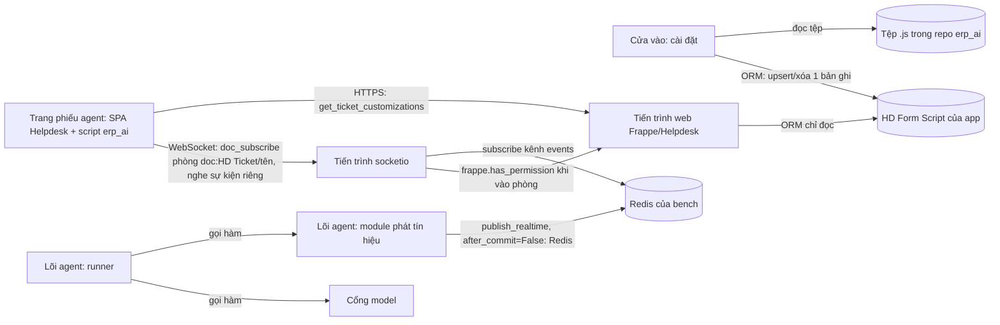

Feature: FEAT-002
Stage: architect
Author-agent: architect
Date: 2026-11-12
Approved-by:
<!-- Cổng: người duyệt điền dòng trên `Approved-by: <tên> <YYYY-MM-DD>`. Không có cổng thì để trống. -->

# Đánh giá tác động kiến trúc FEAT-002

Chế độ: `impact` (đã có `docs/team/architecture.md`). G2 tắt cho feature này (`team.py status`: cổng áp dụng = G5), nên dòng `Approved-by` để trống không chặn bước sau.
Đầu vào: `spec.md` (gồm Amendment 1, 2), `research.md` (khuyến nghị D1 + C1, J1/J2), ADR-001..ADR-006, `architecture.md`. `design.md` hiện có viết trước Amendment 1 (`DESIGN_CONFLICT` về comment tạm) và đã cũ; không dùng làm cơ sở.

## Cơ sở khảo sát (đọc trực tiếp 2026-11-12)
- `erp_ai/hooks.py`: `required_apps = ["helpdesk"]`; `after_install`/`after_migrate` → `erp_ai.install.ensure_setup`; không có `before_uninstall`, `app_include_js`, `fixtures`.
- `erp_ai/install.py:30-37`: `ensure_setup()` gọi 6 bước, docstring "Create what is missing; never overwrite or remove anything a human set" (ADR-006).
- `erp_ai/public/js`, `erp_ai/public/css`: rỗng. JS duy nhất của app là form Desk (`erp_ai_setting.js`, report `erp_ai_accuracy.js`). Không có mã nào chạy trên SPA `/helpdesk`.
- `publish_realtime` / `frappe.realtime`: 0 lần dùng trong `erp_ai/**`. `frappe.enqueue` chỉ ở `erp_ai/agent/queue.py:29` (ADR-003).
- `erp_ai/agent/runner.py`: `run_for_ticket` (`:48-59`) không bao giờ ném, không rollback; `_call_model` commit sau mỗi lời gọi gateway (`:62-68`); `_run` (`:71-120`) chạy (a)…(e), chốt `level_L0` cho `comment_mention` (`:99-101`), `ticket_insert` gọi `_classify` (`:115-118`), `L1+` gọi `_reason` (`:119-120`); `_run_tool` bắt mọi ngoại lệ tool (`:313-322`).
- `erp_ai/tests/test_architecture.py`: luật ADR được máy kiểm (`LAYER_RULES` `:36-52`, một chỗ enqueue, cấm `.save()` cấu hình, cấm bỏ quyền trong tool, v.v.). Ràng buộc mới của ADR-007/008 thêm vào đây.
- `.pre-commit-config.yaml`: có `prettier` và `eslint` cho `javascript` → `cmd.lint`/`cmd.format` đã phủ tệp `.js`.
- Đơn vị chạy (`architecture.md` "Đơn vị triển khai", `Procfile`): có sẵn tiến trình `socketio` và Redis của bench; FEAT-002 không thêm đơn vị mới.

## Module bị chạm
| Module | Thay đổi | Mức |
|---|---|---|
| Cấu hình agent (`erp_ai_agent/doctype/erp_ai_setting`) | 3 trường người đặt + kiểm khi lưu (AC-1). Chủ ghi theo ADR-004 hàng 1, không đổi | nhỏ |
| Lõi agent: runner (`erp_ai/agent/runner.py`) | Khoảng trễ trước câu trả lời đầu của `comment_mention`; gọi module phát tín hiệu ở đầu, trước mỗi tool/bước phân loại, và `done` trong `finally` (ADR-008) | vừa |
| Lõi agent: module phát tín hiệu (mới, `erp_ai/agent/`) | Nơi duy nhất gọi `publish_realtime`; bảng nhãn việc (ADR-008) | mới |
| Cửa vào: cài đặt (`erp_ai/install.py`, `hooks.py`) | Upsert bản ghi HD Form Script từ tệp repo; thêm `before_uninstall` xóa đúng bản ghi đó (ADR-007, ngoại lệ hẹp cho ADR-006) | vừa |
| Lớp giao diện (mới): một tệp `.js` trong `erp_ai/` | Chạy trên trang phiếu agent qua HD Form Script, chỉ nghe tín hiệu, hiện/ẩn chỉ báo (ADR-007) | mới |
| `erp_ai/constants.py` | Tên sự kiện, (tên bản ghi HD Form Script) | nhỏ |
| `erp_ai/tests/test_architecture.py` | Thêm luật máy kiểm cho ADR-007, ADR-008 | nhỏ |
| Helpdesk, Frappe | Không sửa | — |

Chiều một hướng, không vòng: script trên trang chỉ phụ thuộc vào hợp đồng sự kiện (nó gọi tới `socketio`, không gì gọi ngược vào nó); runner → module phát → Redis; module phát không gọi Cổng model. Các cạnh còn lại của hệ thống giữ như `architecture.md`.

## Hợp đồng thay đổi
- **Mới — sự kiện realtime của app** (ADR-008): một tên sự kiện riêng, phòng `doc:HD Ticket/<tên>`, payload đúng 7 khóa `ticket_id, run_id, agent_user, agent_name, state ∈ {thinking, working, done}, text, expires_in_s`. Người phát: chỉ module phát (gọi từ runner). Người nghe: chỉ script của ADR-007. Hợp đồng nội bộ của app, phiên bản đầu; thêm khóa sau này phải tương thích ngược (script bỏ qua khóa lạ).
- **Mới — bản ghi HD Form Script** do app sở hữu (ADR-007): tên cố định, chỉ trang agent; đặt lại mỗi lần cài/migrate, xóa khi gỡ app.
- **Thêm — 3 trường cấu hình** (AC-1): thêm vào, không phá vỡ; mặc định điền khi `after_migrate` cho trường còn thiếu (ADR-006, không đổi).
- **Không đổi**: hàm xếp hàng và tham số job (ADR-003); Cổng model và số lời gọi (ADR-002, NFR-3); registry tool và schema tool (ADR-005); schema `ERP AI Log` (lỗi phát đi vào trường `error` có sẵn); `Comment`, `HD Ticket`, `Task` (không thêm bản ghi, NFR-6).

## NFR bị ảnh hưởng
| NFR | Giải pháp | ADR |
|---|---|---|
| NFR-1 (trễ ∈ [min, max], mặc định 3–5 s) | Runner chọn `d` mỗi lần chạy `comment_mention`, chờ trong worker trước câu trả lời đầu; thời gian model đã chạy được trừ (A-3). Cơ chế chờ do designer | ADR-003 (không job thứ hai) |
| NFR-2 (không vượt 540/600 s; cận 30 s) | Cận 30 s kiểm khi lưu form; thời gian chờ ≤ `deadline` còn lại của lần chạy, không nới `deadline`. Không thể làm trễ bằng job xếp hàng muộn vì ADR-003 chỉ cho một chỗ `enqueue` với `timeout=600` | ADR-003 Quyết định 5 |
| NFR-3 (không thêm lời gọi model/chi phí) | Module phát không import Cổng model; chờ và phát tín hiệu không gọi gateway; test so `call_count` và `cost_usd` bật/tắt | ADR-002, ADR-008 |
| NFR-4' (không lộ nội dung) | Payload đúng 7 khóa, dựng ở một chỗ; `text` chỉ là câu chữ cấu hình hoặc nhãn cố định; lỗi phát chỉ ghi tên lớp | ADR-008 |
| NFR-5 (mất ≤ 10 s sau khi lần chạy kết thúc) | Đẩy realtime ngay (`after_commit=False`), `done` trong `finally` sau commit cuối; script ẩn ngay khi nhận `done` của đúng `run_id` | ADR-008, ADR-007 |
| NFR-6 (không thêm lời gọi model; không thêm `Comment`/`HD Ticket`/`Task`) | Phát tín hiệu không ghi DB/cache/tệp; bản ghi duy nhất mới là HD Form Script lúc cài, không phải lúc chạy | ADR-008 Quyết định 5, ADR-007 Quyết định 3 |
| (AC-11, tự mất 600 s) | `expires_in_s = JOB_TIMEOUT_S` trong payload; trạng thái chỉ trong bộ nhớ trang | ADR-008 |

Đối chiếu: NFR trong spec = NFR-1, NFR-2, NFR-3, NFR-4 (thay bằng NFR-4'), NFR-5, NFR-6. NFR trong bảng = NFR-1, NFR-2, NFR-3, NFR-4', NFR-5, NFR-6. Khớp 6/6, không bỏ NFR nào.

## Quyết định
- **ADR-007 (mới, proposed):** lớp giao diện chỉ qua một bản ghi HD Form Script do app sở hữu, nguồn là một tệp `.js` trong repo, đặt lại mỗi lần cài/migrate, xóa khi gỡ app; script chỉ nghe, không gọi server, không HTML.
- **ADR-008 (mới, proposed):** tín hiệu trạng thái qua `publish_realtime` vào phòng `doc:` với `after_commit=False`; một module phát duy nhất, chỉ runner gọi; payload 7 khóa; `done` luôn được phát trong `finally`; không ghi bản ghi nào.
- **ADR-006:** ngoại lệ hẹp ở ADR-007 Quyết định 4 (đặt lại + xóa đúng một bản ghi HD Form Script). Chỉ sửa dòng trạng thái của ADR-006; thân giữ nguyên.
- **ADR-004:** không đổi (theo yêu cầu của người). Xác nhận: bản ghi HD Form Script tạo lúc cài không thuộc bảng chủ ghi lúc chạy; phát realtime không phải là "ghi" theo ADR-004, nên phát ở `L0` (`ticket_insert`) không trái Quyết định 4.
- **ADR-001, ADR-002, ADR-003, ADR-005:** không đổi. Module phát nằm trong Lõi agent, tuân `LAYER_RULES` hiện có; tool không biết tới tín hiệu.
- Không cần ADR "ngoại lệ xóa comment" mà `design.md` cũ đề xuất (spec Amendment 1: không còn comment tạm).

### Quét các chiều
| Chiều | Kết luận |
|---|---|
| Môi trường và deploy | **Đã quyết:** không đơn vị mới; dùng `socketio` + Redis có sẵn của bench. Đổi tệp `.js` cần `bench migrate` để bản ghi được đặt lại (ADR-007 Hệ quả). **Câu hỏi mở (đã có, A-2 FEAT-001):** production có chạy `socketio` — người kiểm sau G4; thiếu thì chỉ báo im lặng, lần chạy không đổi |
| Sở hữu dữ liệu | **Đã quyết:** HD Form Script của app — chỉ mã cài đặt ghi (ADR-007); trạng thái chỉ báo — chỉ trong bộ nhớ trang, không có bản lưu server (ADR-008); 3 trường cấu hình — người qua form (ADR-004 hàng 1) |
| Đường ghi trạng thái | **Đã quyết:** lúc chạy không ghi gì mới (ADR-008 Quyết định 5); lúc cài: upsert một bản ghi (ADR-007). Thứ tự tín hiệu: đầu sau (e), `done` cuối trong `finally` (ADR-008 Quyết định 4) |
| Lỗi, log, cấu hình | **Đã quyết:** lỗi phát không ném, runner ghi tên lớp vào trường `error` có sẵn của nhật ký (ADR-008, ADR-004 "chỉ runner tạo nhật ký"); `expires_in_s` từ `JOB_TIMEOUT_S`; tên sự kiện một chỗ ở `constants.py`. **Để designer:** chuỗi lỗi cụ thể, có thêm dòng logger quan sát hay không (STD-OPS-5) |
| Xác thực, phân quyền | **Đã quyết:** vào phòng `doc:` do Frappe kiểm quyền đọc phiếu; script chỉ chạy trang agent (`apply_to_customer_portal = 0`); payload chỉ mục NFR-4' vì khách có quyền đọc vẫn có thể tự vào phòng (ADR-008 Hệ quả). Không quyền mới, không endpoint mới |
| Tích hợp ngoài | **Không đổi:** Claude API như ADR-002; không lời gọi mạng mới ngoài Redis nội bộ của bench |

## Rủi ro
- Lấy socket của SPA qua `#app.__vue_app__.config.globalProperties.$socket` là chi tiết nội bộ (`UNVERIFIED` theo docs Vue, research Q1). Nâng Helpdesk có thể làm chỉ báo im lặng → ADR-007 Quyết định 5 (tự tắt êm), bước tay AC-10 sau mỗi lần nâng cấp.
- Phần phía trang chỉ kiểm bằng bước tay (J1, A-21) cho tới khi người thêm slot `cmd.test_js` vào `.team/profile.json`. Lỗi logic JS (lọc phiếu, hẹn giờ) chỉ lộ ở bước tay AC-10/AC-11.
- Bản ghi HD Form Script bị đặt lại mỗi lần migrate: quản trị viên sửa tay sẽ mất (có chủ ý, A-22) → tài liệu người dùng.
- Khoảng trễ giữ worker `long` tối đa 30 s mỗi lần chạy `@ai`; giới hạn 5 lần chạy/phiếu/ngày chặn trần.
- `design.md` hiện có là bản trước Amendment 1 nên `team.py status` báo `designed / READY → /team:plan` dù design đã cũ. Phải chạy `/team:design FEAT-002` viết lại trước `/team:plan`.
- Tự phản biện — đã thử dựng hai task cùng tuân mọi ADR mà vẫn xung đột:
  1. Task runner phát "đang làm" ở runner, task tool tự phát trong tool → siết ADR-008: chỉ runner import module phát; tool không biết tín hiệu.
  2. Lần chạy `ticket_insert` và `comment_mention` cùng phiếu chồng nhau; `done` của lần này ẩn chỉ báo của lần kia → siết ADR-008 Quyết định 6: `done` chỉ áp cho đúng `run_id`.
  3. Một task cho script gọi `call()` lúc mở trang để lấy trạng thái (A-12 tốt hơn), task server giữ trạng thái trong cache → cấm ở ADR-007 Quyết định 5 và ADR-008 Quyết định 5.
  4. Task cài đặt chỉ tạo khi thiếu (theo ADR-006), task giao diện mong nội dung khớp repo → ADR-007 Quyết định 4 ngoại lệ đặt lại.
  5. JS viết cứng 600 s, Python đổi `JOB_TIMEOUT_S` → ADR-008: `expires_in_s` trong payload.
  6. Tên sự kiện gõ hai nơi lệch nhau → ADR-008 Ràng buộc: test so chuỗi trong `.js` với hằng trong `constants.py`.
  7. Một task phát `done` với `after_commit=True` cho "khớp commit", nhánh rollback mất `done` → ADR-008 Ràng buộc: mọi lời gọi có `after_commit=False` tường minh.
  8. Một task phát `done` trước commit câu trả lời, chỉ báo tắt trước khi comment hiện → ADR-008 Quyết định 4: `done` sau commit cuối.

  Không còn tổ hợp xung đột nào tìm được.

## Để designer quyết
- Cơ chế chờ (ngủ trong worker), chỗ đặt lời gọi chờ trong lượt, tránh giữ khóa dòng trong lúc ngủ, cách chọn `d` (nguyên/thực) — chỉ một module (runner) dùng; ADR-003 đã loại phương án job thứ hai, nên không đạt điều kiện "không hiển nhiên".
- Tên trường cấu hình, nhãn form, thông báo lỗi tiếng Việt — đã có quy ước `INT_LIMITS` (`erp_ai_setting.py:30-36`).
- Tên module phát, tên sự kiện, tên bản ghi HD Form Script, tên/vị trí tệp `.js` — theo `naming.*`.
- Chữ nhãn việc cho từng tool và bước phân loại (A-15) — dữ liệu cố định trong một bảng (ADR-008 Quyết định 3).
- Vị trí, kiểu dáng, hiệu ứng của chỉ báo; có hiện trên mobile hay không (A-19, A-20) — chỉ một tệp `.js` chạm tới.
- Cách chống đăng ký trùng khi `setupForm` chạy lại, cách ẩn khi đổi phiếu (AC-10 (i)) — chi tiết trong một tệp.
- Cách viết `.js` cho dễ nạp bằng `vm` nếu sau này có J2 — chỉ khi người thêm slot.
- Dòng logger quan sát (STD-OPS-5) và chuỗi lỗi phát trong trường `error` của nhật ký.

## Chế độ system
Không áp dụng (chế độ `impact`). ADR mới: ADR-007, ADR-008. `docs/team/architecture.md` không viết lại; As-Built của FEAT-002 cập nhật bảng Thành phần (thêm "Lõi agent: module phát tín hiệu", "Lớp giao diện: HD Form Script") và sơ đồ.
