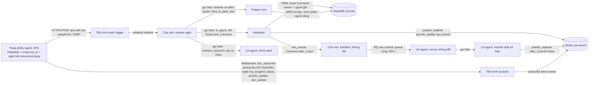

Feature: FEAT-003
Stage: architect
Author-agent: architect
Date: 2026-11-12
Approved-by:
<!-- Cổng: người duyệt điền dòng trên `Approved-by: <tên> <YYYY-MM-DD>`. Không có cổng thì để trống. -->

# Đánh giá tác động kiến trúc FEAT-003

Chế độ: `impact`, vì đã có `docs/team/architecture.md`. Mode decide; G1–G4 tắt (intake dòng 36), nên dòng `Approved-by` để trống không chặn bước sau.

Đầu vào:
- `intake.md`;
- `spec.md`: phần 1 AC-1..AC-5, NFR-1, NFR-2; Amendment 1 AC-6..AC-15, NFR-3..NFR-5, B-1..B-14;
- `research.md`: khuyến nghị P2 + R-B + T-A;
- ADR-001..ADR-008, `architecture.md`, `FEAT-002/arch-impact.md`.

`.team/current.json` không bị ghi đè, vì FEAT-002 đang giữ nó (đang verify). Lần sửa Amendment 1 (2026-11-12) cũng không ghi, vì BUG-002 đang giữ.

## Cơ sở khảo sát (Explore + đọc trực tiếp, 2026-11-12, nhánh `team/FEAT-002`)
- **Method whitelisted:** cả `erp_ai/**` chỉ có một, `check_keys` (`erp_ai_setting.py:125`), `methods=["POST"]`, không `allow_guest`. Chưa có endpoint nào cho SPA `/helpdesk`.
- **`erp_ai/public/js/agent_status_indicator.js` (195 dòng):**
  - chữ ký `function setupForm({ doc, router })`;
  - trạng thái `window.__erpAiAgentStatus` (`:10-18`);
  - khối đăng ký một lần `if (state.socket !== socket)` (`:163-190`), nghe sự kiện ADR-008 và `connect`;
  - `doc_subscribe` ở mỗi lần chạy (`:161`);
  - `router.afterEach` (`:176-189`);
  - `document.body.appendChild` (`:67`);
  - trả `{ actions: [] }`;
  - không có `call`, `setInterval`, `.off(`, và `querySelector` chỉ dùng cho `#app`.
- **`erp_ai/tests/test_architecture.py`:**
  - `LAYER_RULES` (`:36-64`);
  - `STATUS_SCRIPT_FORBIDDEN` (`:98-118`, gồm `\bcall\b`, `600`);
  - `STATUS_SCRIPT_REQUIRED` (`:121-132`), cộng chữ ký `setupForm` ghim ở `:1068-1075`;
  - `test_form_script_only_in_install`, `test_install_deletes_only_status_script_on_uninstall`, `test_publish_realtime_only_in_run_status`;
  - `test_level_and_send_policy_fields_only_in_policy`;
  - `test_no_legacy_ticket_comment_or_spoofable_author` (cấm `comment_email`/`comment_by`).
- **`erp_ai/install.py`:** bản ghi `ERP AI Agent Status` (`:20-30`, upsert ở `:208-225`, xóa trong `before_uninstall` ở `:52-57`). Có 4 field AI `ai_resolution_hint` (Text Editor), `ai_confidence`, `ai_classified_by`, `ai_updated_at`, cộng `ai_opt_out`, tất cả permlevel 8 (`:98-153`).
- **Đường comment của FEAT-001:**
  - `handlers.comment_after_insert` (`:100-120`) xét theo thứ tự `comment_type` → `is_enabled` → `owner == AGENT_USER` → `contains_keyword` → `can_send_ticket` → `enqueue_agent_run`. Ghi log chỉ bằng logger, không bản ghi.
  - Runner (`:94-107`): `not_sendable`, `daily_limit` (đếm `run_id` trong ERP AI Log), `effective_level` (vượt ngân sách → `L1`), `level_L0`. Mỗi nhánh bỏ qua ghi một bản ghi `skip`.
  - `authority.py` đọc core `Comment` và lấy `owner` làm tác giả.
  - `post_comment` → `doc.new_comment` (`write_ticket.py:73-83`). Comment của agent chỉ nhận ra được bằng `owner == AGENT_USER`.
- **Helpdesk 15.1.0 (đọc 2026-11-12):**
  - `HD Ticket.new_comment` kiểm `is_agent()` nhưng không kiểm quyền đọc phiếu (`hd_ticket.py:616-629`);
  - `is_agent()` xét HD Agent `is_active`, nếu không có bản ghi thì xét role (`helpdesk/utils.py:42-57`);
  - `can_see_ticket_comments` (`extends/comment.py:72-79`);
  - `Comment.before_insert` chặn người không phải agent (`:15-22`);
  - phòng HD Ticket chỉ cho agent vào (`helpdesk/overrides/realtime.py:6-23`);
  - `call` của frappe-ui (cũng là `call` trong ngữ cảnh `setupForm`, `TicketHeader.vue:107,320`) luôn gửi POST (`frappe-ui/src/utils/call.ts:24-31`) — đọc thêm ở Amendment 1.
- **Frappe 15.126.1:**
  - `get_activity_timeline` dùng `get_lazy_doc(..., check_permission=True)` (`frappe/desk/form/activity.py:26-33`);
  - `html_to_plain_text` (`frappe/core/utils.py:95`);
  - `Document.apply_fieldlevel_read_permissions` (`frappe/model/document.py:880`);
  - (Amendment 1) whitelist từ chối HTTP method ngoài `methods=` (`frappe/handler.py:99-110`); request POST được commit, GET thì rollback (`frappe/app.py:451-458`); `Comment.validate` luôn sanitize nội dung (`frappe/core/doctype/comment/comment.py:69-74`); bộ đếm ghi `frappe.db.transaction_writes` (`frappe/database/database.py:437-438`).
- **Đơn vị chạy:** web, worker `long`, scheduler, `socketio`, Redis đều có sẵn (`architecture.md` "Đơn vị triển khai"). Không có đơn vị mới.
- **Profile:** `language` chỉ có `python`, không có slot `cmd.test_js`, `ui: false`. `allowed_new_file_roots` = `erp_ai`, `docs`, `.github`.

## Module bị chạm
| Module | Thay đổi | Mức |
|---|---|---|
| **Phần 1:** DocType `ERP AI Setting`, `ERP AI Credential`, `ERP AI Log` (`erp_ai/erp_ai_agent/doctype/**`) | Chỉ thêm `description` và Section Break có label. Không cột, không đổi thuộc tính khác (AC-5). Module `ERP AI agent` giữ nguyên (ADR-001) | nhỏ |
| **Phần 2:** Cửa vào, module ngăn (mới, ở gốc `erp_ai/`) | 2 method whitelisted, cả hai POST: đọc (chỉ đọc, 0 câu ghi SQL) và gửi; cổng quyền chung; chữ thường ở server; gửi qua `HD Ticket.new_comment` (ADR-010, Amendment 1) | mới |
| **Phần 2:** Lớp giao diện, `erp_ai/public/js/agent_status_indicator.js` (cùng tệp, cùng bản ghi) | Thêm action header, ngăn trên `document.body`, nghe `docinfo_update`/`doc_update`, gọi `call` tới 2 method, chuyển một phần tử chỉ báo vào ngăn (ADR-009) | vừa |
| `erp_ai/constants.py` hoặc nơi designer chọn | Danh sách đường dẫn 2 method, định nghĩa một lần (ADR-009, ADR-010) | nhỏ |
| `erp_ai/tests/test_architecture.py` | Đổi danh sách cấm của tệp `.js` (bỏ `\bcall\b`, thêm chuỗi cấm mới) và chữ ký `setupForm`; thêm `LAYER_RULES` cho module ngăn, luật whitelist, luật "chỉ ghi `new_comment`" (ADR-009, ADR-010) | nhỏ |
| Cửa vào: cài đặt (`install.py`), handlers, runner, Lõi agent, Cổng model, tasks | Không đổi mã. Nội dung bản ghi HD Form Script đổi theo tệp `.js` khi migrate (ADR-007 Quyết định 4) | — |
| Helpdesk, Frappe | Không sửa | — |

Đồ thị một chiều, không có vòng:
- trang → web → module ngăn → (Helpdesk, Frappe core, chính sách) → DB và Redis;
- Helpdesk → handlers → runner → module phát → Redis;
- trang → socketio → Redis.

Không gì gọi ngược vào trang hay vào module ngăn. Module ngăn không tới runner, hàng đợi hay Cổng model; nó chỉ chạm handlers gián tiếp, qua `doc_events` của comment do Helpdesk tạo. Các cạnh còn lại giữ như `architecture.md` và `FEAT-002/arch-impact.md`.

## Hợp đồng thay đổi
- **Mới: 2 method whitelisted của `erp_ai`** (ADR-010). Đây là hợp đồng nội bộ giữa script và server, phiên bản đầu.
  - Đọc: `POST` (Amendment 1; `call` của `setupForm` chỉ gửi POST), chỉ đọc, trả 4 field AI dạng chữ và luồng B-5 dạng chữ.
  - Gửi: `POST`, nhận phiếu và chữ người gõ, trả kết quả gửi. Từ khóa đang cấu hình có `<`, `>`, `&` → `ValidationError`, 0 comment (Amendment 1).
  - Cả hai đều không cho Guest, kiểm `is_agent()` và quyền đọc phiếu ở server, và được Frappe kiểm CSRF.
  - Hình dạng dữ liệu do designer chọn. Thêm khóa về sau phải tương thích ngược: script bỏ qua khóa lạ.
- **Đổi: phạm vi của script trên trang** (ADR-009 thay ADR-007 Quyết định 5, 6). Script được gọi `call`, chỉ tới 2 method trên. Script nghe thêm `docinfo_update`/`doc_update`, là sự kiện có sẵn của Frappe, không phải sự kiện mới. Chữ ký `setupForm` có thêm `call`. Bản ghi HD Form Script, tên tệp, tên bản ghi và cờ `apply_to_customer_portal = 0` giữ nguyên.
- **Không đổi:**
  - sự kiện `erp_ai:agent_status` và payload 7 khóa (ADR-008);
  - hàm xếp hàng và tham số job (ADR-003);
  - registry tool (ADR-005);
  - bảng chủ ghi (ADR-004);
  - Cổng model (ADR-002);
  - `policy.contains_keyword` và cách handler so từ khóa (FEAT-001);
  - schema HD Ticket và 3 DocType của app: không field mới (AC-5, AC-14). Phần 1 chỉ thêm `description` và Section Break, không có cột.
- **Phần 1:** đổi siêu dữ liệu, tương thích ngược, `bench migrate` áp vào. Không di trú dữ liệu.

## NFR bị ảnh hưởng
| NFR | Giải pháp | ADR |
|---|---|---|
| NFR-1 (mô tả ≤ 400 ký tự) | Không có quyết định kiến trúc. Nội dung metadata do designer/dev viết, đo ở AC-2 | — (ADR-001: giữ module) |
| NFR-2 (không đổi hiệu năng hay hành vi, phần 1) | Chỉ `description` và Section Break; AC-5 so JSON. Không chạm mã chạy | — |
| NFR-3 (≤ 10 s, không tải lại) | Comment mới làm Frappe phát `docinfo_update` sau commit; field phiếu đổi làm Frappe phát `doc_update`. Cả hai vào phòng `doc:` mà script đã `doc_subscribe` (ADR-008 Quyết định 6). Khi ngăn mở, mỗi sự kiện của đúng phiếu dẫn tới 1 lời gọi đọc (POST); nối lại socket cũng 1 lời gọi đọc. Chỉ báo vẫn theo ADR-008. Không polling | ADR-009 Quyết định 4, ADR-008 |
| NFR-4 (xem không tốn gì; gửi tốn như comment `@ai`) | Method đọc không ghi, không commit, không gọi gateway hay runner; vì là POST (Frappe commit), có thêm test `transaction_writes` không tăng. Ngăn đóng thì không gọi gì. Không ghi storage. Gửi = 1 `new_comment`, phần sau do handler và runner làm y như ô Comments; từ khóa đặc biệt → 0 comment, 0 lời gọi gateway | ADR-010 Quyết định 5, 7, 8 (Amendment 1); ADR-009 Quyết định 4 |
| NFR-5 (chữ thường; người không phải agent không nhận dữ liệu AI; không làm được gì hơn ô Comments) | HTML → chữ chỉ ở server, client chỉ dùng `textContent` và có danh sách cấm. Cổng `is_agent()` + quyền đọc phiếu; field AI áp permlevel. `apply_to_customer_portal = 0`; phòng HD Ticket chỉ cho agent. Gửi qua đúng `new_comment` của Helpdesk, không đính kèm | ADR-010 Quyết định 3, 4, 6, 7; ADR-009 Quyết định 5; ADR-007 Quyết định 1 |

Đối chiếu: NFR trong spec gồm NFR-1, NFR-2 (phần 1) và NFR-3, NFR-4, NFR-5 (Amendment 1). Dòng "Thời gian mở khu vực" ghi "không có" (B-13). NFR trong bảng gồm đúng NFR-1..NFR-5. Khớp 5/5, không bỏ NFR nào. Dòng không có NFR thì không có giải pháp; theo STD-DESIGN-5, không thêm cache hay phân trang.

### Kiểm tác động lên các chốt hiện có (yêu cầu của team-leader)
Mọi tin gửi từ ngăn trở thành một core `Comment` tạo qua `HD Ticket.new_comment` dưới phiên người gửi, nội dung có từ khóa. Vì vậy nó đi đúng đường `comment_after_insert` → hàm xếp hàng → runner như comment gõ ở ô Comments. Method gửi bị cấm tự xét chốt (ADR-010 Quyết định 8).

| Chốt | Đường xét (không đổi) | Kết quả khi gửi từ ngăn | Có mã mới không |
|---|---|---|---|
| Agent tắt | handler `is_enabled` | Comment của người vẫn được tạo; không xếp hàng; 0 lời gọi gateway | Không |
| Nhóm loại trừ, cờ không dùng AI (NFR-4 của FEAT-001) | handler `can_send_ticket`, runner kiểm lại (ADR-003) | Không xếp hàng; 0 lời gọi gateway; không lộ nhánh cho người gửi (B-8) | Không; module ngăn không được đọc các trường đó (luật hiện có) |
| Giới hạn lượt/ngày | runner `runs_today`, đếm từ ERP AI Log (ADR-004) | Bản ghi `skip`/`daily_limit` như hiện nay; không trả lời | Không |
| Ngân sách tháng | runner `effective_level`: vượt → `L1` (ADR-003 bước e) | Chạy ở `L1` | Không |
| Mức `L0` (không trả lời) | runner `level_L0` cho `comment_mention` | Bản ghi `skip`; 0 comment của bot; ngăn chỉ hiện tin của người cùng dòng hướng dẫn B-8 | Không |
| Thẩm quyền `ERP AI Instructor` / người được giao | `authority.py` đọc `owner` của core `Comment` | `owner` = người gửi, nên kết quả chỉ thị hay dữ liệu giống ô Comments (B-14) | Không; ADR-010 cấm `set_user` và cấm gửi dưới `AGENT_USER` |
| Opt-out khi gửi từ ngăn | Như hàng "cờ không dùng AI": luồng `comment_mention` tái dùng nguyên vẹn | Như trên | Không |
| Khách không thấy dữ liệu AI | `apply_to_customer_portal = 0`; cổng `is_agent()` ở server; permlevel 8; phòng `doc:` chỉ cho agent | HD Contact và Guest bị `PermissionError` ở cả hai method (AC-13) | Cổng mới ở module ngăn, có test |

Kết luận: không cần nới ADR-004, mô hình thẩm quyền, NFR-4 của FEAT-001 hay quy tắc khách không thấy dữ liệu AI. Không có `NEEDS_ANSWER`. Amendment 1 cũng không nới điều nào trong số đó.

## Quyết định
- **ADR-009 (mới, proposed):** thay ADR-007 Quyết định 5, 6 và hai dòng Ràng buộc về tệp `.js`. Nội dung:
  - P2: action header mở một ngăn trên `document.body`;
  - `call` chỉ tới danh sách method của `erp_ai`;
  - không polling;
  - chỉ `textContent`, không phân tích HTML ở client;
  - một bản ghi, một tệp, một trạng thái, một chỉ báo;
  - nghe thêm `docinfo_update`/`doc_update`, không bao giờ gỡ listener;
  - ẩn dưới 640 px;
  - đính chính ADR-008.
- **ADR-010 (mới, proposed):** một module Cửa vào với đúng 2 method, cả hai POST (Amendment 1). Nội dung:
  - cổng `is_agent()` + quyền đọc phiếu;
  - đọc dưới phiên người dùng, không bỏ quyền;
  - đổi sang chữ thường ở server;
  - gửi chỉ qua `HD Ticket.new_comment`, từ khóa thêm ở server bằng `policy.contains_keyword`;
  - không tự xét chốt của agent;
  - chỉ có đúng một lệnh ghi.
- **ADR-010 Amendment 1 (2026-11-12, theo `DESIGN_CONFLICT` C-1, C-2 của designer):**
  - C-1: method đọc `methods=["POST"]` vì `call` của frappe-ui luôn gửi POST và Frappe từ chối method HTTP ngoài `methods=`. ADR-009 Quyết định 4 giữ nguyên. Bù mất rollback của GET bằng Ràng buộc `frappe.db.transaction_writes` không tăng quanh lời gọi đọc.
  - C-2: `Comment.validate` luôn sanitize, nên từ khóa có `<`, `>`, `&` không bao giờ khớp sau khi lưu. Method gửi kiểm `contains_keyword` trên nội dung ở dạng sẽ lưu, trước `new_comment`; không qua → `ValidationError`, 0 comment, không lộ từ khóa. Test bắt buộc đổi tương ứng. `policy.contains_keyword` không đổi.
- **ADR-007:** chỉ sửa dòng trạng thái để trỏ tới ADR-009; thân giữ nguyên. Quyết định 1–4 (một kênh, một tệp nguồn, chủ ghi là mã cài đặt, ngoại lệ đặt lại/xóa) vẫn hiệu lực.
- **ADR-008:** chỉ sửa dòng trạng thái để trỏ tới ADR-009 Quyết định 7. Câu Hệ quả về khách vào phòng không còn đúng trên Helpdesk 15.1.0 (`helpdesk/overrides/realtime.py:6-23`). Hợp đồng và Quyết định 1 ("không endpoint mới" cho tín hiệu) giữ nguyên: 2 method của ADR-010 không mang trạng thái lần chạy.
- **ADR-004:** không đổi. Comment do ngăn tạo là comment của người, dưới phiên người đó, qua method của Helpdesk, đúng như ô Comments. Hàng comment của agent ("chỉ `post_comment`") vẫn đúng, vì ADR-010 Quyết định 3 cấm gửi dưới `AGENT_USER`.
- **ADR-001, ADR-002, ADR-003, ADR-005, ADR-006:** không đổi. Module ngăn thuộc tầng Cửa vào và có dòng `LAYER_RULES` riêng.
- **Phần 1:** không cần ADR. Siêu dữ liệu của 3 DocType trong một module, không có hai phần nào có thể chọn khác nhau ngoài những gì AC-1..AC-5 đã định.

### Quét các chiều
| Chiều | Kết luận |
|---|---|
| Môi trường và deploy | **Đã quyết:** không có đơn vị mới. Đổi tệp `.js` cần `bench migrate` (ADR-007). Thêm module Python cần `bench restart`. Chỉ site dev `miyano`; production và G5 là việc của người. **Câu hỏi mở (đã có từ FEAT-002):** production có chạy `socketio` không. Nếu thiếu thì ngăn vẫn đọc/gửi được nhưng không cập nhật trực tiếp |
| Sở hữu dữ liệu | **Đã quyết:** comment của người do người tạo qua method của Helpdesk; comment của agent chỉ do `post_comment` tạo (ADR-004, ADR-010 Quyết định 3, 9); field AI chỉ do tool ghi (ADR-004, B-12); trạng thái ngăn chỉ nằm trong bộ nhớ trang (ADR-009); không có DocType hay field mới |
| Đường ghi trạng thái | **Đã quyết:** ngăn có đúng một đường ghi là method gửi → `new_comment` (ADR-010 Quyết định 7). Method đọc (POST) phát 0 câu ghi SQL, có test bộ đếm (Quyết định 5, Amendment 1). Kích hoạt agent vẫn qua handler sau commit (ADR-003). Thứ tự hiển thị: tin vừa gửi hiện khi gửi xong, câu trả lời đến qua `docinfo_update` |
| Lỗi, log, cấu hình | **Đã quyết:** từ chối quyền thì ném `frappe.PermissionError`; từ khóa không giữ được sau sanitize thì `frappe.ValidationError`, thông báo không chứa từ khóa (Amendment 1); lỗi phía trang bắt trong ngăn, không làm hỏng chỉ báo hay trang (ADR-009 Quyết định 4); không thêm cấu hình (B-10); không trả giá trị cấu hình nào (ADR-010 Quyết định 5). **Để designer:** câu chữ thông báo tiếng Việt, có ghi logger khi gửi hay không (STD-OPS-5), độ dài tối đa |
| Xác thực, phân quyền | **Đã quyết:** cổng `is_agent()` + quyền đọc phiếu ở server cho cả hai method; cả hai POST nên có CSRF; field AI áp permlevel; không `ignore_permissions`, không `set_user`, không Guest (ADR-010). Trang khách không nhận script (ADR-007 Quyết định 1). Phòng `doc:` chỉ cho agent (Helpdesk). Không cấp quyền mới cho ai (B-11) |
| Tích hợp ngoài | **Không đổi:** không có lời gọi mạng mới. Claude API chỉ được gọi qua runner (ADR-002) |

## Rủi ro
- **Script chạy trên chi tiết nội bộ của Helpdesk:** ngữ cảnh `setupForm`, `__vue_app__.$socket`, ngưỡng 640 px (`UNVERIFIED`, research 1 và 4). Nâng Helpdesk có thể làm ngăn hoặc chỉ báo im lặng. Ứng phó: tự tắt êm (ADR-009 Quyết định 4); chạy lại bước tay AC-6, AC-11 và FEAT-002 AC-10 sau mỗi lần nâng cấp (tài liệu người dùng).
- **`docinfo_update`/`doc_update` là tên sự kiện dùng chung.** Nếu Helpdesk gỡ listener theo tên mà không kèm handler, ngăn mất cập nhật trực tiếp (ADR-009 Hệ quả). Bước tay AC-11 bắt được.
- **Không có slot test JS.** Logic phía trang (lọc phiếu, chuyển chỉ báo, đóng khi đổi phiếu) chỉ kiểm bằng test tĩnh ADR-009 cộng bước tay. Mọi logic có thể đặt ở server thì đặt ở server (ADR-010).
- **Đọc qua POST được commit** (Amendment 1). Nếu một hàm được gọi (timeline, permlevel) sau nâng cấp bắt đầu ghi phụ, lệnh ghi sẽ không bị rollback. Ứng phó: test `transaction_writes` không tăng chạy trong `cmd.test`.
- **Từ khóa có `<`, `>`, `&`** (đã xác minh, thay `UNVERIFIED` 5 của research): ngăn từ chối gửi, 0 comment (Amendment 1). Ô Comments cùng cấu hình tạo comment mà không kích hoạt agent. Nếu người muốn cấm cấu hình như vậy, đó là luật của ERP AI Setting, thuộc analyst.
- **Spam nút gửi** tạo nhiều comment, y như ô Comments. Chi phí đã bị chặn bởi giới hạn lượt/ngày và chống trùng job (ADR-003).
- **`test_architecture.py` phải sửa** danh sách cấm và chữ ký `setupForm`. Reviewer phải đối chiếu dòng sửa với ADR-009 Ràng buộc: chỉ bỏ `\bcall\b`, mọi chuỗi cấm cũ khác còn nguyên, thêm chuỗi cấm mới (STD-TEST-5).
- **Phụ thuộc FEAT-002.** Phần 2 sửa cùng tệp `.js` với FEAT-002, nên chỉ build sau khi FEAT-002 qua verify (A-7). Phải chạy lại bước tay FEAT-002 AC-10 (h)(i) (AC-15).
- **Tự phản biện.** Đã thử dựng hai task cùng tuân mọi ADR mà vẫn xung đột:
  1. Task giao diện tự thêm `@ai` ở client, task server cũng thêm từ khóa, nên tin bị thêm hai lần. Hoặc client không đọc được từ khóa. → Siết ADR-009 Quyết định 5: script gửi đúng chữ người gõ. ADR-010 Quyết định 5: không method nào trả từ khóa.
  2. Task server chặn sớm khi phiếu bị loại trừ để "đỡ tốn", task test AC-10 đòi kết quả giống ô Comments. → ADR-010 Quyết định 8 cấm chặn sớm, có luật grep `can_send_ticket`/`is_enabled`/`effective_level`/`runs_today` trong module ngăn.
  3. Task giao diện gỡ `docinfo_update` để chống trùng, làm hỏng timeline của Helpdesk. → ADR-009 cấm `.off(`, `removeListener`, `removeAllListeners`; đăng ký trong khối một-lần-mỗi-socket.
  4. Task giao diện tạo phần tử chỉ báo thứ hai trong ngăn, task FEAT-002 giữ phần tử cũ, nên có hai chỉ báo. → ADR-009 Quyết định 6: một phần tử, chuyển chỗ; một đối tượng `window.__erpAi…`.
  5. Task server đổi HTML sang chữ, task giao diện escape thêm một lần, nên hiện `&amp;lt;`. → ADR-009 Quyết định 5 và ADR-010 Quyết định 6: đổi một lần ở server, client không escape hay unescape.
  6. Task đọc comment bằng `frappe.get_all` sau cổng tự viết, lệch với cổng của Helpdesk, lộ comment của phiếu ngoài nhóm. → ADR-010 Quyết định 3, 4: dùng `is_agent()` + quyền đọc của Frappe, đọc qua đường có kiểm quyền, cấm `get_all`/`db.sql` trên `Comment`.
  7. Task GET trả "bot đang chạy" để hiện chỉ báo khi mở ngăn giữa chừng, lệch với chỉ báo của ADR-008. → ADR-010 Quyết định 5: không trả trạng thái lần chạy (ADR-008 Quyết định 1).
  8. Task giao diện gọi đọc mỗi khi có `docinfo_update` dù ngăn đóng, hoặc dùng `setInterval`. → ADR-009 Quyết định 4: chỉ gọi khi ngăn mở; cấm `setInterval`.
  9. Task đặt method trong `erp_ai/agent/`, rồi một tool import nó. → ADR-010 Quyết định 1: tầng Cửa vào, có dòng `LAYER_RULES`, Lõi agent không import.
  10. Một task gửi dưới `AGENT_USER` (ví dụ gọi từ job thử), handler coi là `written_by_agent` và bảng chủ ghi ADR-004 lệch. → ADR-010 Quyết định 3: từ chối khi phiên là `AGENT_USER`; cấm `set_user`.
  11. (Amendment 1) Task server giữ đọc là GET theo bản cũ, task giao diện chỉ dùng `call` theo ADR-009, nên ngăn không bao giờ tải được. → ADR-010 Quyết định 2 sửa thành POST; Ràng buộc test `methods == ["POST"]` cho cả hai.
  12. (Amendment 1) Task server sửa `contains_keyword` để giải thực thể cho khớp từ khóa `a&b`, task khác giữ test FEAT-001 về từ khóa, làm lệch hành vi ô Comments. → ADR-010 Quyết định 7: cấm sửa `contains_keyword`; từ chối gửi thay vào đó.
  13. (Amendment 1) Task server kiểm từ khóa trên nội dung trước khi escape (còn `&` thô) nên cho qua, nhưng nội dung đã lưu không khớp. → ADR-010 Quyết định 7: kiểm trên dạng sẽ được lưu; test đọc lại `Comment.content` từ DB.

  Không còn tổ hợp xung đột nào tìm được.

## Để designer quyết
- **Tên module ngăn, tên 2 hàm, hình dạng dữ liệu trả về, nơi định nghĩa danh sách method:** theo `naming.*`. Chỉ một module chạm tới; hợp đồng đã ghim ở ADR-009/010.
- **Độ dài tối đa của tin, vị trí chèn từ khóa** (B-6 để designer), **câu chữ thông báo và dòng hướng dẫn B-8:** nghiệp vụ đã chốt ở spec, chỉ một hàm dùng.
- **Cách tính "nội dung ở dạng sẽ được lưu"** cho phép kiểm từ khóa (escape tương đương hay gọi đúng hàm sanitize của `Comment.validate`): ADR-010 Amendment 1 chỉ ghim bất biến và test đọc lại từ DB.
- **Có giới hạn tần suất gửi (`frappe.rate_limiter`, research RQ-3) hay không:** spec không đòi (STD-DESIGN-5). Nếu thêm thì không được làm đổi kết quả AC-10.
- **Bố cục, kiểu dáng, vị trí và kích thước ngăn; nhãn và biểu tượng action; cách đánh dấu tin của bot so với tin của người:** chỉ một tệp `.js` chạm tới.
- **Cách lọc `docinfo_update`/`doc_update` theo phiếu, cách đóng ngăn khi đổi kích thước hay đổi phiếu:** chi tiết trong một tệp, đã có tiền lệ ở FEAT-002.
- **API cụ thể để áp permlevel khi đọc 4 field AI, và cách gọi đường đọc comment có kiểm quyền:** ADR-010 chỉ ghim bất biến (không bỏ quyền, dưới phiên người dùng).
- **Phần 1: cách chia Section Break, chữ của từng mô tả:** đã có quy tắc ở spec (AC-1..AC-5, A-5) và ràng buộc thứ tự `skipped_fields` sau `value_after`.
- **Logger quan sát khi gửi (STD-OPS-5):** không ghi nội dung tin hay email người gửi vào log (STD-SEC-6).

## Chế độ system
Không áp dụng (chế độ `impact`). ADR mới: ADR-009, ADR-010 (có Amendment 1). ADR-007 và ADR-008 chỉ sửa dòng trạng thái. `docs/team/architecture.md` không viết lại. As-Built của FEAT-003 cập nhật bảng Thành phần ("Cửa vào: module ngăn", "Lớp giao diện: ngăn trên trang phiếu") và sơ đồ.
