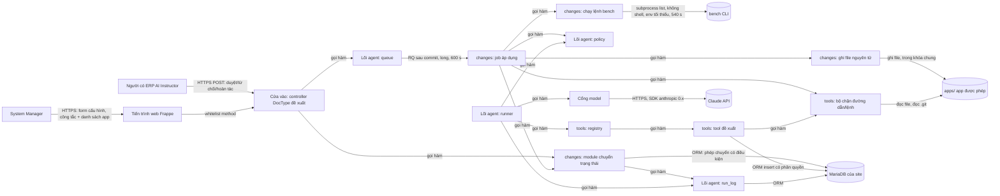
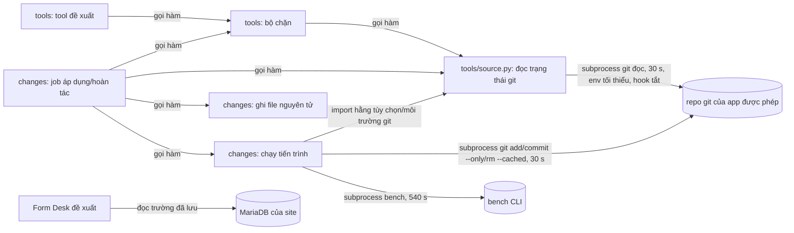

Feature: FEAT-004
Stage: architect
Author-agent: architect
Date: 2026-11-12
Approved-by:
<!-- Cổng: người duyệt điền dòng trên `Approved-by: <tên> <YYYY-MM-DD>`. Không có cổng thì để trống. -->

# Đánh giá tác động kiến trúc FEAT-004

Chế độ `impact` (đã có `docs/team/architecture.md`). Mode của feature: decide (spec `:12`), nên mọi điểm mở được chốt ở mục "Giả định đội đã chốt" bên dưới, không có `questions.md`. Cổng G2 tắt trong `.team/config.json`.

## Cơ sở khảo sát (đọc trực tiếp mã và bench, 2026-11-12)
- **Tầng và chiều phụ thuộc (ADR-001)** được thực thi bằng `erp_ai/tests/test_architecture.py`:
  - `LAYER_RULES` (`:36-64`);
  - một chỗ enqueue duy nhất trong `agent/queue.py`, đúng một lời gọi (`:356-394`);
  - `subprocess` chỉ trong `agent/tools/source.py`, có timeout/list/không shell (`:480-532`);
  - trường mức quyền và chốt gửi chỉ ở `agent/policy.py` (`:88`, `:535-547`);
  - module trạng thái "không ghi gì" (`:806-829`, scanner FEAT-002).
- **Registry:** `_granted_specs(effective_level, has_instructor)` là chỗ duy nhất quyết bộ tool, nhóm `read|ticket_write|task_write` (`erp_ai/agent/tools/registry.py:25`, `:48-52`). `execute_tool` kiểm lại bộ cấp và bọc mỗi tool trong savepoint (`:109-124`).
- **Runner:** chuyển sang tài khoản agent; dựng `ToolContext` một lần sau bước (e) (`erp_ai/agent/runner.py:77-126`). Hạn chót = `JOB_TIMEOUT_S − JOB_SAFETY_MARGIN_S` = 540 s (`:103`; `erp_ai/constants.py:24-26`). Runner ghi một bản ghi `reason` mỗi lượt, với `actions`/trước/sau lấy từ kết quả tool (`:338-361`, `:368-400`).
- **Nhật ký:**
  - `run_log.write_entry` là chỗ duy nhất tạo ERP AI Log, `insert()` dưới user phiên (`erp_ai/agent/run_log.py:11-33`);
  - quyền: System Manager đọc, `ERP AI Agent` tạo + đọc (`erp_ai_log.json:244-256`);
  - `runs_today` chỉ đếm `classify|reason` (`erp_ai/agent/policy.py:56-68`);
  - hàm cộng chi phí cộng mọi dòng trong tháng (`erp_ai/tasks.py:26-40`).
- **Thẩm quyền:** `is_instruction` = role `ERP AI Instructor` hoặc được người khác giao phiếu; Administrator, Guest và tài khoản agent không bao giờ có thẩm quyền (`erp_ai/agent/authority.py:12`, `:44-69`).
- **Tool đọc:** đọc bản ghi chỉ cho 6 DocType (`erp_ai/agent/tools/read.py:23-25`). Chặn đường dẫn đọc bằng `resolve_safe_path`: gốc `apps/`, khử symlink, mẫu tên cấm, đuôi cho phép (`erp_ai/agent/tools/source.py:13-80`). Lệnh `git` truyền `{**os.environ}` (`:258-267`).
- **Prompt:** `build_reason_system` (`erp_ai/agent/prompts.py:174-178`). Mục GIỚI HẠN có "Không sửa file trong apps/" (`:98`); quy tắc 6 "chờ một chữ ok" (`:92-94`).
- **Bench và môi trường:**
  - 13 thư mục trong `apps/`. Worktree thật của `erp_ai` nằm trong `apps/erp_ai/.claude/worktrees/` (`git -C apps/erp_ai worktree list`); `apps/erp_ai-wt` rỗng.
  - `Procfile`: `web`, `worker` (không lọc hàng đợi), `schedule`, `watch`, `socketio`, `redis_*`. `bench` ở `/home/miyano/.local/bin/bench`.
  - Frappe đã cài có `frappe/utils/synchronization.py:18` `filelock`.
- **Song song:**
  - FEAT-003 Amendment 1 đang build ngăn trên trang phiếu (ADR-009/010 khóa đúng hai method).
  - FEAT-005 (mới intake) sẽ thêm tool `L2`/`L3` vào cùng registry.

## Module bị chạm
| Module | Thay đổi | Mức |
|---|---|---|
| `erp_ai/agent/tools/` (registry) | Hàm cấp tool thêm đầu vào "khả năng thay đổi đang bật"; nhóm mới chỉ cấp khi bật ∧ `L3` ∧ có người ra lệnh (ADR-011) | Vừa |
| `erp_ai/agent/tools/` (mới) | Tool đề xuất (chỉ tạo bản ghi đề xuất) + bộ chặn đường dẫn ghi/lệnh dùng chung, dựng trên `resolve_safe_path` (ADR-011) | Lớn |
| `erp_ai/agent/policy.py` | Đọc công tắc và danh sách app được phép (chỗ đọc duy nhất) (ADR-011) | Nhỏ |
| `erp_ai/agent/runner.py` | Truyền thêm đầu vào cấp tool; chọn biến thể prompt theo kết quả cấp; ghi dòng nhật ký bước "đề xuất" (ADR-011, ADR-012) | Vừa |
| `erp_ai/agent/prompts.py` | Khối prompt khi được cấp; bản cũ giữ nguyên từng byte khi không cấp (ADR-011) | Nhỏ |
| `erp_ai/agent/changes/` (gói mới, Lõi agent) | Module chuyển trạng thái; job áp dụng/hoàn tác; ghi file nguyên tử; chạy lệnh `bench` (ADR-012, ADR-013) | Lớn |
| `erp_ai/agent/queue.py` | Lời gọi enqueue thứ hai cho job áp dụng (ADR-013) | Nhỏ |
| `erp_ai/agent/run_log.py` | Một loại bản ghi mới; nhánh bỏ quyền hẹp cho đúng loại đó (ADR-012) | Nhỏ |
| `erp_ai/erp_ai_agent/doctype/` (DocType mới + form Desk) | Thực thể đề xuất, nội dung bất biến; method POST duyệt/từ chối/hoàn tác (Cửa vào) (ADR-012) | Lớn |
| `erp_ai/erp_ai_agent/doctype/erp_ai_setting/`, `erp_ai_log/` | Trường công tắc + danh sách app (mặc định tắt/rỗng); giá trị loại bản ghi mới | Nhỏ |
| `erp_ai/tests/test_architecture.py` | Cập nhật luật theo Ràng buộc của ADR-011/012/013 (giữ mọi luật cũ, nới đúng chỗ ADR nói) | Vừa |
| Không chạm | `gateway/`, `handlers.py`, `tasks.py`, `run_status.py`, `public/js/agent_status_indicator.js`, module ngăn của FEAT-003 | — |

## Hợp đồng thay đổi
- **Model ↔ registry:** thêm một nhóm tool, chỉ hiện khi đủ ba điều kiện. Công tắc tắt → danh sách tool và prompt trùng FEAT-001 (AC-1). Tương thích ngược.
- **Hàm cấp tool / ngữ cảnh tool:** thêm một đầu vào. Hợp đồng nội bộ; mọi lời gọi hiện có truyền giá trị "tắt".
- **HTTP:** method whitelisted mới (duyệt, từ chối, hoàn tác) trên controller của DocType đề xuất, `POST`, không Guest. Không đổi hai method của ngăn (ADR-010).
- **Hàng đợi:** job mới trên `long`, `timeout=600`, chống trùng theo đề xuất. Job agent không đổi.
- **Dữ liệu:**
  - DocType mới, trường mới trên ERP AI Setting, một giá trị mới cho loại bản ghi của ERP AI Log; vào site bằng `bench migrate`.
  - Bản ghi cũ không đổi, giới hạn lần chạy và chi phí không đổi.
- **Hệ tệp:** ghi trong `apps/<app được phép>/`, chỉ sau duyệt, chỉ từ `erp_ai/agent/changes/`.

## NFR bị ảnh hưởng
NFR trong spec: NFR-1, NFR-2, NFR-3, NFR-4, NFR-5, NFR-6 (6 mục). Bảng dưới có đủ 6 dòng.

| NFR | Giải pháp | ADR |
|---|---|---|
| NFR-1 (0 byte đổi, 0 lệnh trước khi duyệt) | Tool đề xuất chỉ tạo bản ghi; ghi file và tiến trình con chỉ có trong `agent/changes/` (luật grep); áp dụng chỉ chạy trong job xếp sau phép chuyển "đã duyệt"; test so hash + stub đếm 0 lời gọi | ADR-011, ADR-012, ADR-013 |
| NFR-2 (đúng nội dung đã duyệt, ≤ 1 lần) | Nội dung bất biến sau khi tạo; dấu nội dung lúc duyệt được kiểm lại lúc áp dụng; phép chuyển có điều kiện (một bên thắng); `job_id` + `deduplicate`; khóa chung; ghi nguyên tử rồi so từng byte; đối số đúng như đã lưu, qua bộ chặn lần nữa | ADR-012, ADR-013 |
| NFR-3 (thời gian lệnh trong giới hạn đường chạy) | Đường chạy = job áp dụng riêng, `timeout=JOB_TIMEOUT_S` (600 s); timeout lệnh = 600 − 60 = 540 s; diệt cả nhóm tiến trình khi quá giờ rồi ghi "lỗi — quá thời gian". **Chưa đo** `bench migrate` / `bench build --app` trên `miyano` (architect chỉ chạy lệnh chỉ đọc) → dev đo, designer ghi số; > 540 s thì cần ADR mới | ADR-013 |
| NFR-4 (≤ 400 dòng đầu ra) | Cắt ≤ 400 dòng trong module chạy lệnh trước khi lưu vào đề xuất hay nhật ký; kết quả không quay lại model trong feature này | ADR-013 |
| NFR-5 (0 byte khóa/bí mật) | Môi trường tiến trình con là danh sách cho phép tường minh, không `os.environ`; bộ chặn từ chối mẫu tên bí mật, `protected_paths`, `sites/`; luật hiện có: `get_password` chỉ ở `gateway/credentials.py`; model không đọc được bản ghi đề xuất | ADR-011, ADR-013, ADR-002 |
| NFR-6 (100% bước có một dòng nhật ký) | Một loại bản ghi mới của ERP AI Log; runner ghi bước "đề xuất", module chuyển trạng thái ghi mọi bước còn lại; mọi bước đi qua module đó nên không có bước nào không có dòng | ADR-012 |

## Quyết định
- **ADR mới:**
  - ADR-011: nhóm tool đề xuất; điều kiện cấp; prompt theo kết quả cấp; bộ chặn dùng chung; cấm `erp_ai` theo danh tính repo.
  - ADR-012: thực thể đề xuất; bảng chủ ghi; máy trạng thái một cửa; duyệt trên form Desk; nhật ký.
  - ADR-013: job áp dụng riêng; enqueue thứ hai; khóa chung; ghi nguyên tử; chạy `bench` với môi trường tối thiểu và timeout 540 s.
- **ADR bị sửa một phần** (chỉ dòng trạng thái được sửa, thân giữ nguyên):
  - ADR-003: Ràng buộc "đúng một enqueue" → hai, bởi ADR-013.
  - ADR-004: thêm ba hàng chủ ghi và hai nơi được bỏ quyền, bởi ADR-012.
  - ADR-005: Quyết định 1 và 6 sửa bởi ADR-011; Quyết định 5 (câu "chỉ `git`") và dòng Ràng buộc `subprocess` sửa bởi ADR-013.
- **Không đổi:**
  - ADR-001: thêm gói con trong Lõi agent, cùng chiều phụ thuộc.
  - ADR-002, ADR-006 (A-2: không nâng quyền tài khoản agent).
  - ADR-007, ADR-008, ADR-009, ADR-010.
- **Hoàn tác cả feature (AC-15):**
  - tắt công tắc → bộ tool và prompt như FEAT-001 (AC-1), và job áp dụng từ chối đề xuất đang chờ;
  - hoàn tác từng thay đổi code đã áp dụng vẫn làm được;
  - gỡ mã: revert các commit của feature; DocType mới để lại dữ liệu cho tới khi người xóa.

### Sơ đồ phụ thuộc (một chiều, không vòng)

Không có cạnh từ `tools` sang `changes`, từ `changes` sang runner/Cổng model/controller, hay từ handlers sang `changes`.

### Quét các chiều
| Chiều | Kết luận |
|---|---|
| Môi trường và deploy | **Đã quyết:** không thêm đơn vị chạy; job áp dụng chạy trên worker `long` hiện có (ADR-013). Chỉ site dev `miyano`; production ngoài phạm vi (G5). **Câu hỏi mở (để người kiểm sau G4):** worker production có `bench` trong môi trường và phục vụ `long` không (`UNVERIFIED`) |
| Sở hữu dữ liệu | **Đã quyết:** ADR-012 (tool tạo đề xuất; chỉ module chuyển trạng thái ghi trạng thái; không role nào sửa/xóa). Cấu hình mới thuộc hàng "trường người đặt" của ADR-004 |
| Đường ghi trạng thái | **Đã quyết:** phép chuyển có điều kiện (ADR-012); job sau commit, chống trùng, khóa chung, commit trước khi chạy lệnh (ADR-013) |
| Lỗi, log, cấu hình | **Đã quyết:** một loại bản ghi ERP AI Log mới, chỉ tạo qua `write_entry` (ADR-012); công tắc + danh sách app chỉ đọc ở `policy.py` (ADR-011); lỗi/từ chối của tool vẫn `ok=false` (ADR-005); không thêm hằng thời gian (ADR-013). **Để designer:** câu chữ lỗi, tiêu đề Error Log |
| Xác thực, phân quyền | **Đã quyết:** duyệt = role `ERP AI Instructor` kiểm ở server, POST, không Guest, `NEVER_AUTHORITY` bị chặn (ADR-012); tool chạy dưới tài khoản agent qua phân quyền; job áp dụng chạy dưới người duyệt và kiểm lại (ADR-012/013). Tài khoản agent không đổi role (ADR-006, A-2) |
| Tích hợp ngoài | **Đã quyết:** bench CLI là tiến trình con có timeout, không retry (một lệnh đã duyệt chạy tối đa một lần, NFR-2). Không có gọi mạng mới |

## Rủi ro
- **Chưa có số đo thời gian lệnh (NFR-3).** `bench build` có thể vượt 540 s, khi đó mọi lần build đều thất bại. Giảm thiểu: dev đo trên `miyano` trước khi chốt design; nếu vượt thì cần ADR mới (hàng đợi/timeout riêng).
- **Người duyệt cần vào được Desk.** Hiếu, Việt, Tiến phải là System User. `UNVERIFIED`; người kiểm sau G4.
- **Prompt quy tắc 6 ("chờ một chữ ok", `prompts.py:92-94`)** mâu thuẫn với AC-5 nếu khối mới không vô hiệu nó cho thay đổi code/lệnh (ADR-011 Quyết định 3; test AC-14).
- **`bench migrate` chạy khi web và worker đang chạy** có thể gây lỗi tạm cho request đang chạy. Đây là cách bench vẫn dùng khi cập nhật; người chọn thời điểm duyệt.
- **Trạng thái "đang áp dụng" kẹt** khi worker chết giữa chừng; feature này không tự gỡ (ADR-012 Hệ quả).
- **Mã Python đã sửa chỉ có hiệu lực sau `bench restart`** do người làm (A-10). Trên dev, `bench watch` tự build JS/CSS khi file đổi.
- **FEAT-005 làm song song trên cùng hàm cấp tool.** Architect của FEAT-005 phải mở rộng ADR-011 Quyết định 6 (một bảng cấp) chứ không thêm hàm cấp thứ hai; thứ tự merge vào `test_registry` cần tech-lead điều phối.
- **Administrator bỏ qua phân quyền** và sửa được bản ghi đề xuất. Bị chặn một phần bởi controller bất biến và kiểm dấu lúc áp dụng; ngoài mô hình đe dọa.
- **Tự phản biện.** Đã thử dựng hai task cùng tuân mọi ADR mà vẫn xung đột:
  1. Hai người bấm duyệt cùng lúc → hai job. Đã chặn: phép chuyển có điều kiện + `job_id`/`deduplicate` (ADR-012 QĐ 3, ADR-013 QĐ 2).
  2. Hai đề xuất cùng file, cả hai được duyệt, hai worker chạy song song, cả hai thấy dấu khớp rồi cùng ghi. Đã siết: khóa chung bao trọn bước "kiểm lại → ghi" (ADR-013 QĐ 4); bên sau thành "hết hiệu lực".
  3. Tool tự đọc công tắc, runner dùng giá trị khác. Đã chặn: tên trường chỉ ở `policy.py` (ADR-011 Ràng buộc).
  4. Prompt nói có tool mới trong khi registry không cấp. Đã chặn: prompt chọn theo kết quả cấp (ADR-011 QĐ 3).
  5. Bộ chặn lúc đề xuất cho qua, lúc áp dụng chặn khác, hoặc ngược lại. Đã chặn: một bộ chặn gọi ở cả hai chỗ (ADR-011 QĐ 4).
  6. Handler comment thấy "ok" rồi đổi trạng thái. Đã chặn: chỉ controller và `changes/` import module chuyển trạng thái (ADR-012 Ràng buộc).
  7. Job giữ giao dịch mở trong lúc `bench migrate` đổi bảng ERP AI Log/đề xuất → treo khóa metadata. Đã siết: commit trước tiến trình con, có test (ADR-013 QĐ 5).
  8. Dòng nhật ký mới làm tăng `runs_today` hay chi phí. Đã chặn: bộ lọc `classify|reason` và chi phí rỗng, có test (ADR-012 QĐ 6).
  9. System Manager thêm tên một worktree của `erp_ai` vào danh sách được phép. Đã chặn: cấm theo danh tính repo git (ADR-011 QĐ 4).
  10. Hoàn tác A sau khi B đã áp dụng lên cùng file. Đã chặn: so dấu với nội dung sau của A → từ chối (ADR-013 QĐ 6).
  11. Lệnh quá giờ: tiến trình cha bị diệt nhưng `node`/`python` cháu vẫn chạy và đè lần áp dụng sau. Đã siết: nhóm tiến trình riêng, diệt cả nhóm, trong khóa chung (ADR-013 QĐ 3).

  Không còn tổ hợp xung đột nào tìm được.

## Để designer quyết
- Tên DocType, tên trường, nhãn trạng thái, tên tool, schema, tên file trong `erp_ai/agent/changes/` (đã đủ ràng buộc ở tầng/chiều; còn lại là tên, theo `naming.*`).
- Hình dạng chính xác từng lệnh cho phép và cách khớp: đối chiếu bench và Frappe 15 trên `miyano` (A-6), kèm researcher nếu cần nguồn.
- Cơ chế khóa chung. Ứng viên: `frappe/utils/synchronization.py:18`; nếu dùng thì cần nguồn trong `research.md`.
- Cơ chế phép chuyển có điều kiện: UPDATE có điều kiện hoặc khóa dòng.
- Cách xác định tệp thực thi `bench` (từ cấu hình hoặc tra đường dẫn; không từ model, STD-DESIGN-7) và danh sách biến môi trường cho phép.
- Cách hiện diff an toàn trên form Desk, liên kết trong comment. Tool tự comment hay model gọi `post_comment`: AC-3 cần comment chắc chắn có.
- Giá trị `trigger` cho dòng nhật ký loại mới (`write_entry` đang bắt buộc).
- Câu chữ khối prompt (AC-14).
- Lý do: các điểm này chỉ một module dùng, hoặc đã có quy ước (`naming.*`, ADR-005 `ok=false`), hoặc ADR đã ràng đủ để hai task không lệch nhau.

## Giả định đội đã chốt (mode decide)
- **G-1 Hoàn tác vẫn được khi công tắc tắt.** Chọn: cho phép | vì: công tắc là để tắt hành vi của bot (spec Constraints); hoàn tác là thao tác an toàn của người | phương án khác: công tắc tắt chặn cả hoàn tác | sai thì: thêm một chốt ở phép chuyển "hoàn tác" và một test.
- **G-2 Job áp dụng chạy dưới người duyệt, không chuyển sang tài khoản agent.** Chọn: user phiên = người đã duyệt, kiểm ở đầu job | vì: ghi đĩa và chạy lệnh ở mức hệ điều hành, role Frappe không chặn được (spec A-2); nhật ký ghi đúng người | phương án khác: `set_user(AGENT_USER)` như runner | sai thì: đổi đầu job; module chuyển trạng thái vẫn ghi người thực hiện tường minh.
- **G-3 Người duyệt mất role giữa lúc duyệt và lúc áp dụng thì không áp dụng.** Chọn: kiểm lại role lúc áp dụng | vì: cùng nguyên tắc "kiểm lại mọi chốt lúc chạy" của ADR-003 | phương án khác: chỉ kiểm lúc duyệt | sai thì: bỏ một điều kiện ở ADR-012 QĐ 7.

## Chế độ system
Không áp dụng: `docs/team/architecture.md` đã có. ADR mới: ADR-011, ADR-012, ADR-013. Writer cập nhật `architecture.md` (thành phần "gói thay đổi", đơn vị chạy, bảng NFR) ở As-Built.

## Sửa vòng 1 (Amendment 1)
Lần chạy architect thứ hai, 2026-11-12, cho spec Amendment 1 (`spec.md` M-1..M-9; intake "Yêu cầu bổ sung 2026-11-12"). Cổng G2 tắt; FEAT-004 đang `planned`, phải chạy lại design → plan trước build (M-9). Không ghi `.team/current.json` (phiên build FEAT-006 đang giữ).

### Cơ sở khảo sát vòng 1
- **Repo app lõi** (đọc 2026-11-12, lệnh chỉ đọc): không repo nào trong `frappe`, `erpnext`, `helpdesk`, `hrms` có hook cài trong `.git/hooks`; `frappe`, `helpdesk` là shallow clone (có `.git/shallow`), remote `upstream`; `erpnext`, `hrms` remote `origin`; `git status --porcelain`: `erpnext` 10 dòng, `frappe` 1 dòng. `GIT_TIMEOUT_S = 30` (`erp_ai/agent/tools/source.py:55`); `AGENT_USER` là địa chỉ trên miền công ty (`erp_ai/constants.py:1`), nên không dùng làm danh tính commit.
- **Explore — `bench update`** (frappe-bench 5.31.0 đã cài qua pipx; đọc mã gói, không chạy):
  - Thứ tự: `validate_branch` → bật bảo trì → backup → pull → requirements → patch → build → tắt bảo trì (`bench/utils/bench.py:482-516`).
  - Trước pull: chạy `git status` cho mọi app, dừng với "Cannot proceed with update: You have local changes in app …" nếu không khớp "nothing to commit, working tree clean"; file chưa theo dõi cũng chặn; **không** kiểm commit chưa đẩy (`bench/app.py:987-1011`).
  - Pull: `git pull <remote> <nhánh>`; `rebase_on_pull: false` (mặc định và trên bench này) nên là merge; remote = `upstream` nếu có, không thì remote đầu tiên; nhánh = nhánh đang checkout, không dùng cấu hình theo dõi (`bench/app.py:983`, `:1049`; `bench/utils/app.py:176-180`, `:215-228`).
  - `--reset`: bỏ kiểm, `git fetch` + `git reset --hard <remote>/<nhánh>`; với `shallow_clone: true` (bench này có) còn `git reflog expire --all` + `git gc --prune=all` → commit chưa đẩy mất vĩnh viễn (`bench/app.py:1041-1047`).
  - Bench không đọc/đặt hook, `core.hooksPath`, `user.name`/`user.email`.
- **Explore — git** (git 2.43.0, man page đã cài):
  - `git commit -- <path>` mặc định `--only`: lấy nội dung working tree của path, bỏ qua thứ đã staged ở path khác; path phải đã được git biết (file mới phải `add` trước) (git-commit(1)).
  - Hook của commit: pre-commit, prepare-commit-msg, commit-msg, post-commit; `--no-verify` chỉ bỏ pre-commit, commit-msg; ghi index gọi post-index-change; cập nhật ref gọi reference-transaction (githooks(5)). `core.hooksPath` đổi thư mục tìm hook (git-config(1)).
  - `GIT_AUTHOR_*`/`GIT_COMMITTER_*` thắng `user.*`; `GIT_CONFIG_GLOBAL=/dev/null` bỏ `~/.gitconfig`; `GIT_CONFIG_NOSYSTEM=1` bỏ cấu hình hệ thống; `.git/config` của repo vẫn áp dụng; `--no-gpg-sign` thắng `commit.gpgSign`.
  - `core.fsmonitor` trong `.git/config` làm `git status` chạy lệnh ngoài; `maintenance.auto=false`, `gc.auto=0` tắt bảo trì tự động sau commit.
  - Khóa ref thử lại 100 ms (`core.filesRefLockTimeout`); `index.lock` có sẵn thì git dừng ngay (hành vi, man page không ghi; test AC-18 xác nhận).
  - `rev-parse --abbrev-ref @{upstream}` trả `remote/nhánh`, không URL; `merge-base --is-ancestor` trả 0/1; `rev-parse --git-path` chỉ đúng tệp trạng thái dở cả trong worktree.

### Quyết định cho O-1..O-9
Chi tiết, lý do, phương án khác và cách hoàn tác của từng điểm nằm trong ADR-022 (mới) và các đoạn "Sửa vòng 1" của ADR-011/012/013.

| Điểm | Quyết định | ADR |
|---|---|---|
| O-1 | Trong khóa chung, sau "đang áp dụng" đã commit DB: kiểm chốt → kiểm trước git → ghi nguyên tử → `add` (file mới) + `commit --only -- <đích>` → kiểm sau → "đã áp dụng". Commit lỗi/quá giờ → trả file và index về như trước, `Lỗi`. `index.lock` có sẵn → `Lỗi` ngay, không chờ | ADR-022 QĐ 1; ADR-013 QĐ 4, 6 |
| O-2 | `subprocess` vẫn đúng 2 file. Git đọc (`rev-parse`, `rev-list`, `status`, `check-ignore`, `ls-files`, `merge-base`, `diff-tree`, `cat-file`) chỉ ở `source.py`; git ghi (`add`, `commit --only`, `rm --cached`) chỉ ở file chạy tiến trình của `changes/`; danh sách cấm tường minh; lệnh `bench` cho phép không chứa `update`/`switch-to-branch`/`get-app`… | ADR-022 QĐ 2; ADR-013 QĐ 7, 8 |
| O-3 | Kiểm git **cả lúc đề xuất** bằng đúng một hàm đọc trong `source.py`, gọi từ bộ chặn; lúc áp dụng gọi lại hàm đó. Không có lệnh git trong request web | ADR-022 QĐ 3; ADR-011 QĐ 4 |
| O-4 | Xác nhận A-11 (nhánh đang checkout). Thêm: nhánh đổi giữa đề xuất và áp dụng → `Hết hiệu lực`. Câu cảnh báo theo hành vi bench 5.31.0 ở trên | ADR-022 QĐ 6 |
| O-5 | Tác giả = người commit = `ERP AI Agent` + địa chỉ miền `.invalid`, hằng trong `constants.py`, qua biến `GIT_AUTHOR_*`/`GIT_COMMITTER_*`; bỏ cấu hình git chung/hệ thống. Thông điệp chỉ từ trường server (mã đề xuất, số phiếu, họ tên người duyệt đã lọc, app, đường dẫn) | ADR-022 QĐ 4, 5 |
| O-6 | Không chạy hook của repo: `core.hooksPath` → thư mục rỗng do feature giữ; cộng `core.fsmonitor=false`, tắt bảo trì tự động, `--no-gpg-sign` | ADR-022 QĐ 4 |
| O-7 | Không thêm trạng thái. Trường git mới chia nội dung (lúc đề xuất) / trạng thái (lúc áp dụng, mã commit); dòng nhật ký thành công có mã commit | ADR-022 QĐ 7; ADR-012 QĐ 1, 3, 6 |
| O-8 | Một hàm gốc `apps/`; helper test chung dựng gốc tạm có repo `frappe`/`erpnext`/`helpdesk`/`hrms`/`erp_ai`, thay hàm gốc, và so HEAD + `status --porcelain` của 4 repo lõi thật trước/sau; `erp_ai` cấm theo hợp hai danh tính repo | ADR-022 QĐ 8; ADR-011 QĐ 4 |
| O-9 | Để designer (vị trí trên form). Kiến trúc chốt: form chỉ hiện trường đã lưu, không gọi git, không đụng ngăn trang phiếu → không xung đột FEAT-003 Amendment 1 | ADR-022 QĐ 9 |

### Module bị chạm thêm
| Module | Thay đổi vòng 1 | Mức |
|---|---|---|
| `erp_ai/agent/tools/source.py` | Hàm đọc trạng thái git (không phải tool của model); hằng tùy chọn/môi trường git an toàn; hàm gốc `apps/` dùng chung | Vừa |
| `erp_ai/agent/tools/` (bộ chặn) | Gọi hàm đọc git cho thay đổi code; trả nhánh, theo dõi, số đi trước, cờ app lõi; `erp_ai` theo hợp hai danh tính | Vừa |
| `erp_ai/agent/changes/` (file chạy tiến trình, job) | Bước git ghi; trả lại khi lỗi; kiểm sau; hoàn tác bằng commit | Lớn |
| `erp_ai/constants.py` | Hằng danh tính bot | Nhỏ |
| DocType đề xuất | Trường git (nội dung + trạng thái), hiển thị trên form | Vừa |
| `erp_ai/tests/test_architecture.py` + helper test git | Luật git của ADR-022; helper repo tạm | Vừa |

### NFR (vòng 1)
NFR trong spec sau amendment: NFR-1..NFR-9 (9 mục). NFR-4, NFR-5 không đổi (bảng gốc ở trên). Bảng dưới có 7 dòng cho các NFR đổi hoặc mới.

| NFR | Giải pháp | ADR |
|---|---|---|
| NFR-1 [changed] (0 commit trước duyệt) | Git ghi chỉ ở `changes/`; tool chỉ gọi git đọc với `--no-optional-locks`, hook tắt; test so HEAD repo tạm trước/sau đề xuất | ADR-022 QĐ 2, 3, 4 |
| NFR-2 [changed] (commit trùng byte) | Kiểm sau: blob của đích trong commit = nội dung đã duyệt; sai → `Lỗi`, lưu mã commit | ADR-022 QĐ 1 |
| NFR-3 [changed] (cùng job, không chờ vô hạn) | Cùng job, cùng khóa chung; mỗi lệnh git timeout `GIT_TIMEOUT_S` (30 s) có sẵn; `index.lock` → lỗi ngay; ref lock thử ≤ 100 ms; không số thời gian mới | ADR-022 QĐ 1, 4; ADR-013 QĐ 4 |
| NFR-6 [changed] (mã commit trong nhật ký) | Dòng áp dụng/hoàn tác thành công có mã commit | ADR-012 QĐ 6; ADR-022 QĐ 7 |
| NFR-7 (commit đúng phạm vi) | Kiểm trước: đích sạch; `commit --only -- <đích>`; kiểm sau: đúng 1 path, cha nối từ HEAD cũ, nhánh không đổi; không lệnh dời ref nào khác; hook tắt (hook có thể sửa file khác) | ADR-022 QĐ 1, 2, 4 |
| NFR-8 (0 email/URL/token) | Danh tính hằng `.invalid`; `GIT_CONFIG_GLOBAL=/dev/null`; thông điệp chỉ từ trường server, họ tên lọc `@`/`://`; cấm lệnh đọc URL remote; chỉ lưu `remote/nhánh` | ADR-022 QĐ 2, 5 |
| NFR-9 (test không chạm repo thật) | Một hàm gốc `apps/`; helper repo tạm duy nhất; helper so HEAD/status 4 repo thật; qa đo lại ngoài suite | ADR-022 QĐ 8 |

### Sơ đồ phụ thuộc vòng 1 (phần thêm, một chiều)

Không có cạnh từ `tools` sang `changes`; không có cạnh git từ form, controller, runner, handlers.

### Quét các chiều (vòng 1)
| Chiều | Kết luận |
|---|---|
| Môi trường và deploy | **Đã quyết:** không thêm đơn vị chạy; git chạy trong job áp dụng hiện có. Commit chỉ local; đẩy lên fork, PR, deploy là việc của người (A-4'). **Câu hỏi mở (người, sau G4):** quy trình của người trước `bench update` (đẩy lên fork trước) — ghi vào README (DoD) |
| Sở hữu dữ liệu | **Đã quyết:** trường git lúc đề xuất là nội dung (tool ghi, bất biến); trường lúc áp dụng/mã commit là trạng thái (module chuyển trạng thái ghi) (ADR-012 QĐ 1). Lịch sử git của repo app thuộc người; bot chỉ thêm commit, không sửa |
| Đường ghi | **Đã quyết:** một đường git ghi (file chạy tiến trình của `changes/`), trong khóa chung (ADR-022 QĐ 1, 2) |
| Lỗi, log, cấu hình | **Đã quyết:** không trạng thái mới; lý do lỗi cụ thể từng điều kiện AC-18/19; danh tính là hằng, không trường cấu hình (ADR-022 QĐ 5, 7). **Để designer:** câu chữ lý do, mẫu thông điệp |
| Xác thực, phân quyền | **Đã quyết:** không đổi (ADR-012); app lõi chỉ khi System Manager thêm vào danh sách (A-3'). Tiến trình git chạy dưới user hệ điều hành của worker, như ghi file |
| Tích hợp ngoài | **Đã quyết:** không gọi mạng (cấm `fetch`/`pull`/`push`/`ls-remote`); số đi trước dựa trên ref remote có sẵn ở máy |

### Việc của designer (làm lại design.md theo M-9)
1. §1 Ngoài phạm vi (`design.md:12`): bỏ "không commit"; giữ không push/đổi nhánh/sửa lịch sử.
2. §2.1, §2.2: tên và kiểu các trường git (nội dung/trạng thái theo ADR-012 QĐ 1 vòng 1); không trường URL; không thêm trạng thái.
3. §3.2 bộ chặn: hàm đọc trạng thái git trong `source.py` (đầu vào/đầu ra, lý do từ chối từng điều kiện AC-18); cờ app lõi; `erp_ai` theo hợp hai danh tính (ADR-022 QĐ 3, 8).
4. §3.5, §4.3 (`design.md:435`): thứ tự bước 1–6 của ADR-022 QĐ 1, nhánh trả lại, kiểm sau; danh sách đối số chính xác cho `add`/`commit`/`rm --cached`; hằng tùy chọn và môi trường git; cách tạo/giữ thư mục hook rỗng (ngoài repo đích).
5. §4.4 hoàn tác: ghi lại nội dung trước/gỡ file, `commit --only`, kiểm `merge-base --is-ancestor`, trả lại khi commit lỗi.
6. Mẫu thông điệp commit (áp dụng, hoàn tác) và chuỗi địa chỉ `.invalid`; cách lọc họ tên.
7. Câu chữ comment và form cho AC-21/AC-22 theo hành vi bench 5.31.0 ở "Cơ sở khảo sát vòng 1"; vị trí hiển thị trên form (O-9).
8. §5 quyền: không đổi; ghi rõ form không gọi git.
9. §6 rollback: hoàn tác cả feature vẫn = tắt công tắc; commit đã có giữ trong lịch sử (người revert bằng git nếu cần).
10. §7 touchpoints: thêm `source.py`, `constants.py`, file chạy tiến trình, helper test git, `test_architecture.py`.
11. §8 test plan: AC-16..AC-23, NFR-7..NFR-9 theo Ràng buộc của ADR-022 (gồm test hook đánh dấu, test `index.lock`, test nhánh đổi, test commit lỗi cho cả áp dụng và hoàn tác, test HOME giả có `user.email`).
12. Sau design: tech-lead làm lại `plan.md`, `tasks.md` (M-9).

### Thay đổi spec cần analyst (`analyze --amend`)
- **D-1 (cần):** AC-18 thêm trường hợp "nhánh đang checkout lúc áp dụng khác nhánh đã hiện lúc đề xuất/duyệt → `Hết hiệu lực`, không ghi, 0 commit" (ADR-022 QĐ 6). Nếu analyst không nhận: bỏ điều kiện đó khỏi ADR-022 QĐ 1 bước 2.
- **D-2 (cần):** AC-19 cách kiểm: "repo tạm có hook từ chối commit" không còn gây lỗi vì hook không chạy (O-6). Đổi thành: (a) stub làm `commit` thất bại, (b) stub quá giờ, (c) repo tạm có hook từ chối → commit vẫn thành công, 0 hook chạy. Thêm: AC-19 áp cả cho commit hoàn tác.
- **D-3 (ghi chú):** A-12, A-17 và O-1..O-9 đã chốt (ADR-022); M-8 có thể đánh dấu "đã giải". AC-20 "từ chối hoàn tác" → trạng thái `Lỗi` (như thiết kế hiện tại); không đổi chữ AC.
- Câu AC-21 "`bench update` có thể xung đột với hoặc làm mất commit local" đúng với hành vi đã đọc; không cần đổi.

### Rủi ro vòng 1
- **`bench update --reset` xóa vĩnh viễn commit chưa đẩy** (bench này `shallow_clone: true`). Feature chỉ cảnh báo; người phải đẩy lên fork trước.
- **`bench update` thường đang bị chặn sẵn** vì `erpnext` có 10 dòng thay đổi chưa commit; commit của bot không thêm chặn (file đích sạch sau commit).
- **Git bị diệt khi quá giờ có thể để lại `index.lock`**; job không tự xóa (có thể là của người), lý do lỗi nói rõ.
- **Người ghi đè file đích giữa bước ghi và commit** (cửa sổ vài giây trong khóa của bot, không phải khóa của người) → commit sai nội dung, phát hiện ở kiểm sau, `Lỗi` có mã commit.
- **Hook không kiểm commit của bot**; CI trên fork là chỗ kiểm.
- **Tự phản biện vòng 1.** Đã thử dựng hai task cùng tuân mọi ADR mà vẫn xung đột:
  12. Tool đề xuất đọc nhánh bằng cách này, job áp dụng đọc bằng cách khác → "nhánh đổi" báo sai. Đã chặn: một hàm đọc git trong `source.py` cho cả hai (ADR-022 QĐ 3).
  13. File `changes/` dựng môi trường git riêng, quên `GIT_CONFIG_GLOBAL` → email trong `~/.gitconfig` lọt vào commit. Đã chặn: hằng môi trường git một chỗ, luật cấm dựng thứ hai, test HOME giả (ADR-022 Ràng buộc).
  14. Designer cho đề xuất loại lệnh `bench update`/`switch-to-branch` → đổi nhánh hoặc pull ngoài đường git. Đã chặn: danh sách lệnh `bench` cho phép cấm các lệnh con đó, có test (ADR-022 QĐ 2).
  15. Người commit tay đúng lúc bot commit → cha của commit bot là commit của người. Đã siết: kiểm sau dùng "HEAD cũ là tổ tiên của cha" thay vì "cha = HEAD cũ", vẫn đúng 1 path; `index.lock` do git giữ tuần tự hai bên.
  16. Test AC-16 dựng `erp_ai` tạm nhưng bộ chặn chỉ nhận `erp_ai` thật → test qua mà luật sai, hoặc ngược lại. Đã chặn: hợp hai danh tính repo (ADR-022 QĐ 8).
  17. Commit lỗi khi file mới đã `add` → index còn entry, repo trông như có thay đổi staged. Đã chặn: `rm --cached` ở nhánh trả lại, test kiểm index như trước (ADR-022 QĐ 1, Ràng buộc).
  18. Form gọi git để hiện nhánh "mới nhất" → `subprocess` trong request web. Đã chặn: form chỉ đọc trường đã lưu; luật cấm git ở controller (ADR-022 QĐ 9, Ràng buộc).

  Không còn tổ hợp xung đột nào tìm được.

### Rà soát độ khớp (design.md hiện có với Amendment 1)
REVIEW: fix
`design.md` hiện còn ghi "Không chạm `.git`, không commit (A-4)" (`design.md:435`) và bộ chặn không gọi git, trái ADR-022 QĐ 1–3 và ADR-013 QĐ 6 (vòng 1), nên chưa đáp ứng NFR-1 [changed], NFR-7 và AC-17..AC-20. Phần còn lại (trạng thái, khóa chung, ghi nguyên tử, chạy `bench`) khớp ADR-012/013 và giữ được khi thêm bước git trong cùng khóa, không cần trạng thái mới (ADR-022 QĐ 7). Designer làm lại các mục ở "Việc của designer" ở trên, gồm test cho NFR-8, NFR-9 theo Ràng buộc của ADR-022, trước khi tech-lead làm lại plan.

### Rà soát độ khớp lần 2 (design.md sau Sửa vòng 1, 2026-11-12)
REVIEW: fix
`design.md` đã phủ đủ 11 việc của designer ở trên (việc 12 là của tech-lead) và khớp ADR-022 QĐ 1–6 cùng đoạn "Sửa vòng 1" của ADR-011/012/013: dấu file rồi mới kiểm git (D-19, đúng thứ tự QĐ 1 bước 1–2), tập git đọc/ghi và một chỗ định nghĩa `git_global_options`/`git_env` trong `source.py`, nhánh đổi thành `Hết hiệu lực`, form chỉ đọc trường đã lưu; các quyết định riêng D-12 (`process_runner.py`, ADR-013 Ràng buộc để designer đặt tên), D-13, D-15, D-16 (`erp-ai-agent@bot.invalid` trong `constants.py`, đúng QĐ 5), D-18 (gỡ file rồi `commit --only`, không dùng `git rm`, nằm trong tập ghi QĐ 2), D-20, D-21 không phá ADR nào, và D-14 vẫn thuộc hàng chủ ghi "tạo bản ghi và phần nội dung" của ADR-012 QĐ 1–2, vì controller đặt `commit_message` trong chính lần `insert` của tool, dưới tài khoản agent, chỉ từ trường server. Còn hai chỗ trái ADR-022 QĐ 1: kiểm sau đòi `parents == (old_head,)` (`design.md:623`, `:674`) trong khi QĐ 1 bước 5 (tự phản biện 15) chỉ đòi "HEAD cũ là tổ tiên của cha", nên commit đúng của bot nằm sau một commit tay của người sẽ thành `Lỗi` sai (NFR-7); và nhánh D-17 "HEAD đã đổi → kiểm sau" (`design.md:622`, `:673`) không phân biệt HEAD do bot dời hay do người dời, nên khi kiểm sau sai thì giữ file đã ghi và lưu mã commit của người làm `apply_commit_sha`, trái câu "lệnh ở bước 4 lỗi hoặc quá giờ → trả lại" (AC-19). Không cần sửa ADR; designer sửa đúng các dòng dưới, rồi tech-lead mới chốt task cho bước 3.4–3.5 của §4.3 và bước 6 của §4.4.

Dòng cần sửa trong `design.md`:
- `:331` `class CommitSummary: commit: str; parents: tuple[str, ...]; paths: tuple[str, ...]; branch: str | None` → thêm trường `author_email: str`.
- `:334` `def git_commit_summary(repo_root: str, base: str) -> CommitSummary   # HEAD so với base` → `def git_commit_summary(repo_root: str) -> CommitSummary   # commit HEAD so với cha của chính nó (diff-tree), không so với HEAD cũ`.
- `:623` `s = source.git_commit_summary(repo, base=old_head)`: `s.parents == (old_head,)` → `s = source.git_commit_summary(repo)`: `len(s.parents) == 1 and source.git_is_ancestor(repo, old_head, s.parents[0]) is True`.
- `:674` `**Kiểm sau:** parents == (old_head,)` → `**Kiểm sau:** len(parents) == 1 và git_is_ancestor(repo, old_head, parents[0]) is True`.
- `:622` sau "`head_now ≠ old_head` (commit đã thành dù lệnh báo lỗi) → bước 3.5." thêm: "Ở nhánh này, trước bước 3.5 đọc `s = source.git_commit_summary(repo)`; `s.author_email ≠ BOT_GIT_EMAIL` (HEAD không phải commit của bot) → **trả lại** (3.6, so HEAD với `head_now` thay cho `old_head`) → `Lỗi` `GIT_COMMIT_FAILED`, không lưu `apply_commit_sha`."
- `:673` "HEAD đã đổi → kiểm sau." → "HEAD đã đổi → cùng quy tắc với §4.3 bước 3.4 (tác giả ≠ `BOT_GIT_EMAIL` → trả lại, so HEAD với `head_now`, `Lỗi` `GIT_COMMIT_FAILED`, không lưu `undo_commit_sha`; ngược lại → kiểm sau)."
- `:1065` (D-17 "Vì") thêm câu: "HEAD đã đổi mà tác giả không phải bot thì coi như commit lỗi và trả lại (ADR-022 QĐ 1)."; thêm test `test_commit_failed_while_human_commit_moved_head_restores` cạnh `:909`.
