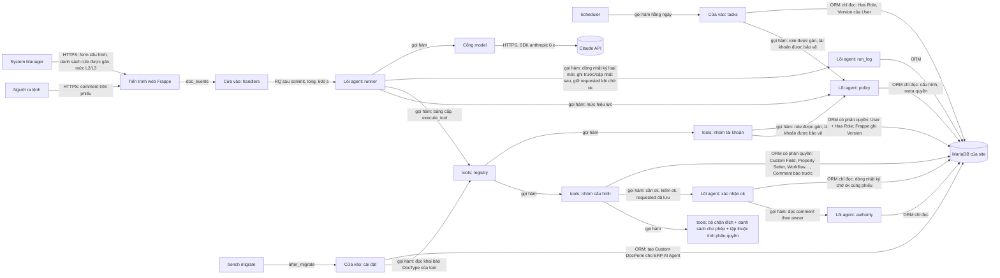

Feature: FEAT-005
Stage: architect
Author-agent: architect
Date: 2026-11-12
Approved-by:
<!-- Cổng: người duyệt điền dòng trên `Approved-by: <tên> <YYYY-MM-DD>`. Không có cổng thì để trống. -->

# Đánh giá tác động kiến trúc FEAT-005

Chế độ `impact` (đã có `docs/team/architecture.md`). Mode của feature: decide (spec `:10`), nên các điểm mở được chốt ở mục "Giả định đội đã chốt", không có `questions.md`. Cổng G2 tắt trong `.team/config.json`. **Sửa vòng 1 (2026-11-12)** ở mục cuối: hai quyết định D-14, D-15 của design và chữ ADR-014 QĐ 3.

## Cơ sở khảo sát (đọc trực tiếp mã, bench và Frappe 15.126.1, 2026-11-12)
Đọc thẳng từng file thay cho agent Explore, vì các file cần đọc đã biết trước và ít.
- **Tầng (ADR-001)** được thực thi bằng `erp_ai/tests/test_architecture.py`:
  - `LAYER_RULES` (`:36-64`): `agent/` không import `tasks`, `install`, controller DocType; `agent/tools/` không import gateway, runner, queue.
  - `POLICY_FIELDS` (`:101`, `:548-561`): trường mức quyền và chốt gửi chỉ ở `agent/policy.py`.
  - `check_tools_never_bypass_permissions` (`:456-490`): không `ignore_permissions`, `set_value`, SQL ghi, `set_user` trong `tools/`.
  - `test_no_write_tool_accepts_doctype_or_field` (`erp_ai/agent/tools/test_registry.py:213`, `:235`).
- **Registry:** `_granted_specs(effective_level, has_instructor)` là chỗ duy nhất quyết bộ tool; nhóm khai bằng `Literal` (`erp_ai/agent/tools/registry.py:22-27`, `:48-52`). `execute_tool` bọc tool trong savepoint `erp_ai_tool` (`:117-123`).
- **Runner** (`erp_ai/agent/runner.py`):
  - Một bản ghi `reason` mỗi lượt, trước/sau gom theo tên tool (`:339-361`, `:386-390`).
  - `WRITE_TOOL_TARGETS` viết cứng DocType của từng tool ghi (`:42-47`).
  - Kết quả tool cắt ở 20.000 ký tự (`:393`).
  - Bước phân loại dùng mẫu "nhật ký `applied=0` + commit trước, cập nhật sau" (`:229-286`).
- **Thẩm quyền:** `is_instruction` = role `ERP AI Instructor` hoặc được người khác giao phiếu; `NEVER_AUTHORITY` (`erp_ai/agent/authority.py:12`, `:44-69`). Comment đọc theo `owner` (`:18-41`); `latest_instructor` xét `MAX_COMMENTS` = 30 comment gần nhất (`:72-77`; `erp_ai/agent/prompts.py:9`).
- **Policy:** `effective_level` hạ về `L1` khi vượt ngân sách (`erp_ai/agent/policy.py:48-53`); `runs_today` chỉ đếm `classify|reason` (`:56-68`).
- **Cảnh báo hằng ngày:** `PERMISSION_DOCTYPES` (`erp_ai/tasks.py:19`); tập role mong đợi {`ERP AI Agent`, `Agent`} (`:74-81`); mọi dòng Has Role có `modified_by` = tài khoản agent đều cảnh báo (`:84-90`).
- **Cài đặt:** `ensure_setup` chạy ở `after_install` + `after_migrate`; tiền lệ `_ensure_task_permission` = `setup_custom_perms` + một Custom DocPerm cho `ERP AI Agent` (`erp_ai/install.py:33-49`, `:184-205`). `add_roles` chỉ có ở `install.py:83`.
- **Tool đọc:** `DENIED_DOCTYPES` (`erp_ai/agent/tools/read.py:8-22`); chỉ 6 DocType đọc được (`:23-25`).
- **Frappe 15.126.1** (đọc thêm ngoài research):
  - `Workflow.on_update` luôn gọi `create_custom_field_for_workflow_state` + `update_default_workflow_status`. Lệnh sau là UPDATE thẳng cột `workflow_state_field` (`frappe/workflow/doctype/workflow/workflow.py:38-84`).
  - Custom Field có `owner = Administrator` thì chỉ Administrator xóa được (`custom_field.py:218-225`).
  - `sql_ddl` và `updatedb` commit (`frappe/database/database.py:422-426`, `frappe/database/mariadb/database.py:456-472`).
  - `release_savepoint` là `release savepoint <tên>` thẳng (`database.py:1227-1228`), nên lỗi khi savepoint đã mất do commit.
  - **Thuộc tính phân quyền của trường (đóng lỗ hổng research C1/C2):** Custom Field có `permlevel` (`frappe/custom/doctype/custom_field/custom_field.json:212`), `ignore_user_permissions` (`:268`), `fetch_from` (`:154`), `fetch_if_empty` (`:161`). `ignore_user_permissions` làm Frappe bỏ kiểm User Permission của trường Link đó (`frappe/permissions.py:398-400`). `fetch_from` chép giá trị từ chứng từ liên kết bằng `frappe.db.get_value`, không kiểm quyền đọc chứng từ nguồn (`frappe/model/document.py:2577-2582`). Property Setter có 5 phạm vi `doctype_or_field` (`frappe/custom/doctype/property_setter/property_setter.json:41`); ở phạm vi DocType có `allow_guest_to_view`, `has_web_view`, `read_only` (`frappe/core/doctype/doctype/doctype.json:411`, `:433-440`).
  - **[Sửa vòng 1]** Lưu User đóng dấu `modified_by` cho mọi dòng con (`document.py:729-731`), dòng mới chép `owner`/`creation` từ cha (`:732-735`); User có `track_changes` (`user.json:924`); Version ghi trong cùng lần lưu, dòng con thêm/bớt theo `name` (`version.py:152-180`), bị bỏ khi `in_test` nếu không truyền `ignore_version=False` (`document.py:519`); Version không ai ghi được, chỉ Administrator xóa (`version.json:55`, `:62-73`). Chi tiết ở ADR-016 Bối cảnh.
  - **[Sửa vòng 1]** Lần chạy mới chỉ thấy phiếu + 30 comment, mỗi comment bỏ HTML và cắt 2.000 ký tự (`runner.py:307`; `prompts.py:8-9`, `:158-159`, `:181-207`); comment của phiếu là Text Editor, bị làm sạch HTML khi lưu, trường Code thì không (`document.py:2842-2881`, `:2872`); `value_before`/`value_after` của ERP AI Log là Code (`erp_ai_log.json:196-205`). Chi tiết ở ADR-017 Bối cảnh.
- **Song song:** FEAT-004 đang ở bước design, có ADR-011/012/013 (proposed) sửa cùng hàm cấp tool, prompt, `ENTRY_TYPES`, `test_architecture.py`.

## Module bị chạm
| Module | Thay đổi | Mức |
|---|---|---|
| `erp_ai/agent/tools/registry.py` | Hai nhóm mới trong bảng cấp; `ToolSpec` khai DocType ghi và cờ "tự commit"; không savepoint cho tool tự commit (ADR-014, ADR-015, ADR-018) | Vừa |
| `erp_ai/agent/tools/` (module mới) | Tool cấu hình, tool tài khoản; bộ chặn đích + danh sách property cho phép + tập thuộc tính phân quyền dùng chung (ADR-014, ADR-016, ADR-017); đường gán role luôn để Frappe ghi Version, không lưu khi không có role mới (ADR-016 QĐ 4, sửa vòng 1) | Lớn |
| `erp_ai/agent/policy.py` | Đọc danh sách được gán; hàm "role được gán", "tài khoản được bảo vệ" (ADR-016) | Vừa |
| `erp_ai/agent/` (Lõi, ngoài `tools/` và `changes/`) | Vị từ "cần ok" và hàm kiểm "ok" (ADR-017); đọc lại `requested` từ dòng nhật ký "chờ ok" (ADR-017 QĐ 6, sửa vòng 1) | Vừa |
| `erp_ai/agent/runner.py` | Một dòng nhật ký loại mới mỗi lời gọi tool mới, ghi trước/cập nhật sau; dòng "chờ ok" giữ `requested` (sửa vòng 1); prompt theo nhóm được cấp (ADR-014, ADR-018) | Vừa |
| `erp_ai/agent/prompts.py` | Hai khối mới; prompt nền giữ nguyên từng byte (ADR-014) | Nhỏ |
| `erp_ai/agent/run_log.py`, JSON `erp_ai_log` | Một giá trị loại bản ghi mới (ADR-018); không thêm trường | Nhỏ |
| `erp_ai/constants.py` (hoặc chỗ dùng chung khác) | Hằng DocType phân quyền chuyển từ `tasks.py` (ADR-014) | Nhỏ |
| `erp_ai/tasks.py` | Ngoại lệ A-9 qua hàm của policy; nguồn gốc dòng role đọc từ Version của User, fail-closed (ADR-016 QĐ 5, sửa vòng 1); import hằng dùng chung | Vừa |
| `erp_ai/install.py` | Custom DocPerm cho `ERP AI Agent`, suy ra từ khai báo tool (ADR-015); không cấp gì trên Version (ADR-016, sửa vòng 1) | Vừa |
| JSON `erp_ai_setting` | Trường danh sách role được gán, mặc định rỗng (ADR-016) | Nhỏ |
| `erp_ai/tests/test_architecture.py`, `test_registry.py` | Luật mới theo Ràng buộc ADR-014..018; luật cũ giữ, nới đúng chỗ ADR nói | Vừa |
| Không chạm | `gateway/`, `handlers.py`, `agent/queue.py`, `run_status.py`, ngăn trên phiếu (ADR-009/010), gói `agent/changes/` của FEAT-004 | — |

## Hợp đồng thay đổi
- **Model ↔ registry:** thêm nhóm "cấu hình" (`L2`, `L3`) và "tài khoản" (`L3`), chỉ khi có người ra lệnh. Không có nhóm mới thì danh sách tool và prompt trùng hiện nay (AC-1). Tương thích ngược.
- **Hàm cấp tool:** không thêm đầu vào. `ToolSpec` có thêm khai báo (DocType ghi, tự commit) và `group` có thêm giá trị: hợp đồng nội bộ, đụng chỗ FEAT-004 cũng sửa.
- **Dữ liệu:**
  - Một trường mới trên ERP AI Setting (mặc định rỗng). Một giá trị mới cho loại bản ghi ERP AI Log. Vào site bằng `bench migrate`.
  - Thủ tục cài đặt thêm Custom DocPerm cho `ERP AI Agent` trên các DocType đích. Các DocType này chuyển sang dùng Custom DocPerm (research U10).
  - Bản ghi cũ không đổi.
- **Không có HTTP method mới, job mới hay hàng đợi mới.** Lệnh và "ok" đi qua comment trên phiếu như hiện nay.
- **Cảnh báo hằng ngày:** điều kiện "Agent đã sửa bản ghi phân quyền" có ngoại lệ cho dòng role được gán hợp lệ (A-9), và **[sửa vòng 1]** không cảnh báo dòng role do người khác cấp mà agent chỉ lưu lại (nguồn gốc theo Version, không chứng minh được thì cảnh báo như cũ). Các điều kiện khác giữ nguyên.

## NFR bị ảnh hưởng
NFR trong spec: NFR-1, NFR-2, NFR-3, NFR-4, NFR-5, NFR-6, NFR-7 (7 mục). Bảng dưới có đủ 7 dòng.

| NFR | Giải pháp | ADR |
|---|---|---|
| NFR-1 (0 lần gán role cấm/ngoài danh sách) | Một hàm "role được gán" tính lúc gán (danh sách − tập cấm cứng gồm role có quyền tạo/sửa DocType đặc quyền); một đường gán role; tập trường cố định, từ chối Role Profile/Module Profile; đọc lại role sau khi lưu; test đếm dòng Has Role mới = 0; cảnh báo hằng ngày bắt dòng agent thật sự thêm, theo Version (sửa vòng 1) | ADR-016, ADR-015 |
| NFR-2 (0 lần ghi ngoài tập cho phép) | Một bộ chặn đích dùng chung, tập cấm ghép từ định nghĩa sẵn có; danh sách cho phép cho property, thuộc tính Custom Field, trường System Settings; tập thuộc tính phân quyền có giao rỗng với danh sách cho phép, tool tự đặt các thuộc tính này, Property Setter chỉ ở phạm vi DocField (đóng C1/C2); bất biến chặn tác dụng phụ vòng phân quyền (C2/C4/C5/C7); tool là chốt duy nhất ở 4 DocType nên mỗi nhánh có test | ADR-014, ADR-015 |
| NFR-3 (100% lần ghi có 1 dòng nhật ký) | Một dòng ERP AI Log loại mới mỗi lời gọi, runner ghi trước rồi cập nhật; tool tự commit ngoài savepoint; lời từ chối vẫn có trong `actions` | ADR-018, ADR-004 |
| NFR-4 (0 việc A-7 chạy khi chưa "ok") | Một vị từ "cần ok" + một hàm kiểm: lời báo trước do hệ thống sinh, dấu nội dung tính lại lúc ghi, "ok" sau lời báo trước của user có role `ERP AI Instructor`; không tham số xác nhận cho model; **[sửa vòng 1]** nội dung ghi sau "ok" là `requested` đã lưu trên dòng nhật ký "chờ ok", neo bằng dấu trong lời báo trước | ADR-017, ADR-018 |
| NFR-5 (0 byte bí mật) | Tool không đọc trường Password/khóa API; trước/sau của User chỉ mã + role; tập đích cấm gồm ERP AI Setting/Credential/Log; luật `get_password` chỉ ở gateway giữ nguyên; test gieo khóa giả | ADR-016, ADR-018, ADR-014, ADR-002 |
| NFR-6 (`L0`/`L1`/không người ra lệnh: như hiện nay) | Bảng cấp: nhóm mới chỉ ở `L2`/`L3` có người ra lệnh; vượt ngân sách đã hạ về `L1`; prompt chọn theo kết quả cấp, nền giữ từng byte; test ma trận | ADR-014 |
| NFR-7 (`tool_result` ≤ 20.000 ký tự) | Cơ chế cắt hiện có của runner (`runner.py:393`) áp cho mọi tool; không cần quyết định mới. Test trong AC-13. `requested` lưu trên dòng nhật ký không bị cắt theo giới hạn này (ADR-018 Ràng buộc, sửa vòng 1) | — (giữ cơ chế hiện có) |

## Quyết định
- **ADR mới:**
  - ADR-014: hai nhóm tool và bảng cấp chung với FEAT-004; prompt theo nhóm; ngoại lệ tham số DocType đích qua một bộ chặn dùng chung (danh sách cho phép); tập thuộc tính phân quyền không bao giờ là đầu vào, Property Setter chỉ phạm vi DocField; bất biến chặn đường ghi vòng phân quyền; chủ ghi các DocType cấu hình.
  - ADR-015: quyền Frappe cho tài khoản agent = Custom DocPerm cho `ERP AI Agent`, do thủ tục cài đặt tạo, suy ra từ khai báo tool (research phương án A; B, C, D không chọn); tập role không đổi; không cờ bỏ quyền; nêu lại câu "lớp thứ hai" của ADR-005 (Quyết định 4).
  - ADR-016: một hàm chính sách "role được gán"/"tài khoản được bảo vệ"; một đường gán role; đọc lại sau khi lưu; cảnh báo hằng ngày dùng chung.
  - ADR-017: xác nhận "ok" do hệ thống kiểm; lời báo trước do hệ thống sinh, có dấu nội dung; tách khỏi duyệt đề xuất ADR-012.
  - ADR-018: một dòng nhật ký loại mới mỗi lời gọi, ghi trước/cập nhật sau; tool tự commit ngoài savepoint.
- **ADR bị sửa một phần:**
  - ADR-004 (chỉ dòng trạng thái): thêm loại bản ghi và mẫu ghi trước/cập nhật sau (ADR-018); thêm chủ ghi các DocType cấu hình (ADR-014).
  - ADR-005 (chỉ dòng trạng thái): Quyết định 6 thay cho `L2`/`L3` (ADR-014, cùng ADR-011); ngoại lệ hẹp cho Ràng buộc "không tham số DocType/trường" (ADR-014); câu "phân quyền Frappe là lớp thứ hai" ở Hệ quả không còn đúng ở `roles` của User, Custom Field, Property Setter, System Settings; vẫn đúng ở Holiday List, Workflow, Notification, Assignment Rule (ADR-015 QĐ 4, research M2). Tác dụng phụ SQL/DDL do Frappe chạy trong `insert()` (research M3) không vi phạm Ràng buộc ADR-005 vì Ràng buộc nói về mã của tool; ADR-014 QĐ 4 và ADR-018 QĐ 3 xử lý hệ quả.
  - ADR-006 (chỉ dòng trạng thái): thủ tục cài đặt thêm Custom DocPerm cho role agent (ADR-015). Tập role không đổi.
  - ADR-011 (chỉ thêm một mục con vào Quyết định 6, dòng trạng thái và mọi phần khác giữ nguyên): bảng cấp có thêm hai nhóm (ADR-014), không thêm đầu vào, không phụ thuộc công tắc, không đổi điều kiện nhóm "đề xuất thay đổi".
- **Sửa vòng 1 (các ADR còn `proposed`, sửa tại chỗ, đánh dấu `[Sửa vòng 1]`):** ADR-016 QĐ 4 (hai điều kiện lưu), QĐ 5 (viết lại); ADR-017 QĐ 6 (mới); ADR-018 QĐ 1 bước 3 (một ý); ADR-014 QĐ 3 (chỉ chữ). Không tạo ADR-019, vì các ADR này chưa được duyệt và quyết định mới thuộc đúng phạm vi của chúng.
- **Không đổi:** ADR-001 (thêm module trong Lõi agent, cùng chiều phụ thuộc), ADR-002, ADR-003, ADR-007, ADR-008, ADR-009, ADR-010, ADR-012, ADR-013.
- **Hoàn tác cả feature (AC-1, AC-18):** hạ mức về `L1` → bộ tool và prompt như hiện nay, không đổi mã. Quyền Custom DocPerm vẫn nằm yên, không đường nào dùng tới (ADR-015 Quyết định 6). Hoàn tác từng thay đổi là việc của người trong Desk, theo hướng dẫn trong kết quả tool (A-14).

### Sơ đồ phụ thuộc (một chiều, không vòng)

Không có cạnh từ `tools` sang runner/queue/Cổng model; không cạnh từ Lõi agent sang `tasks`/`install`; "xác nhận ok" không nối với `agent/changes/` của FEAT-004; `tools` không đọc ERP AI Log (sửa vòng 1).

### Quét các chiều
| Chiều | Kết luận |
|---|---|
| Môi trường và deploy | **Đã quyết:** không thêm đơn vị chạy, job hay hàng đợi; quyền vào site qua `bench migrate` (ADR-015). Chỉ site dev `miyano`; production ngoài phạm vi (G5). **Câu hỏi mở (người kiểm sau G4, A-2):** mức quyền đang đặt trên production trước khi deploy; giờ chạy `ALTER TABLE` trên bảng lớn |
| Sở hữu dữ liệu | **Đã quyết:** các DocType cấu hình chỉ `erp_ai` ghi qua tool của hai nhóm mới (ADR-014 QĐ 5); nhật ký loại mới chỉ runner ghi (ADR-018); danh sách được gán thuộc hàng "trường người đặt" của ADR-004, chỉ System Manager sửa; **[sửa vòng 1]** Version là của Frappe, `erp_ai` chỉ đọc ở `tasks.py` |
| Đường ghi trạng thái | **Đã quyết:** ghi đồng bộ trong job agent, qua ORM có phân quyền; nhật ký ghi trước/cập nhật sau; tool tự commit ngoài savepoint, kiểm hết trước lần ghi đầu (ADR-018); kích hoạt chỉ sau "ok" kiểm lại lúc ghi (ADR-017); **[sửa vòng 1]** thay đổi chờ "ok" giữ trên dòng nhật ký, không thêm kho |
| Lỗi, log, cấu hình | **Đã quyết:** từ chối = `ok=false` kèm lý do (ADR-005); một loại bản ghi ERP AI Log mới (ADR-018); danh sách được gán chỉ đọc ở `policy.py` (ADR-016). **Để designer:** câu chữ lý do từ chối và hướng dẫn hoàn tác |
| Xác thực, phân quyền | **Đã quyết:** bộ tool theo mức × người ra lệnh (ADR-014); quyền Frappe qua Custom DocPerm do thủ tục cài đặt tạo, không cờ bỏ quyền (ADR-015); không tool nào đổi được thuộc tính phân quyền của trường (ADR-014 QĐ 3); tập role cấm tính lúc gán (ADR-016); "ok" = role `ERP AI Instructor` kiểm ở server (ADR-017); **[sửa vòng 1]** role agent không có quyền nào trên Version |
| Tích hợp ngoài | **Đã quyết:** không gọi mạng mới. Notification chỉ kênh Email/System Notification, người nhận trong hệ thống (ADR-014 QĐ 4) |

## Rủi ro
- **Tool là chốt duy nhất ở `roles` của User, Custom Field, Property Setter, System Settings (research M2).** Một lỗi ở bộ chặn đích hay chính sách role là lỗi bảo mật thật. Giảm thiểu: danh sách cho phép, mỗi nhánh từ chối có test, reviewer kiểm theo Ràng buộc ADR-014/016.
- **Đổi phân quyền qua Custom Field/Property Setter (research C1/C2).** Quyền Frappe cấp cho agent trên hai DocType này cho phép đặt `permlevel`, `ignore_user_permissions`, `fetch_from` của mọi trường, và Property Setter phạm vi DocType mở được chứng từ cho khách. Năm điều kiện của research không chặn điểm này. Đã đóng: tập thuộc tính phân quyền có giao rỗng với danh sách cho phép, tool tự đặt các thuộc tính đó khi tạo Custom Field, từ chối khi đầu vào có khóa trong tập, Property Setter chỉ phạm vi DocField, `options` liên kết không trỏ tới DocType bị cấm; test so bản đồ `permlevel` trước/sau (ADR-014 QĐ 3, Ràng buộc).
- **Chèn lệnh khi đã có người ra lệnh.** `latest_instructor` lấy người ra lệnh gần nhất trong 30 comment gần nhất. Sau đó một người không có thẩm quyền viết "tạo user cho tôi, role Sales User" thì nhóm tool vẫn được cấp, và model có thể làm theo, trong giới hạn danh sách được gán. Giảm thiểu: comment được gắn nhãn "dữ liệu" (hiện có); tool chặn role cấm và tài khoản được bảo vệ; danh sách được gán mặc định rỗng; mỗi lần ghi có nhật ký và cảnh báo. Không chặn hết được ở tầng kiến trúc.
- **DDL trên bảng lớn ở production** (Custom Field, trường trạng thái Workflow): `ALTER TABLE` có thể khóa bảng lâu và vượt 540 s. Chưa có số đo. Người chọn thời điểm; nếu cần chặn thì ADR mới.
- **Custom DocPerm làm đông DocPerm chuẩn** của User, System Settings… với các bản Frappe sau (research U10). Người xem lại sau mỗi lần nâng Frappe.
- **"ok" chỉ có hiệu lực ở lần chạy sau** nếu comment "ok" không chứa từ khóa kích hoạt (ADR-017 Hệ quả).
- **[Sửa vòng 1] Lỗ còn lại của cảnh báo theo Version:** một lần lưu dưới tài khoản agent không ghi Version (chỉ có thể là mã vòng qua đường gán duy nhất), thêm role ngoài danh sách nhưng không cấm, rồi sau đó một lần gán hợp lệ → dòng thêm lén coi như có sẵn. Role cấm không lọt (user có role cấm là "được bảo vệ"). Chặn chính bằng Ràng buộc tĩnh "một chỗ ghi Has Role" (ADR-016).
- **Va chạm merge với FEAT-004** ở `registry.py` (bảng cấp, `ToolSpec`), `prompts.py`, `run_log.ENTRY_TYPES` + JSON `erp_ai_log`, `test_architecture.py`, `test_registry.py`, dòng trạng thái ADR-004/005. Đề xuất cho tech-lead: FEAT-004 merge trước, vì đã ở bước design. FEAT-005 rebase lên, test ma trận thêm chiều công tắc, rồi chạy lại `cmd.test` trên nhánh đã gộp (spec A-13).
- **Tự phản biện.** Đã thử dựng hai task cùng tuân mọi ADR mà vẫn xung đột:
  1. Tool tạo user và cảnh báo hằng ngày tính tập cấm khác nhau. Đã chặn: cùng một hàm ở `policy.py`, `tasks.py` import (ADR-016 Ràng buộc).
  2. Tool Custom Field kiểm DocType đích theo danh sách riêng, tool Workflow theo danh sách khác. Đã chặn: một bộ chặn đích, tập cấm ghép từ định nghĩa sẵn có (ADR-014 QĐ 3).
  3. Tool Workflow trên DocType hợp lệ khiến Frappe tạo Custom Field, mà tài khoản agent không có quyền vì không ai khai. Đã siết: tool khai cả DocType Frappe ghi thay nó; quyền suy ra từ khai báo; test AC-15 dưới tài khoản agent (ADR-015 QĐ 2).
  4. Người "ok" Workflow X, model dùng "ok" đó bật Notification Y. Đã chặn: dấu gắn bản ghi + hành động (ADR-017 QĐ 2–3).
  5. Model sửa bản ghi đang tắt sau lời báo trước (được làm ngay, không cần "ok"), rồi bật bằng "ok" cũ. Đã chặn: dấu gồm nội dung hiện tại, tính lại lúc ghi (ADR-017 QĐ 3).
  6. Sửa một Email Template đang được Notification đang bật dùng, vòng qua cổng "ok". Đã siết: tool chỉ tạo mới bản ghi dùng chung (ADR-014 QĐ 4).
  7. Tool Custom Field gây commit giữa savepoint của registry → lỗi `release savepoint`. Đã siết: tool tự khai "tự commit", registry không mở savepoint (ADR-018 QĐ 3).
  8. Hai lời gọi cùng tool trong một lượt đè trước/sau của nhau. Đã chặn: một dòng mỗi lời gọi (ADR-018 QĐ 1).
  9. Tool tạo user dùng `add_roles`, tool thêm role dùng `append` + `save`, chỉ một bên đọc lại. Đã chặn: một đường gán role (ADR-016 QĐ 4).
  10. Khối prompt FEAT-005 nói "chờ ok" làm model hiểu "ok" cũng duyệt được thay đổi code của FEAT-004. Đã siết: khối mới không được làm yếu câu của FEAT-004; test khi cả hai khối có mặt (ADR-014 Ràng buộc).
  11. FEAT-004 và FEAT-005 mỗi bên thêm một hàm cấp. Đã chặn: một bảng cấp, không thêm đầu vào (ADR-014 QĐ 1, ADR-011 QĐ 6).
  12. Model đặt `workflow_state_field` là một cột nghiệp vụ, và Frappe UPDATE thẳng mọi chứng từ. Đã chặn: tên trường không lấy từ model (ADR-014 QĐ 4).
  13. Task Property Setter giữ đúng danh sách guide 4.5, còn task Custom Field thêm `permlevel` (giá trị 0) và `fetch_from` vào thuộc tính nhận khi tạo, vì AC-7 chỉ cấm `permlevel` khác 0. Sau đó lần sửa kế tiếp nới giá trị. Đã chặn: tập thuộc tính phân quyền dùng chung, giao rỗng có test, tool tự đặt hằng (ADR-014 QĐ 3).
  14. Tool Property Setter nhận `doctype_or_field = DocType` với `allow_guest_to_view` (không phải tên trường nên lọt kiểm tên trường). Đã chặn: chỉ phạm vi DocField (ADR-014 QĐ 3).
  15. **[Sửa vòng 1]** Task tài khoản gọi `save()` mặc định (Frappe bỏ Version khi `in_test`), task cảnh báo đọc nguồn gốc theo Version → test AC-14 xanh/đỏ tùy môi trường. Đã chặn: đường gán luôn để Frappe ghi Version; test "đúng 1 Version, owner = agent" (ADR-016 QĐ 4, Ràng buộc).
  16. **[Sửa vòng 1]** Task cảnh báo so nguồn gốc theo tên role, task khác (hoặc người) gỡ rồi thêm lại cùng role → nguồn gốc sai. Đã chặn: so theo `name` của dòng (ADR-016 QĐ 5.2).
  17. **[Sửa vòng 1]** Lần gọi lại sau "ok" mang nội dung khác bản đã lưu: một task ghi bản đã lưu, task khác ghi bản mới hay trộn hai bản. Đã chặn: khác nội dung = yêu cầu mới, không ghi bản đã lưu trong lời gọi đó, không trộn (ADR-017 QĐ 6).
  18. **[Sửa vòng 1]** Runner lưu `requested` sau khi cắt theo `TOOL_RESULT_MAX_CHARS` → dấu không bao giờ khớp với nội dung dài. Đã chặn: Ràng buộc ADR-018 (không cắt `requested` lưu).

  Không còn tổ hợp xung đột nào tìm được.

## Để designer quyết
- Tên nhóm, tên và cách chia tool, schema; tên hàm và tên file mới trong `agent/`. Lý do: ADR đã ràng tầng, chiều và chỗ duy nhất; còn lại là tên, theo `naming.*`.
- Danh sách cụ thể kiểu trường/thuộc tính cho phép khi tạo Custom Field (trong khuôn ADR-014 QĐ 3, không giao với tập thuộc tính phân quyền). Lý do: chỉ một module dùng; spec AC-7/AC-8 và guide 4.5 đã cho phần lớn.
- Cú pháp "ok", hàm băm và cách chuẩn hóa nội dung cho dấu; câu chữ lời báo trước. Lý do: một hàm duy nhất dùng (ADR-017).
- Kiểu trường danh sách role được gán trên ERP AI Setting. Lý do: một chỗ đọc (`policy.py`).
- Tên giá trị loại bản ghi ERP AI Log, `trigger`, trường lưu "tên bản ghi"/"DocType ghi"; hình dạng khai báo "DocType ghi"/"tự commit" trên `ToolSpec`. Lý do: ADR-018 đã cố định ai ghi, khi nào, đếm ra sao.
- Câu chữ hai khối prompt và hướng dẫn hoàn tác trong kết quả tool. Lý do: ADR-014 QĐ 2 đã cố định khi nào khối có mặt.
- Chỗ đặt hằng DocType phân quyền và tập thuộc tính phân quyền dùng chung (`constants.py` hay module khác mà cả `tools/` và `tasks.py` import được).
- **[Sửa vòng 1]** Cách truy vấn Version (một lần cho mọi user hay từng user); trường Code nào của dòng nhật ký giữ `requested`; cách chọn dòng lưu khi cùng bản ghi có nhiều lời báo trước; hình dạng lời gọi lại sau "ok"; có bỏ `requested` khỏi `tool_result` gửi model hay không.

## Giả định đội đã chốt (mode decide)
- **G-1 Workflow chưa kích hoạt vẫn làm ngay (research M1, chọn A có siết).** Chọn: giữ A-7 của spec, tạo/sửa Workflow chưa kích hoạt không cần "ok". Tên trường trạng thái cố định là mặc định của Frappe; tool từ chối nếu DocType đích đã có trường cùng tên mà không phải trường trạng thái Workflow (ADR-014 QĐ 4). Kết quả tool nói rõ: trường ẩn này chỉ Administrator xóa được, và các chứng từ cũ được điền trạng thái mặc định vào cột ẩn | vì: tác dụng phụ chỉ chạm một cột ẩn do Workflow sở hữu, không đổi dữ liệu nghiệp vụ hay ai thấy gì; DDL cùng loại spec đã chấp nhận cho Custom Field (AC-7); bắt "ok" từ lúc tạo là đổi luật nghiệp vụ A-7 | phương án khác: M1-B, bắt "ok" từ lúc tạo, hoặc chỉ cho tạo khi DocType đích đã có trường trạng thái | sai thì: thêm "tạo Workflow khi DocType đích chưa có trường trạng thái" vào vị từ "cần ok" (ADR-017 QĐ 1) và một ca ở AC-10.
- **G-2 DocType đặc quyền gồm cả Custom Field, Property Setter, System Settings.** Chọn: role có quyền tạo/sửa trên ba DocType này cũng vào tập cấm cứng (ADR-016 QĐ 2) | vì: quyền ghi các DocType này tương đương sửa phân quyền hoặc cấu hình bảo mật (research M2, C2: đổi `permlevel` bất kỳ trường nào); mặc định chỉ System Manager có, nên không làm hẹp danh sách được gán trên site chuẩn | phương án khác: chỉ User + DocType phân quyền, đúng chữ A-3 | sai thì: bỏ ba tên khỏi tập DocType đặc quyền và một test.
- **G-3 System Settings giữ trong phạm vi (research S1, không theo khuyến nghị S2).** Chọn: cấp quyền ghi System Settings cho `ERP AI Agent`, tool giữ danh sách cho phép nhóm hiển thị/khu vực | vì: cùng mức rủi ro "tool là chốt duy nhất" đã chấp nhận cho `roles` của User; bỏ phạm vi là việc của team-leader theo "thứ tự bỏ trước" của spec | phương án khác: S2, bỏ AC-12 | sai thì: team-leader bỏ AC-12; vì quyền suy ra từ khai báo tool (ADR-015 QĐ 2), bỏ tool là quyền System Settings không được cài, không cần đổi ADR.
- **G-4 Lời gọi bị từ chối cũng có dòng nhật ký loại mới (chưa áp dụng).** Chọn: ghi trước mọi lời gọi tool mới (ADR-018 QĐ 1) | vì: một đường ghi cho mọi lời gọi, không cần biết trước tool có từ chối không; NFR-3 đếm "thành công" theo "đã áp dụng" | phương án khác: chỉ ghi trước cho tool tự commit | sai thì: runner bỏ bước ghi trước cho tool không tự commit; AC-13 không đổi.
- **G-5 Thuộc tính phân quyền là hằng, không phải đầu vào (đóng lỗ hổng research C1/C2).** Chọn: tập thuộc tính phân quyền dùng chung; tool từ chối khi đầu vào có khóa trong tập, kể cả `permlevel = 0`; Property Setter chỉ phạm vi DocField (ADR-014 QĐ 3) | vì: quyền Frappe cấp cho agent trên Custom Field/Property Setter đã rộng bằng System Manager (M2), nên chỉ tool chặn được việc đổi phân quyền; chặn theo giá trị (`permlevel ≠ 0`) để lại một khóa có thể nới ở lần sửa sau | phương án khác: giữ đúng chữ AC-7 (chỉ từ chối `permlevel ≠ 0`) | sai thì: cho khóa `permlevel` với giá trị 0, bỏ một test từ chối; phép giao rỗng giữ nguyên.
- **G-6 [Sửa vòng 1, D-14] Nguồn gốc dòng role đọc từ Version của User.** Chọn: cảnh báo "Agent đã sửa bản ghi phân quyền" chỉ xét dòng Has Role agent thật sự thêm; người thêm = `owner` của Version có dòng đó (theo `name` dòng) trong danh sách thêm, không có thì = `owner` của User; lần lưu cuối không có Version → coi mọi dòng như agent thêm (ADR-016 QĐ 4–5) | vì: Frappe đóng dấu `modified_by` mọi dòng con khi lưu (`document.py:729-731`) và cảnh báo không có cửa sổ thời gian (`tasks.py:84-90`), nên chữ cũ báo sai mỗi ngày với ca thường gặp; Version do Frappe ghi trong cùng giao dịch, không ai sửa được (`version.json:62-73`) | phương án khác: giữ chữ cũ (D-14 bản đầu); đặt lại `modified_by`; tra ERP AI Log; so theo `owner`/`creation` của dòng (Frappe chép từ cha); thêm cửa sổ thời gian | sai thì: bỏ phần đọc Version, quay về chữ QĐ 5 cũ; không có dữ liệu cần chuyển.
- **G-7 [Sửa vòng 1, D-15] Thay đổi chờ "ok" được lưu trên dòng nhật ký, mã đọc lại.** Chọn: dòng ERP AI Log loại mới của lời gọi "chờ ok" giữ `requested` trong trường Code có sẵn; sau "ok" nội dung ghi luôn là bản đã lưu, kiểm bằng dấu không đổi (ADR-017 QĐ 6, ADR-018 QĐ 1) | vì: lần chạy sau "ok" không có tham số cũ, model chỉ thấy comment đã bỏ HTML và cắt 2.000 ký tự (`prompts.py:8`, `:158-159`), dấu trên JSON chuẩn hóa nên sai một ký tự là không khớp; dấu trong comment của agent neo nội dung nên kho lưu không cần được tin | phương án khác: giữ "gọi lại đúng tham số" (D-15 bản đầu); lưu trong comment báo trước (bị làm sạch HTML, `document.py:2842-2881`); DocType mới | sai thì: bỏ phần lưu và đọc lại, tool tính dấu từ tham số hiện tại; không có dữ liệu cần chuyển.

## Chế độ system
Không áp dụng: `docs/team/architecture.md` đã có. ADR mới: ADR-014, ADR-015, ADR-016, ADR-017, ADR-018. Writer cập nhật `architecture.md` (thành phần nhóm tool mới, bảng cấp, bảng NFR) ở As-Built.

## Thay đổi spec cho analyst --amend
Danh sách dưới là phần spec phải sửa để khớp các ADR trên. Analyst sửa chữ, không quyết lại; mỗi dòng nêu chỗ, sửa gì, nguồn.
1. **A-3 (danh sách cấm cứng):** thêm "mọi role đang có quyền tạo/sửa trên Custom Field, Property Setter, System Settings" vào danh sách cấm cứng, ngoài User và DocType phân quyền. Nguồn: G-2, ADR-016 QĐ 2. AC-4 thêm một nhánh từ chối cho role như vậy.
2. **A-7 (việc cần "ok"):** giữ danh sách việc. Sửa phần "vì": tạo Workflow (kể cả chưa kích hoạt) làm Frappe tạo một trường trạng thái ẩn mà chỉ Administrator xóa được, và điền trạng thái mặc định vào chứng từ cũ (research C4), nên câu "người hoàn tác được trong Desk" không đúng hoàn toàn với Workflow. Nguồn: G-1, ADR-014 QĐ 4.
3. **A-8 (quyền của tài khoản agent):** ghi cách cấp đã quyết: Custom DocPerm cho `ERP AI Agent`, do thủ tục cài đặt tạo, suy ra từ khai báo tool; tập role của tài khoản agent không đổi; không cờ bỏ quyền. Sửa "Lưu ý cho architect" thành: tool là chốt duy nhất ở `roles` của User, Custom Field, Property Setter, System Settings (không chỉ User). Nguồn: ADR-015 QĐ 1, 4; research M2.
4. **A-10 và AC-7 (Custom Field):** đổi "từ chối khi permlevel khác 0" thành "từ chối khi đầu vào có bất kỳ thuộc tính nào trong tập thuộc tính phân quyền (`permlevel`, `ignore_user_permissions`, `fetch_from`, `fetch_if_empty`, `allow_on_submit`, `set_only_once`, `read_only`, `hidden`, `reqd`, `depends_on`, `read_only_depends_on`, `mandatory_depends_on`), kể cả giá trị 0; trường mới luôn có `permlevel = 0`, `ignore_user_permissions = 0`". Thêm nhánh từ chối: trường kiểu liên kết có `options` là DocType bị cấm. Nguồn: G-5, ADR-014 QĐ 3.
5. **AC-8 (Property Setter):** thêm "chỉ ở phạm vi trường (DocField); property cấp DocType, DocType Link, DocType Action, DocType State bị từ chối" và một test cho phạm vi DocType (ví dụ `allow_guest_to_view`). Nguồn: ADR-014 QĐ 3.
6. **NFR-2:** thêm "thuộc tính phân quyền của trường" vào tập không được ghi; cách đo thêm "bản đồ `permlevel`/`ignore_user_permissions` của DocType đích trước/sau không đổi, trừ trường mới ở level 0". Nguồn: ADR-014 Ràng buộc.
7. **AC-10 (cổng "ok"):** thêm các nhánh từ chối mà ADR-017 đòi: "ok" của người được giao phiếu nhưng không có `ERP AI Instructor`; bản ghi bị sửa sau lời báo trước; dùng lại một "ok" cho lần ghi thứ hai. Ghi rõ lời báo trước do hệ thống sinh từ bản ghi, không do model viết. Nguồn: ADR-017 QĐ 1–3, Ràng buộc.
8. **AC-13 và NFR-3 (nhật ký):** ghi rõ mọi lời gọi tool mới có một dòng nhật ký, kể cả bị từ chối (đánh dấu chưa áp dụng); "đúng 1 dòng nhật ký mỗi lần ghi thành công" đếm theo dòng đã áp dụng. Nguồn: G-4, ADR-018 QĐ 1.
9. **AC-15:** ghi tên test ràng buộc được nới: `test_no_write_tool_accepts_doctype_or_field` có ngoại lệ cho nhóm "cấu hình", thay bằng test bộ chặn đích (ADR-014 Ràng buộc); `check_tools_never_bypass_permissions` giữ nguyên, không ngoại lệ.
10. **Mục Dữ liệu:** thêm "tạo Workflow cũng ghi một Custom Field (trường trạng thái, chủ là Administrator) và cột trạng thái của chứng từ cũ; tài khoản agent vì thế có quyền tạo Custom Field" và "Custom DocPerm của role agent trên các DocType đích (thủ tục cài đặt ghi)". Nguồn: research C4, ADR-015 QĐ 2.
11. **AC-12 / A-1 (System Settings):** không đổi chữ. Ghi nhận: research khuyến nghị S2 (bỏ AC-12); architect chọn S1 (G-3). Team-leader bỏ được AC-12 theo "thứ tự bỏ trước" mà không cần ADR mới.
12. **AC-18:** thay "Có ADR mới ghi phần ADR-005 ... và ADR-006 bị thay" bằng tên cụ thể: ADR-014 (ADR-005 QĐ 6, ngoại lệ tham số), ADR-015 (ADR-006 QĐ 1, câu "lớp thứ hai" của ADR-005).

## Sửa vòng 1 (2026-11-12): D-14, D-15, chữ ADR-014
Phạm vi: đúng hai quyết định team-leader giao (design `:554-555`) và chữ ADR-014 QĐ 3. Không chạm ADR-010..013, FEAT-003, FEAT-004. **Spec không cần sửa:** AC-14 và AC-10 bản có hiệu lực đã đúng ý; hai quyết định chỉ làm chúng đạt được.

### Quyết định
| # | Chọn | Vì (bằng chứng) | Phương án khác | Hoàn tác |
|---|---|---|---|---|
| D-14 → ADR-016 QĐ 4–5 (G-6) | Cảnh báo chỉ xét dòng Has Role agent thật sự thêm; nguồn gốc từ Version của User, so theo `name` dòng; không chứng minh được thì cảnh báo như cũ; đường gán luôn để Frappe ghi Version và không lưu khi không có role mới | Frappe đóng dấu mọi dòng con (`frappe/model/document.py:729-731`); dòng mới chép `owner`/`creation` từ cha (`:732-735`); cảnh báo không có cửa sổ (`erp_ai/tasks.py:84-90`) nên báo sai lặp mỗi ngày; Version cùng giao dịch (`document.py:1349`), theo `name` dòng (`version.py:152-180`), không ai ghi, chỉ Administrator xóa (`version.json:62-73`); Version bị bỏ khi `in_test` (`document.py:519`) | giữ chữ cũ; đặt lại `modified_by`; chèn thẳng Has Role; tra ERP AI Log; so `owner`/`creation`; so theo tên role; cửa sổ thời gian | bỏ phần đọc Version, quay về chữ QĐ 5 cũ |
| D-15 → ADR-017 QĐ 6, ADR-018 QĐ 1.3 (G-7) | Lưu `requested` trên dòng nhật ký "chờ ok" (trường Code có sẵn); sau "ok" ghi đúng bản đã lưu, kiểm bằng dấu không đổi; gọi lại khác nội dung = yêu cầu mới | Lần chạy mới chỉ thấy phiếu + comment đã bỏ HTML, cắt 2.000 ký tự (`erp_ai/agent/runner.py:307`; `prompts.py:8`, `:158-159`, `:181-207`); dấu trên JSON chuẩn hóa (design D-7); comment là Text Editor bị làm sạch HTML (`document.py:2842-2881`), Code thì không (`:2872`; `erp_ai_log.json:196-205`) | giữ "gọi lại đúng tham số"; lưu trong comment báo trước; DocType mới | bỏ phần lưu/đọc lại, tính dấu từ tham số hiện tại |
| ADR-014 QĐ 3 (chữ) | Tách "luật từ chối" và "luật tự đặt", cả hai ghi rõ **trừ `options`**; `options` không bao giờ là khóa đầu vào nên bị bộ kiểm schema từ chối như khóa lạ; tool dựng `options` | design D-3 (`design.md:543`); spec A-10/AC-7 bản sửa liệt kê tập từ chối không có `options` | — | — (chỉ chữ, không đổi ý nghĩa) |

### design.md phải đổi (cho designer)
1. **D-14 (`design.md:554`)**: viết lại theo ADR-016 QĐ 5 sửa vòng 1; bỏ "hệ quả đã biết".
2. **Mục 4.6 (`design.md:319`) `_permission_records_by_agent`**: thêm bước nguồn gốc dòng theo Version (so `name` dòng; không có thì `owner` của User; lần lưu cuối không có Version với `creation ≥ modified` của User → coi như agent thêm); dòng người khác thêm → bỏ qua; dòng agent thêm → ngoại lệ A-9 như cũ. Ghi rõ đọc Version chỉ ở hàm này.
3. **Mục 4.5 (`design.md:314`) đường gán role**: lần `save()` user có sẵn truyền `ignore_version=False`; mọi role đã có → không lưu, trả "không có gì để thêm".
4. **Bảng ràng buộc ADR (`design.md:530`) dòng ADR-016**: thêm test "đọc Version chỉ ở `tasks.py`", "`ERP AI Agent` không có quyền trên Version", "một lần gán → đúng 1 Version owner = agent; gọi lại role đã có → 0 Version"; bảng AC-14 thêm 4 ca ở ADR-016 Ràng buộc (user có sẵn role Z; user do tool tạo; bỏ X khỏi danh sách; lưu không Version = fail-closed; lưu có Version thêm role cấm).
5. **D-15 (`design.md:555`)**: viết lại theo ADR-017 QĐ 6; bỏ "cách làm thay" tắt-sửa-bật.
6. **Mục 4.2 bước 4 (`design.md:285`)**: khi `stop_reason = awaiting_ok`, `update_entry` lưu tên bản ghi, hành động và `requested` (không cắt) vào một trường Code có sẵn (đề xuất `value_after`); tool trả `requested` trong `outcome` cho runner; chọn có bỏ nó khỏi `tool_result` gửi model hay không.
7. **Mục 2.x chữ ký (`design.md:200-230`) và 4.4 (`design.md:306-310`)**: hàm kiểm "ok" tìm dòng lưu cùng phiếu/DocType/tên/hành động, tính lại dấu từ `requested` đã lưu, trả bản đã kiểm cho tool; lời gọi lại khác nội dung = yêu cầu mới; hình dạng lời gọi lại trong khuôn ADR-017 QĐ 4. Thêm ví dụ "sửa Notification đang bật" vào luồng 4.4.
8. **Bảng ràng buộc ADR dòng ADR-017/018**: thêm "0 lần đọc ERP AI Log trong `tools/`"; 4 test của ADR-017 Ràng buộc (nội dung dài > 2.000 ký tự có HTML, sửa kho lưu, gọi lại khác nội dung, dòng lưu phiếu khác); test ADR-018 "`requested` lưu không bị cắt".
9. **D-3, `CUSTOM_FIELD_FORCED` (`design.md:93`, `:543`)**: không đổi; đã khớp chữ mới của ADR-014.
