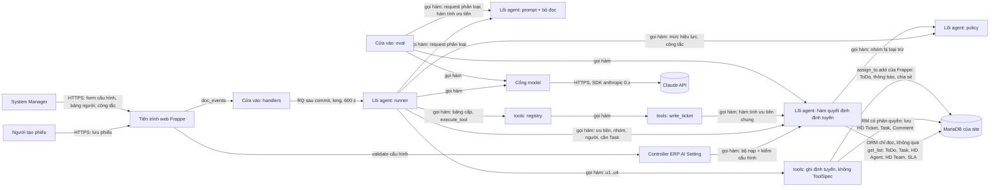

Feature: FEAT-006
Stage: architect
Author-agent: architect
Date: 2026-11-12
Approved-by:
<!-- Cổng: người duyệt điền dòng trên `Approved-by: <tên> <YYYY-MM-DD>`. Không có cổng thì để trống. -->

# Đánh giá tác động kiến trúc FEAT-006

Chế độ `impact` (đã có `docs/team/architecture.md`). Mode của feature: decide (intake), G2 tắt trong `.team/config.json`, nên các điểm mở được chốt ở mục "Giả định đội đã chốt". Không quyết định nào dựa vào giá trị dữ liệu site trong `research-site.md`; các giá trị đó chỉ được ghi thành đầu vào cho designer.

## Cơ sở khảo sát (đọc trực tiếp mã, bench và Frappe 15.126.1 / Helpdesk 15.1.0, 2026-11-12)
Đọc thẳng từng file thay cho agent Explore, vì các file cần đọc đã biết trước và ít (cùng cách làm của FEAT-005).
- **Runner** (`erp_ai/agent/runner.py`): bước phân loại chỉ khi `ticket_insert`, ở mọi mức (`:127-133`); ghi bản ghi `classify` `applied=0` + commit trước, rồi `execute_tool("set_classification")` trong savepoint `erp_ai_apply`, rồi cập nhật `actions`/trước/sau của cùng bản ghi (`:228-286`); `ToolContext` dựng một lần, không dựng ở `L0` (`:116-126`); `CLASSIFY_MAX_TOKENS = 400` (`:32`).
- **Registry** (`erp_ai/agent/tools/registry.py`): `ToolContext` frozen (`:12-19`); `ToolSpec.group` `Literal` 3 giá trị (`:22-27`); `TOOL_MODULES` (`:30-34`); `_granted_specs(level, has_instructor)` là chỗ cấp duy nhất (`:48-52`); `execute_tool` chỉ chạy tên đã cấp (`:109-124`).
- **Tool ghi** (`erp_ai/agent/tools/write_ticket.py`): `set_classification` lấy giá trị từ ánh xạ qua `resolve_ticket_values`, từ chối khi người đã phân loại, `doc.save()` (`:24-57`); `create_task` từ chối khi không có người ra lệnh, liên kết phiếu chỉ trong `description` (`:86-108`).
- **Phân loại** (`erp_ai/agent/classification.py`): `parse_classification` bỏ cả kết quả khi `dau_muc`/`do_tin_cay` sai (`:53-76`); `resolve_ticket_values` = ánh xạ + `[GẤP]` (`:116-122`); `validate_mapping` dùng ở controller ERP AI Setting (`erp_ai/erp_ai_agent/doctype/erp_ai_setting/erp_ai_setting.py:5`).
- **Prompt** (`erp_ai/agent/prompts.py`): JSON phân loại (`:56-66`); `ROUTING_TABLE` viết cứng tên người và SLA của 16.2 (`:135-145`); `build_classify_request` dùng chung với eval (`:166-171`).
- **Policy** (`erp_ai/agent/policy.py`): chỉ chỗ này đọc `permission_level`, `excluded_teams`, `ai_opt_out`; chuẩn hóa tên nhóm `_normalize` (`:17-38`, `:48-53`).
- **Luật kiến trúc** (`erp_ai/tests/test_architecture.py`): `LAYER_RULES` (`:39-80`); `POLICY_FIELDS` (`:104`); `check_tools_never_bypass_permissions` cấm `ignore_permissions`, `db.set_value`, SQL ghi, `set_user`, và **`get_all` (bắt `get_list`)** trong `agent/tools/**` (`:567-601`).
- **Cài đặt** (`erp_ai/install.py`): `ensure_setup` ở `after_install` + `after_migrate` (`:33-49`); `_ensure_task_permission` = `setup_custom_perms("Task")` + một Custom DocPerm (`ERP AI Agent`, 0, read/write/create, `if_owner=1`, **không `share`**), bỏ qua nếu đã có dòng (`:184-205`). Vậy R1 đúng, R2 (`research-site.md:75-76`) sai về quyền tạo Task.
- **Frappe 15.126.1** (đọc thêm ngoài research):
  - `assign_to._add`: kiểm `read` của người gọi (`frappe/desk/form/assign_to.py:85-86`), tạo ToDo bỏ quyền (`:99-114`), người được giao không đọc được → `add_docshare` (`:121-134`); `add_docshare` kiểm quyền **`share`** của người gọi (`frappe/share.py:58-86`, `:247-256`).
- **Quyền chuẩn** (JSON DocType): HD Ticket — `Agent` có `share=1` (`helpdesk/helpdesk/helpdesk/doctype/hd_ticket/hd_ticket.json:539-540`); HD Service Level Agreement — chỉ `System Manager`, `Agent Manager` (`hd_service_level_agreement.json:208-221`); Task — chỉ `Projects User` (`erpnext/erpnext/projects/doctype/task/task.json:426-427`).
- **Song song:** FEAT-003 planned (đang build), FEAT-004 planned, FEAT-005 designed. Cả ba nhánh FEAT-004/005 sửa `registry.py`, `prompts.py`, `runner.py`, `run_log.ENTRY_TYPES`, `install.py`, `test_architecture.py`, `test_registry.py` (FEAT-004 `arch-impact.md:40-44`, `:141`; FEAT-005 `arch-impact.md:43-54`, `:147`).

## Module bị chạm
| Module | Thay đổi | Mức |
|---|---|---|
| `erp_ai/agent/prompts.py` | JSON phân loại có 3 khóa điểm/lý do chấm (ADR-019 QĐ 1); phần routing của prompt suy luận dựng từ cấu hình, không còn tên người viết cứng (AC-14) | Vừa |
| `erp_ai/agent/classification.py` (hoặc module mới trong Lõi agent) | Bộ đọc điểm (sai → "không có điểm"); một hàm thuần R1–R5 + chọn nhóm/người; bộ nạp + kiểm cấu hình mới (ADR-019 QĐ 1, 3, 4, 6) | Vừa |
| `erp_ai/agent/` (Lõi, ngoài `tools/`) | Phép đọc hệ thống chỉ-đọc: vị từ "đã có người", "đã có Task", HD Agent đang hoạt động, SLA đang áp + thời hạn (ADR-019 QĐ 3, 5; ADR-021 QĐ 4) | Vừa |
| `erp_ai/agent/policy.py` | Đọc công tắc tự gán; hàm "nhóm bị loại trừ" dùng chung chuẩn hóa (ADR-019 QĐ 6) | Nhỏ |
| `erp_ai/agent/tools/` (module mới, **không** `ToolSpec`) | Các đơn vị ghi (u1)–(u4) của bước định tuyến (ADR-019 QĐ 2–3, ADR-020) | Vừa |
| `erp_ai/agent/tools/write_ticket.py` | `set_classification` dùng hàm tính ưu tiên chung, schema không đổi; `create_task` đặt tham chiếu Task → phiếu (ADR-019 QĐ 4–5) | Nhỏ |
| `erp_ai/agent/runner.py` | Bước định tuyến sau bản ghi `classify` ở `L1`+, nhật ký vào bản ghi `classify`; lấy bool công tắc từ policy (ADR-019 QĐ 2, 6, 7) | Vừa |
| `erp_ai/install.py` | 2 trường điểm + trường lý do trên HD Ticket (permlevel 8, Int default 0); Custom Field Link HD Ticket trên Task; bật `share` trên dòng Task của app (ADR-020 QĐ 5, ADR-021 QĐ 2, 5) | Vừa |
| JSON `erp_ai_setting` + controller | Các bảng cấu hình và công tắc (mặc định tắt); `validate` gọi bộ kiểm chung (AC-4) | Vừa |
| `erp_ai/eval/` | Chỉ số khớp ưu tiên/nhóm, phân bố điểm; dùng chung request + hàm tính ưu tiên (AC-15) | Nhỏ |
| `erp_ai/tests/test_architecture.py`, `test_registry.py`, `test_install.py` | Luật mới theo Ràng buộc ADR-019..021; luật cũ giữ nguyên | Vừa |
| Không chạm | `gateway/`, `handlers.py`, `agent/queue.py`, `run_status.py`, `run_log.ENTRY_TYPES`, hàm cấp tool và bảng cấp, ngăn trên phiếu (ADR-009/010), gói `agent/changes/` của FEAT-004, tool cấu hình/tài khoản của FEAT-005 | — |

## Hợp đồng thay đổi
- **Model ↔ registry:** không đổi. Không tool mới cho model, bảng cấp không đổi, schema `set_classification`/`create_task` không đổi (AC-9).
- **Prompt phân loại:** thêm khóa điểm và lý do chấm; khóa cũ giữ nguyên. Bộ đọc chịu được trả lời cũ (không có khóa điểm → "không có điểm"). Eval dùng chung nên đổi cùng lúc.
- **Prompt suy luận:** phần routing dựng từ cấu hình. Prompt nền **đổi** so với nhánh nền — ảnh hưởng test "trùng từng byte" của FEAT-004/005 (xem Thứ tự merge).
- **Dữ liệu (vào site bằng `bench migrate`):** 3 Custom Field trên HD Ticket (Int default 0 cho điểm, permlevel 8); 1 Custom Field Link trên Task; các trường mới trên ERP AI Setting; dòng Custom DocPerm Task của app có thêm `share`. Phiếu cũ có điểm 0 = "chưa chấm", không cần chuyển dữ liệu. Gỡ: trường để lại không hại; tắt công tắc là hoàn tác hành vi gán/Task.
- **Nhật ký:** không thêm loại bản ghi; bản ghi `classify` có thêm điểm và nhiều `actions` hơn.
- **Không có HTTP method, job, hàng đợi hay lời gọi model mới.**

## NFR bị ảnh hưởng
NFR trong spec: NFR-1..NFR-4 (4 mục). Bảng dưới có đủ 4 dòng.

| NFR | Giải pháp | ADR |
|---|---|---|
| NFR-1 (số lời gọi model không tăng) | Điểm nằm trong lời gọi phân loại có sẵn; bước định tuyến là mã tất định, không gọi model; test đếm lời gọi theo loại so với nhánh nền | ADR-019 |
| NFR-2 (0 bản ghi cấu hình Helpdesk mới) | Bước định tuyến chỉ ghi HD Ticket, ToDo (qua cơ chế gán), Task, Comment; SLA/Assignment Rule/HD Team chỉ được đọc; ADR-014 QĐ 5 giữ chủ ghi các DocType đó; test đếm trước/sau | ADR-019, ADR-020 |
| NFR-3 (trong `JOB_TIMEOUT_S`) | Không bước chờ mới; vài truy vấn và tối đa 4 đơn vị ghi trong job sẵn có; runner kiểm thời gian như cũ (ADR-003) | — (giữ cơ chế hiện có) |
| NFR-4 (0 byte khóa trong comment, nhật ký, mô tả Task) | Comment/mô tả Task dựng từ mẫu cố định + mã phiếu + điểm + lý do chấm; không đưa cấu hình thô; luật `get_password` chỉ ở gateway giữ nguyên; test gieo khóa giả | ADR-019, ADR-002 |

## Quyết định
### Từng câu hỏi Q-A của spec
| Câu hỏi | Quyết định | Lý do | Phương án bị bỏ |
|---|---|---|---|
| **Q-A1** — ghi khi không có người ra lệnh | **A1-a, siết thêm:** một bước "định tuyến" tất định chỉ runner gọi, ở `L1`+, chỉ ở `ticket_insert`. Nửa quyết định (một hàm thuần R1–R5 + chọn nhóm/người, đọc hệ thống chỉ-đọc) trong Lõi agent; nửa ghi là hàm trong `agent/tools/` nhưng **không phải `ToolSpec`**, không vào schema, `execute_tool` không gọi được. Gán/Task chỉ khi công tắc bật. `create_task` của model vẫn chỉ khi có người ra lệnh (ADR-019) | AC-9 chứng minh được bằng test tĩnh (không tool nào của model nhận người/SLA/ưu tiên); bảng cấp và hàm cấp không đổi nên không va FEAT-004/005; luật ADR-005 vẫn phủ phần ghi | A1-b (tool cho model, đầu vào thứ tư cho hàm cấp); hàm ghi ngoài `tools/`; `ToolSpec` nhóm "chỉ runner" (đụng `ToolSpec.group`, dễ bị cấp nhầm) |
| **Q-A2** — quyền | **A2-a có sửa:** tập role giữ {`ERP AI Agent`, `Agent`}; gán phiếu chỉ cần đọc (role `Agent` có `share` trên HD Ticket nếu Frappe cần chia sẻ); **dòng Custom DocPerm Task của app có thêm `share`** (vẫn `if_owner`), vì Frappe chia sẻ Task cho người được giao không có `Projects User` và kiểm `share` của người gọi; đọc SLA/ToDo/Task của người khác bằng phép đọc hệ thống trong Lõi agent, không cấp thêm quyền đọc; `assign_to.add` là ngoại lệ có tên cho ADR-015 QĐ 5; AC-17 chứng minh với tập role đã ghim (ADR-021) | R1 kết luận "không cần thêm quyền" bỏ sót bước kiểm `share` (`frappe/share.py:74`, `:247-256`): không có cờ này thì giao Task đầu mục D cho trưởng bộ phận sẽ `PermissionError`. `share` trên Task do chính bot tạo là quyền hẹp nhất làm được AC-13 | A2-b (thêm `Projects User`/role mới); chỉ giao Task cho người đã đọc được Task; Task không người nhận; Custom DocPerm đọc SLA (làm đông DocPerm chuẩn Helpdesk); tự tạo ToDo |
| **Q-A3** — thứ tự với Assignment Rule | **A3-a có nhánh nhật ký của A3-c:** một lần lưu (u1) mang nhóm + ưu tiên + điểm; sau đó mới xét "đã có người" (ToDo `status != Cancelled`, đọc hệ thống); có rồi (kể cả rule vừa gán trong (u1)) → không gán, nhật ký ghi tên rule; chưa có → gán 1 người; Task chỉ sau khi bot vừa gán (ADR-020) | Khớp A-5, QĐ-3; không gán-rồi-bị-gỡ; vị từ cùng định nghĩa với Frappe nên rule và bot không chồng | A3-b (gán trước khi lưu nhóm); A3-c thuần (đọc rule trước — thừa) |
| **Q-A4** — bước chấm điểm | **A4-a:** trong JSON bước phân loại; điểm sai/thiếu → "không có điểm", không bỏ cả kết quả phân loại (ADR-019 QĐ 1) | Có ở `L0`, eval đo được bằng cùng request, không thêm lời gọi (NFR-1, AC-1, AC-15) | A4-b (bước suy luận, không có ở `L0`); lời gọi chấm riêng (trái NFR-1) |

### Rủi ro `condition` SLA lỗi chặn lưu phiếu (research R1 `:89`)
- **Bản chất:** lỗi trong `condition` không được Helpdesk bắt, nên chặn **mọi** lần lưu phiếu, của cả người lẫn bot. FEAT-006 không gây ra hành vi này nhưng mời người viết `condition` trên trường điểm.
- **Chặn ở kiến trúc (ADR-020):**
  1. Trường điểm là Int, mặc định 0, cột không NULL → `doc.<trường> >= 3` không bao giờ gặp `None`, kể cả phiếu cũ, phiếu `L0`, phiếu đang tạo và lần `validate_condition` chạy thử trên phiếu rỗng (QĐ 5).
  2. Điểm, nhóm, ưu tiên ghi trong **một** lần lưu → SLA chọn một lần, đã thấy điểm (QĐ 1).
  3. Lần lưu (u1) lỗi → rollback, ghi lớp ngoại lệ vào nhật ký, không gán, không Task, không thử lại bằng `db.set_value` hay cờ bỏ `validate` (QĐ 6; ADR-005 Ràng buộc).
- **Không làm (STD-DESIGN-5):** bot không tự kiểm cú pháp hay chạy thử `condition` của SLA.
- **Việc của tài liệu người dùng (DoD):** mẫu `condition` an toàn; cảnh báo `condition` lỗi khóa mọi lần lưu phiếu; thử trên một phiếu trước khi bật SLA.

### Tài khoản agent có 99 role (research-site mục 5) so với AC-17
- Tài khoản agent đang có 99 role, có `System Manager`, trái ADR-006. Với tập này mọi lần ghi đều qua, nên test chạy thẳng trên site sẽ xanh giả.
- **Quyết định (ADR-021 QĐ 6):**
  - mọi ca thành công AC-2..AC-13 khẳng định và ghim tập role = {`ERP AI Agent`, `Agent`} ngay đầu ca, trả lại tập role cũ của site khi xong, đếm Has Role trước = sau;
  - "không cảnh báo mới" = tập mục cảnh báo trước = sau lần chạy (cảnh báo role thừa đang có không tính).
- **Việc của người:** gỡ 97 role thừa **trước khi bật công tắc** (BUG-002 "Việc của người"). Không đổi mã nào vì 99 role.

### ADR
- **ADR mới:** ADR-019 (chấm điểm ở bước phân loại; bước định tuyến tất định không phải tool của model; một hàm tính quyết định; vị từ "đã có người"/"đã có Task"; cấu hình và công tắc; nhật ký vào bản ghi `classify`; chủ ghi mới). ADR-020 (thứ tự ghi với SLA và Assignment Rule; trường điểm không rỗng; lần lưu hỏng thì dừng; savepoint từng đơn vị). ADR-021 (quyền: role không đổi, `share` trên dòng Task của app, ngoại lệ có tên `assign_to.add`, đọc hệ thống chỉ-đọc, Custom Field Link trên Task, ghim role cho AC-17).
- **ADR bị bổ sung (chỉ dòng trạng thái):** ADR-004 (ba hàng chủ ghi mới, hàng Task nới; ADR-019), ADR-005 (Quyết định 1 bổ sung; ADR-019), ADR-006 (ngoại lệ hẹp `share` + Custom Field Task; ADR-021), ADR-015 (dòng tham chiếu: ngoại lệ có tên cho QĐ 5, dòng Task có thêm `share`; quyết định của FEAT-005 không đổi).
- **Không đổi:** ADR-001 (thêm mã trong Lõi agent và `tools/`, cùng chiều), ADR-002, ADR-003 (bước e có thêm bool công tắc, như ADR-011), ADR-007..ADR-014, ADR-016..ADR-018.
- **Hoàn tác cả feature:** tắt công tắc → 0 ToDo, 0 Task mới (AC-7c); hạ về `L0` → không ghi gì lên phiếu. Phần chấm điểm và ưu tiên theo điểm ở `L1`+ không có công tắc riêng (đúng spec mục Phạm vi 7); muốn quay về ưu tiên theo ánh xạ thì sửa bảng độ quan trọng → mức tối thiểu cho mọi mức "không nâng" (AC-4).

### Sơ đồ phụ thuộc (một chiều, không vòng)

Không có cạnh từ `tools` sang runner, policy-đọc-công-tắc hay Cổng model; hàm quyết định không import `tools/`; `route` không có trong `TOOL_MODULES`. `wt → decide` là `tools/` gọi Lõi agent ngoài runner, cùng chiều với `write_ticket → classification` đang có (`write_ticket.py:4`).

### Quét các chiều
| Chiều | Kết luận |
|---|---|
| Môi trường và deploy | **Đã quyết:** không thêm đơn vị chạy, job, hàng đợi; trường và quyền vào site qua `bench migrate`. Chỉ site dev `miyano`; production ngoài phạm vi (G5). Làm trên `team/FEAT-006` ở worktree riêng |
| Sở hữu dữ liệu | **Đã quyết:** trường điểm, gán người, Task không người ra lệnh chỉ do bước định tuyến ghi (ADR-019 QĐ 8); cấu hình mới thuộc hàng "trường người đặt" của ADR-004; SLA/Assignment Rule/HD Team chỉ đọc (NFR-2) |
| Đường ghi trạng thái | **Đã quyết:** một lần lưu phiếu, rồi gán, rồi Task, mỗi đơn vị một savepoint; Task + giao Task chung savepoint; lần lưu hỏng thì dừng (ADR-020) |
| Lỗi, log, cấu hình | **Đã quyết:** từ chối = `ok=false` + lý do trong `actions` của bản ghi `classify`, không loại bản ghi mới (ADR-019 QĐ 7); cấu hình kiểm khi lưu bằng một bộ kiểm chung (AC-4); công tắc chỉ đọc ở policy. **Để designer:** câu chữ lý do, comment |
| Xác thực, phân quyền | **Đã quyết:** tài khoản agent, tập role không đổi; `share` trên dòng Task của app; `assign_to.add` là ngoại lệ có tên; đọc hệ thống chỉ ở Lõi agent; AC-17 với role đã ghim (ADR-021) |
| Tích hợp ngoài | **Đã quyết:** không gọi mạng mới; thông báo/email gán là cơ chế sẵn có của Frappe/Helpdesk |

## Mục spec phải sửa (cho analyst `--amend`)
1. **Giao diện / tích hợp, Q-A1..Q-A4:** ghi "đã trả lời" với ADR-019 (Q-A1, Q-A4), ADR-021 (Q-A2), ADR-020 (Q-A3). DoD dòng "ADR mới hoặc sửa đổi cho Q-A1 … Q-A2 nếu đổi quyền role": Q-A2 **có** đổi quyền của role (thêm `share` trên dòng Task của app), **không** đổi tập role.
2. **Constraints:** "Không đổi role tài khoản agent (ADR-006)" giữ nguyên; thêm "quyền của role `ERP AI Agent` có thêm `share` trên Task do chính nó tạo (ADR-021)".
3. **Dữ liệu — "Thông tin mới cần lưu":** điểm trên phiếu là số nguyên, 0 = "không có điểm/chưa chấm", không bao giờ rỗng; trường ở permlevel 8 như các trường AI khác (ADR-006, ADR-020 QĐ 5). AC-1 "không có điểm" trên phiếu = 0.
4. **A-5 + AC-6:** định nghĩa "phiếu chưa có ai được gán" = không có ToDo nào của phiếu với `status != Cancelled`, xét **sau** lần lưu nhóm của bot. Nhóm đích có Assignment Rule đang bật có user → rule gán trong chính lần lưu đó, bot không gán, nhật ký ghi tên rule. Test AC-6 phải dùng nhóm không có rule đang bật. Thêm vào tài liệu người dùng: muốn dùng bảng người mặc định thì tắt rule của nhóm.
5. **AC-7(a):** "bất kể ai gán" gồm cả Assignment Rule gán trong cùng lần lưu (u1).
6. **AC-13:** thêm hai nhánh:
   - (i) site bật `disable_document_sharing` mà người được giao không đọc được Task → 0 Task, 1 comment xin phân công, `ok=false`;
   - (ii) **luật nghiệp vụ cho analyst chốt:** phiếu C/D đã có người từ trước (người/rule) → mặc định của architect là bot không tạo Task, không comment, nhật ký ghi lý do (ADR-020 QĐ 3). Phương án khác: tạo Task cho đúng người đã được gán sẵn. Chọn phương án này chỉ đổi một câu của ADR-020 QĐ 3.
7. **AC-17:** "mọi ca thành công chạy dưới tài khoản agent với tập role {`ERP AI Agent`, `Agent`} được test ghim và trả lại; `check_privilege_escalation` không có cảnh báo mới = tập mục cảnh báo trước = sau lần chạy (cảnh báo role thừa đang có không tính)". Thêm vào DoD/tài liệu người dùng: gỡ role thừa của tài khoản agent trước khi bật công tắc.
8. **AC-10:** thêm ca: một SLA có `condition` dạng `>=` trên trường độ phức tạp, phiếu `L0` và phiếu mới vẫn lưu được (ADR-020 Ràng buộc).
9. **Thêm AC (lõi, không cắt):** một SLA có `condition` lỗi → lần chạy kết thúc bình thường, nhật ký có lỗi của lần lưu, 0 ToDo, 0 Task, phiếu trước = sau (ADR-020 QĐ 6).
10. **DoD phần sau G4, tài liệu người dùng:** thêm "mẫu `condition` an toàn trên trường điểm và cảnh báo `condition` lỗi chặn mọi lần lưu phiếu".
11. **Không đổi chữ, chỉ ghi nhận:**
    - AC-11/AC-12: bot đọc SLA bằng phép đọc hệ thống, vì role `Agent` không đọc được HD Service Level Agreement (ADR-021 QĐ 4);
    - AC-14 phần prompt: prompt nền đổi, đụng test "trùng từng byte" của FEAT-004/005 (xem Thứ tự merge).

## Thứ tự merge với FEAT-004/005 (đề xuất cho tech-lead)
- **Thứ tự:** FEAT-003 → FEAT-004 → FEAT-005 → **FEAT-006 sau cùng**. Lý do: FEAT-006 đang ở bước sớm nhất, và hai thay đổi của nó (prompt nền, dòng Task) phá kỳ vọng của test FEAT-004/005. Bên merge sau sửa test theo spec của mình (STD-TEST-5 cho phép vì spec FEAT-006 đổi hành vi).
- **Điểm va theo file:**

  | File / hợp đồng | FEAT-004/005 làm | FEAT-006 làm | Cách gộp |
  |---|---|---|---|
  | `prompts.py` | Khối prompt theo nhóm được cấp; test "không có nhóm mới → trùng từng byte bản hiện nay" (ADR-011 QĐ 3, ADR-014 QĐ 2) | JSON phân loại thêm khóa; phần routing của prompt suy luận dựng từ cấu hình | FEAT-006 rebase lên, cập nhật ảnh chụp "bản nền" của các test đó thành prompt nền mới (dựng với cấu hình test cố định). Khuyến nghị cho designer FEAT-004/005: so với kết quả `build_reason_system` nền tính trong cùng test thay cho chuỗi đóng băng |
  | `registry.py` (`ToolContext`, `ToolSpec`, bảng cấp) | Thêm đầu vào công tắc, nhóm mới, khai báo DocType ghi, cờ "tự commit" | Không đổi bảng cấp, `ToolSpec`; có thể thêm field vào `ToolContext` | FEAT-006 thêm field `ToolContext` sau cùng; giữ test ma trận của FEAT-004/005 nguyên vẹn |
  | `write_ticket.py` | Không (FEAT-005 có module tool riêng) | `set_classification` dùng hàm ưu tiên chung; `create_task` đặt tham chiếu phiếu | Ít va |
  | `classification.py` | Không | Điểm, R1–R5, bộ kiểm cấu hình | Không va |
  | `runner.py` | Dòng nhật ký loại mới mỗi lời gọi tool mới (ADR-018), prompt theo nhóm | Bước định tuyến trong `_classify`/`_apply_classification` | Khác hàm; rebase thủ công, chạy lại `cmd.test` |
  | `install.py` + test cài đặt | `_ensure_tool_permissions` suy ra từ khai báo; test "tập quyền = suy ra + dòng Task có sẵn" (ADR-015 Ràng buộc) | Trường mới; `share` trên dòng Task; Custom Field Task | FEAT-006 sửa kỳ vọng "dòng Task có sẵn" thành có `share`; hàm của FEAT-005 không đổi |
  | `run_log.ENTRY_TYPES`, JSON `erp_ai_log` | Thêm loại (ADR-012, ADR-018) | Không thêm | Không va |
  | JSON `erp_ai_setting` | FEAT-004 công tắc + danh sách app; FEAT-005 danh sách role được gán | Bảng cấu hình + công tắc tự gán | Va cùng file JSON; gộp theo thứ tự trường, chạy `cmd.migrate` |
  | `test_architecture.py`, `test_registry.py` | Luật mới ADR-011..018 | Luật mới ADR-019..021; `POLICY_FIELDS` thêm công tắc | Gộp tay; không luật nào bị nới ngoài chỗ ADR nói |

- **Sau mỗi lần gộp:** `cd ../.. && bench --site miyano run-tests --app erp_ai` (`cmd.test`) và `cmd.migrate` trên nhánh đã gộp.

## Rủi ro
- **Đọc hệ thống chỉ-đọc ở Lõi agent** (ToDo, Task, SLA, HD Agent): là chỗ mới mà dữ liệu không qua phân quyền. Kết quả chỉ dùng để quyết định, không bao giờ đưa thô cho model hay vào comment. Reviewer kiểm theo Ràng buộc ADR-019.
- **`condition` SLA do người viết bị lỗi** khóa mọi lần lưu phiếu (Helpdesk). FEAT-006 chỉ bảo đảm trường của mình không gây lỗi và bot dừng sạch (ADR-020); phần còn lại là tài liệu người dùng.
- **Bảng người mặc định không có hiệu lực ở nhóm có rule đang bật** (có chủ ý, A-5). Có thể bị tưởng là lỗi; nhật ký ghi tên rule, tài liệu nói cách tắt rule.
- **Tài khoản agent dư quyền trên site** (99 role) cho tới khi người gỡ; hành vi thật trên `miyano` không chứng minh quyền. Chỉ test ghim role mới chứng minh (ADR-021 QĐ 6).
- **Test ghim role chạm Has Role của tài khoản agent trên site dev** trong lúc chạy; lỗi giữa chừng có thể để lại tập role sai. Giảm thiểu: một helper dùng chung, trả lại trong `addCleanup`, test kiểm đếm Has Role trước = sau.
- **Trần 400 token của bước phân loại** chưa đo với ba khóa mới (research `UNVERIFIED`); thiếu thì trả lời bị cắt → "không phân loại được". Designer đo trên eval.
- **Chèn lệnh qua độ quan trọng** (A-11): người tạo phiếu thổi phồng mức chặn việc → `High`/`Urgent` (A). Chấp nhận theo spec; trần nằm ở bảng cấu hình.
- **Đầu vào cho designer từ dữ liệu site (qa, journal FEAT-006; không dùng làm căn cứ ADR):**
  - site có 0 HD Agent, nên AC-6 sẽ không gán ai cho tới khi người tạo HD Agent;
  - team `IT` và `Nhân sự & Hành chính` trỏ tới Assignment Rule đã mất; lưu phiếu đổi sang các team này có thể lỗi, khi đó (u1) dừng theo ADR-020 QĐ 6;
  - không có team `Tài chính Kế toán`;
  - SLA test `SLA Priority` đang bật, có `condition`, có thể bắt phiếu High/Low;
  - HD Ticket chưa có trường "Hạn hoàn thành"/"Nguồn phát sinh" (A-9 đúng).
  Thiết kế và test không được dựa vào các giá trị này; test tự tạo dữ liệu của mình.
- **Tự phản biện.** Đã thử dựng hai task cùng tuân mọi ADR mà vẫn xung đột:
  1. (u1) ghi ưu tiên theo điểm, rồi model gọi `set_classification` trong bước suy luận và đè lại ưu tiên theo ánh xạ. Đã chặn: một hàm tính ưu tiên cho mọi đường ghi; điểm lấy từ kết quả bước phân loại, không từ tham số tool (ADR-019 QĐ 4).
  2. Task gán kiểm "đã có người" bằng `get_list` ToDo dưới tài khoản agent, không thấy ToDo người khác giao, gán chồng. Đã chặn: một vị từ, đọc hệ thống, cùng định nghĩa với Assignment Rule (ADR-019 QĐ 5).
  3. Task tạo Task kiểm "đã có Task" bằng `get_list` (`if_owner`), không thấy Task người tạo, tạo trùng. Đã chặn: như (2), đọc qua tham chiếu có cấu trúc (ADR-019 QĐ 5).
  4. Điểm ghi bằng lần lưu thứ hai, SLA chọn khi chưa thấy điểm. Đã chặn: một lần lưu (ADR-020 QĐ 1).
  5. Bot gán trước khi lưu nhóm; Helpdesk gỡ, rule gán người khác, hai thông báo. Đã chặn: gán sau lần lưu (ADR-020 QĐ 2).
  6. Vị từ "đã có người" xét trước (u1); rule gán trong (u1) và bot cũng gán, thành hai người. Đã chặn: xét sau (u1) (ADR-020 QĐ 2).
  7. Task được tạo, giao Task lỗi ở bước chia sẻ, còn Task không người. Đã chặn: chung savepoint (ADR-020 QĐ 7) và `share` trên dòng Task (ADR-021 QĐ 2).
  8. Test AC-17 chạy dưới tài khoản thật 99 role, xanh giả. Đã chặn: ghim role (ADR-021 QĐ 6).
  9. Đọc SLA bằng `get_list` dưới role `Agent` không thấy gì, nên comment "thiếu SLA" trên mọi phiếu. Đã chặn: đọc hệ thống ở Lõi agent; test AC-11/12 dưới role đã ghim (ADR-021 QĐ 4, Ràng buộc).
  10. Lần lưu lỗi vì `condition`, một task thử lại bằng `db.set_value`. Đã chặn: ADR-020 QĐ 6 và Ràng buộc ADR-005.
  11. Runner đọc công tắc từ policy, tool đọc lại từ cấu hình; hai bên lệch khi người vừa sửa. Đã chặn: chỉ policy đọc công tắc, runner truyền xuống (ADR-019 QĐ 6).
  12. Bước định tuyến tự chuẩn hóa tên nhóm để kiểm `excluded_teams`, lệch với `can_send_ticket`. Đã chặn: một hàm của policy (ADR-019 QĐ 6).
  13. FEAT-006 thêm loại bản ghi nhật ký, va `ENTRY_TYPES` với FEAT-004/005 và làm sai `runs_today`. Đã chặn: không thêm loại (ADR-019 QĐ 7).
  14. Phiếu E (R3 không ghi ưu tiên): task A coi "(u1) không ghi gì" là dừng, task B vẫn gán. Đã siết: điều kiện dừng xét theo `ai_classified_by` = người và lỗi của (u1), không theo việc (u1) có ghi gì (ADR-020 QĐ 6).
  15. Một task đăng ký hàm ghi định tuyến thành `ToolSpec` "cho tiện test", model gọi được. Đã chặn: Ràng buộc ADR-019 (không trong `TOOLS`/`TOOL_MODULES`; `execute_tool` → không được cấp).

  Không còn tổ hợp xung đột nào tìm được.

## Để designer quyết
- Tên khóa JSON điểm/lý do, tên trường trên HD Ticket và Task, tên module/hàm mới. Lý do: ADR đã cố định tầng, kiểu (Int, mặc định 0, permlevel 8) và chỗ duy nhất.
- Hình dạng các bảng cấu hình trên ERP AI Setting (bảng con hay JSON), cách khai tiền tố tiêu đề, kiểu công tắc. Lý do: một bộ nạp + kiểm duy nhất (ADR-019 QĐ 6).
- Gọi `assign_to.add` trực tiếp hay `HDTicket.assign_agent`. Lý do: tương đương (ADR-021 QĐ 3).
- Câu chữ comment xin phân công / thiếu SLA / chia sẻ bị tắt; định dạng `actions` cho từng đơn vị. Lý do: AC-16 đã cố định nội dung bắt buộc.
- Phép đọc hệ thống cụ thể (`frappe.db.get_value`/`get_all`/`exists`) và chỗ đặt trong Lõi agent. Lý do: ADR-019 QĐ 3 đã cố định "ngoài `tools/`, chỉ đọc".
- Helper ghim/trả role cho test; dữ liệu test SLA/team/agent tự tạo. Lý do: ADR-021 QĐ 6 cố định kết quả phải chứng minh.
- `CLASSIFY_MAX_TOKENS` sau khi đo trên eval; cách đưa người/bảng từ cấu hình vào phần routing của prompt suy luận (AC-14).
- Đầu mục D/E: model chọn bộ phận bằng khóa nào trong JSON phân loại, và cách khớp với bảng bộ phận (AC-5). Lý do: giá trị chỉ được dùng khi khớp bảng cấu hình, nên không mở đường chèn người/SLA.

## Giả định đội đã chốt (mode decide)
- **G-1 `share` trên dòng Task của app (sửa kết luận R1).** Chọn: bật `share` trên dòng (Task, `ERP AI Agent`, 0, `if_owner`) | vì: Frappe chia sẻ Task cho người được giao không có quyền đọc và kiểm `share` của người gọi (`frappe/share.py:74`, `:247-256`); trưởng bộ phận (D) thường không có `Projects User` | phương án khác: chỉ giao Task cho người đã đọc được Task, hoặc thêm `Projects User` cho tài khoản agent | sai thì: bỏ bước bật cờ trong thủ tục cài đặt; (u3) trả `ok=false` + comment ở ca thiếu quyền, không đổi ADR khác.
- **G-2 Gán sau lần lưu, nhường rule.** Chọn: A3-a có nhánh nhật ký của A3-c | vì: A-5, QĐ-3 | phương án khác: A3-b | sai thì: ADR mới đổi thứ tự (ADR-020 QĐ 2), thêm kiểm "người là thành viên nhóm đích".
- **G-3 Không Task khi phiếu đã có người từ trước.** Chọn: bot chỉ tạo Task cho người chính nó vừa gán | vì: không giành việc (QĐ-3), Task là việc giao kèm lần gán | phương án khác: Task cho người đã được gán sẵn | sai thì: analyst chốt ở AC-13; đổi một câu ADR-020 QĐ 3.
- **G-4 Điểm Int mặc định 0.** Chọn: 0 = "không có điểm" | vì: `condition` an toàn, phiếu cũ không cần chuyển dữ liệu | phương án khác: Select 1/2/3 có thể rỗng | sai thì: đổi kiểu trường bằng migrate; cần một patch điền 0.
- **G-5 Nhật ký vào bản ghi `classify`.** Chọn: không loại bản ghi mới | vì: tránh va `ENTRY_TYPES`, bản ghi đã có `actions`/trước/sau | phương án khác: loại bản ghi "định tuyến" | sai thì: thêm loại, giữ luật `runs_today` chỉ đếm `classify|reason`.

## Chế độ system
Không áp dụng: chế độ `impact`, `docs/team/architecture.md` giữ nguyên. File này mang cổng G2 của FEAT-006 (G2 tắt).
