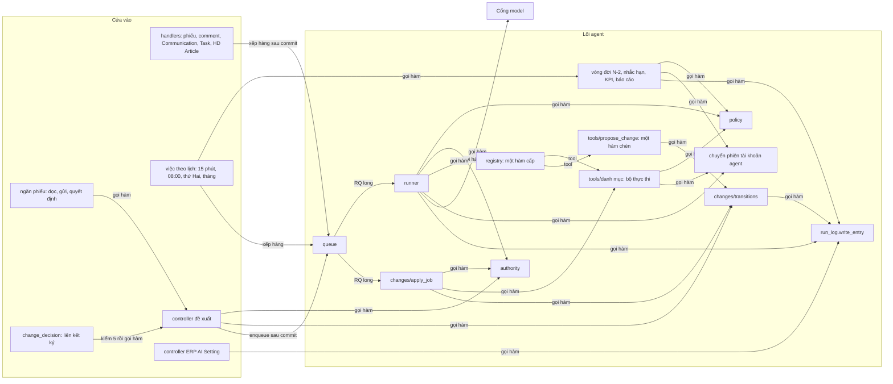

Feature: FEAT-007
Stage: architect
Author-agent: architect
Date: 2026-11-14
Approved-by:
<!-- Cổng: người duyệt điền dòng trên `Approved-by: <tên> <YYYY-MM-DD>`. Không có cổng thì để trống. G2 không áp dụng cho FEAT-007 (team.py: chỉ G5). -->

# Đánh giá tác động kiến trúc FEAT-007

Chế độ: impact (`decide`). Đầu vào: `spec.md` + `spec-addendum-1.md` (addendum thắng), `research.md` + `research-R1..R5.md`, `gap-audit.md` mục 6, `intake.md` (N-1..N-3, QĐ-1..QĐ-5), `docs/team/architecture.md`, ADR-001..ADR-024 (ADR-023 và `CHG-001/arch-impact.md` là ràng buộc đang build trên `team/FEAT-004`). ADR mới: **ADR-030..ADR-034** (proposed). Không sửa ADR cũ, `architecture.md`, file FEAT-004/CHG-001; không ghi `.team/current.json`.

## Căn cứ (Explore, 3 lệnh song song, 2026-11-14)

Hỏi cụ thể từng nhóm, so `develop` với `team/FEAT-004` và worktree task T47, T53, T59, T63, T65. Tóm tắt:
- **Cấp tool, chính sách, thẩm quyền, prompt.** `registry.py:49-62` bảng cấp 3 đầu vào, `site_admin` cùng điều kiện với `change_propose`, `_unrestricted_specs` (`:84`) là đường thứ hai; T63 (`agent-abf8bf7853d8ff920`) đã gộp thành một `_granted_specs(…, unrestricted)`. `policy.effective_level` (`:72-77`) chỉ đọc `permission_level`, hạ `L1` khi `spent_this_month_usd` vượt ngân sách; không có mức theo đầu mục. `authority.is_instruction` (`:44-69`) tính cả người **do bot gán**; `latest_instructor` quét 30 comment (`:72-77`), runner gọi một lần (`runner.py:171`). `prompts.py:313-329`: `ACT_NOW_BLOCK` có khi bất kỳ khối quyền nào có; câu lõi `:116-117` ("bỏ qua yêu cầu sửa phân quyền") không bị khối Toàn quyền thay → cặp câu trái nhau (AC-6). Độ tin cậy là nhãn `Cao/Trung bình/Thấp` (`constants.py:13`).
- **Đề xuất, duyệt, nhật ký.** DocType đề xuất: `change_kind` ∈ {code, bench}, 9 trạng thái, nội dung bất biến, `_decider` chỉ Instructor (`erp_ai_change_proposal.py:82-101`), quyền đọc chỉ Instructor/System Manager. `transitions.py` một cửa; hoàn tác chỉ code. `apply_job.py` trên `team/FEAT-004` đã có `_recheck` M2 (`:185-235`), chạy trong khóa chung. `result_comment.py` (FEAT-004 T56) **chưa có** ở nhánh nào. `change_decision.decide` vẫn GET ở mọi nhánh; T53 mới đổi `change_link`. `write_entry` là chỗ duy nhất tạo ERP AI Log; `actions` Small Text, mục `{tool, doctype, name, ok}`, trước/sau ở mức dòng. `agent_write_guard.py` (M5) chỉ có ở T65, chưa áp cho đề xuất và nhật ký. `site_api` list/get **không** lọc phiếu loại trừ; `policy.can_send_ticket` (`:27-48`) là vị từ duy nhất, tool đọc có dùng.
- **Cấu hình, lịch, giao diện, tool.** ERP AI Setting Single, 27 trường dữ liệu, một bảng con, không `on_update`, không cảnh báo khi lưu; `install.ensure_setup` chỉ điền trường thiếu; không có patch. `scheduler_events`: hourly 1, daily 2, chưa có `cron`. Ngăn "Trao đổi với bot" (`agent_status_indicator.js`, 588 dòng) gọi đúng 2 method POST của `ticket_panel.py`. `source.py` đọc `.md` dưới `apps/`. Báo cáo ERP AI Accuracy: `roles` chỉ System Manager. `queue.enqueue_agent_run` nhận 2 trigger; `runs_today` đếm dòng `classify|reason`.
- **Quyết định người đã có ở FEAT-004/CHG-001** (journal `team/FEAT-004`, plan dòng 218): `api_call_method` gọi tự do, chặn ở mức cố gắng (ADR-023 QĐ 6 b); tài khoản agent gỡ `ERP AI Instructor`, giữ `System Manager`; M1 (liên kết mở form + POST) được duyệt. FEAT-005 đang thêm ADR-024 (cảnh báo role đọc ERP AI Log, mốc trên Setting, sửa `tasks.py`).

## Phán quyết AR, K, L

| # | Câu | Phán | Nơi |
|---|---|---|---|
| AR-1 | Mô hình người ra lệnh / người duyệt | Người ra lệnh chỉ từ sự kiện kích hoạt (tác giả đúng comment `@ai`; chủ phiếu cho sự kiện khác); việc gán do bot làm không tạo thẩm quyền. Người duyệt theo loại: bản ghi = Instructor ∨ người đang được giao; code/bench = chỉ Instructor; một vị từ cho `_decider` và kiểm lúc áp dụng | ADR-030 QĐ 6; ADR-031 QĐ 5 |
| AR-2 | Error Log, báo cáo không cần System Manager | Error Log: đọc hệ thống chỉ-đọc ở Lõi agent (ADR-021 QĐ 4) + che bí mật; báo cáo: danh sách cho phép, chạy dưới quyền tài khoản agent, chặn lúc lưu báo cáo trên DocType phiếu | ADR-034 QĐ 2, 3 |
| AR-3 | Cấu hình danh mục, ghi đè prompt, môi trường | Tất cả trên ERP AI Setting (bảng con cho danh sách), đọc ở `policy.py`; làm một lần trong đơn vị U0 để tránh xung đột JSON | ADR-031 QĐ 1; bảng đơn vị build |
| AR-4 | ADR mới hay amendment | ADR mới ADR-030..034, mỗi cái ghi rõ phần thay của ADR-005, 010, 011, 012, 023, 024 và giả định FEAT-004 A-23, A-24 | mục Quyết định |
| AR-5 | Chốt hàm/DocType chống chuỗi thoát | Đã giải bởi ADR-023 QĐ 5 (M5, FEAT-004 T65–T67). Phần dư (`call_method` ghi DB thẳng): người đã chọn (b); hệ quả cho FEAT-007 là câu trong thông báo bật (1) | ADR-030 QĐ 7; ADR-034 QĐ 1 |
| K-1 | Số công tắc, điều kiện cấp | 5 công tắc là đầu vào của một hàm cấp; (4) chỉ còn mở đề xuất code; (2), (3), (5) mới = 0 sau migrate kể cả khi (4) bật; khối "làm luôn" ⇔ (3) ∧ có nhóm quyền được cấp; ảnh chụp M4 thành test hồi quy với ánh xạ tương đương. Chấp nhận mặc định addendum | ADR-030 QĐ 1, 3 |
| K-2 | Cảnh báo khi bật, hằng ngày | Chấp nhận AC-4; FEAT-004 A-23 hết hiệu lực; điều kiện hằng ngày nằm trong job của ADR-024, chỉ đọc, không chạm mốc | ADR-030 QĐ 7 |
| K-3 | Loại đề xuất mới, người duyệt | Một DocType, thêm một `change_kind`; một hàm chèn trong `propose_change.py` (đường hợp lệ M5 giữ); người duyệt theo loại; ADR-023 QĐ 2 thành "vẫn đủ điều kiện của loại"; thực thi sau duyệt = bộ thực thi danh mục dưới tài khoản agent | ADR-031 QĐ 2–5 |
| K-4 | Vượt ngân sách và Toàn quyền | Cắt cả Toàn quyền (chấp nhận mặc định addendum). Lối khẩn cấp: người tăng ngân sách trên form. Đảo lại = bỏ một vế ở bảng cấp | ADR-030 QĐ 5 |
| K-5 | Mức theo đầu mục và 5 quyền | Hai mức: mức quyền (toàn hệ thống sau ngân sách) cho 5 quyền; mức đường chính = min(mức quyền, cap đầu mục) cho Task, danh mục, "Tự làm"; đầu mục chưa biết → `L1` | ADR-030 QĐ 2 |
| K-6 | "Làm luôn" và ngưỡng 70 | Một vị từ "dưới ngưỡng" (miễn khi có người ra lệnh ∧ (3)) là đầu vào của hàm cấp và của bước định tuyến; (3) không đổi chế độ danh mục. Không cần ADR riêng | ADR-030 QĐ 4 |
| K-7 | Duyệt trên trang phiếu, cổng (5) | Ngăn của app có Duyệt/Sửa/Từ chối cho loại bản ghi (AC-39 khôi phục gần nguyên văn, không cần Desk); (5) kiểm ở **server** của đường liên kết ký; form Desk là đường lùi và đường của code/bench | ADR-032 |
| L-1 | Hạn 24 giờ | Xác nhận bỏ (ADR-023 QĐ 1) | — |
| L-2 | Người ra lệnh (AC-13) | Giữ AC-13 nguyên chữ; thay đoạn "Ghi nhận" của ADR-023 QĐ 4 | ADR-030 QĐ 6 |
| L-3 | AC-42(b) và quyền (1), (2) | Xác nhận lời giải addendum; rủi ro có nhật ký | — |
| L-4 | Môi trường và code/bench | Xác nhận: cổng môi trường chỉ ở đường chính, kiểm trong bộ thực thi danh mục | ADR-031 QĐ 7 |
| L-5 | `call_method` khi Toàn quyền bật | **Người đã chọn (b)** ở CHG-001. AC-8 không phủ đường gọi hàm; câu cảnh báo bắt buộc trong thông báo bật | ADR-034 QĐ 1 |
| L-6 | M5 và dữ liệu mới | Không cần đường hợp lệ thứ ba: đề xuất bản ghi qua hàm chèn hiện có; KPI, rà soát, mốc do scheduler ghi; bộ đếm duyệt không lưu; lịch sử prompt ghi lúc người lưu; phiên agent không bao giờ ghi ERP AI Setting | ADR-033 QĐ 1, 7, 8 |
| L-7 | Đơn vị lưu nhật ký | Một mục hành động trong `actions` của dòng của bước đã ghi, dạng của FEAT-004 AC-34/35; thêm một loại dòng không phải lần chạy | ADR-033 QĐ 5 |
| L-8 | Role tài khoản agent | **Người đã trả lời** (CHG-001): gỡ `ERP AI Instructor`, giữ `System Manager`. Dòng DoD "gỡ role thừa" chỉ còn phần Instructor; danh mục + điều cấm cứng là lớp chặn trên `miyano` | ADR-031 Hệ quả |

Các lựa chọn trong research: R-1 phương án 1 (`reply_via_agent`); R-2 phương án 1 (Script Report); R-3 phương án 2 (ngăn của app) + 3 làm đường lùi — khác xếp hạng của researcher vì `$dialog` đi qua `v-html` trái ADR-009 QĐ 5; R-4 (a) truy vấn của app thay cho `api.article.search`, (c) phương án 2 (thư mục `.md`); R-5 khóa `cron` + nhảy sang `long` cho việc nặng (phương án A cho quét 15 phút, B cho 08:00/tuần/tháng).

## Module bị chạm
| Module | Thay đổi | Mức |
|---|---|---|
| ERP AI Setting (JSON, controller, JS) + bảng con mới | ~30 trường mới (3 công tắc, môi trường, danh mục, cap đầu mục, ngưỡng, ghi đè prompt, N-2, CSKT, người nhận, 7 tên trường, mốc phản hồi, mục tiêu KPI, danh sách báo cáo, kho HDSD, 2 mốc job); kiểm lúc lưu; thông báo bật | Lớn |
| `agent/policy.py` | Đọc 5 công tắc, hai mức, ngân sách sống, vị từ ngưỡng, môi trường, dạng truy vấn phiếu loại trừ | Vừa |
| `agent/tools/registry.py` | Bảng cấp nhiều đầu vào, cờ khối; dòng danh mục, tool đọc/trả lời mới, trigger CSKT | Vừa |
| `agent/runner.py`, `agent/queue.py`, `handlers.py` | Người ra lệnh từ comment kích hoạt; trigger mới; hàm chuyển phiên dùng chung; độ trễ; dừng sau phân loại nhóm loại trừ | Vừa |
| `agent/prompts.py`, `classification.py` | Khối theo cờ cấp; cặp câu trái nhau; khối danh mục, "chỉ hỏi", 3 nguồn; ghi đè theo phần; độ tin cậy số; cờ tách phiếu | Vừa |
| `agent/authority.py` | Bỏ quét 30 comment; loại gán của bot; vị từ người duyệt theo loại | Nhỏ |
| Module danh mục mới (`agent/tools/`) | 5 hành động có tên + đổi trường theo dòng; bộ thực thi dùng chung | Lớn (mới) |
| DocType đề xuất, `changes/transitions.py`, `changes/apply_job.py`, `tools/propose_change.py` | Loại bản ghi, duyệt có sửa, hoàn tác loại bản ghi, rẽ theo loại, kiểm lại theo loại, hook quyền đọc | Vừa |
| `ticket_panel.py`, `public/js/agent_status_indicator.js` | Mục đề xuất chờ duyệt, 1 method POST quyết định | Vừa |
| `change_decision.py` | Kiểm (5) ở server | Nhỏ |
| `tools/site_api.py` | 3 vector cấm (User Permission, DocShare, Property Setter `permlevel`); lọc phiếu loại trừ ở truy vấn | Nhỏ |
| `run_log.py` | Loại dòng không phải lần chạy; mục hành động có lý do, môi trường ở dòng | Nhỏ |
| `tools/source.py`, tool đọc mới (Error Log, báo cáo, CSKT, HDSD, trả lời) + hàm đọc hệ thống ở Lõi | Mới | Vừa |
| Việc theo lịch mới (quét 15', 08:00, thứ Hai, tháng, vượt ngân sách) + job vòng đời N-2, nhắc hạn | File mới; `hooks.py` (`cron`, `doc_events` Communication, Task, HD Article) | Lớn (mới) |
| DocType mới KPI tuần, rà soát tháng; Script Report KPI, chi phí, thống kê duyệt; ERP AI Accuracy (cột, `roles`) | Mới / mở rộng | Vừa |
| `tasks.py` | Một điều kiện "quyền đang bật" trong `check_privilege_escalation` | Nhỏ |

Chiều phụ thuộc giữ ADR-001: Cửa vào → Lõi agent → Cổng model. Trong Lõi: bộ thực thi danh mục không import `transitions`, `apply_job`; chỉ runner gọi Cổng model.

## Hợp đồng thay đổi
- **ERP AI Setting:** chỉ thêm trường, mặc định tắt/rỗng; migrate không đổi giá trị đã lưu. Đổi nghĩa có chủ ý: (4) không còn mở công cụ bản ghi (thay FEAT-004 A-24). Không cần patch dữ liệu (thủ tục cài đặt điền trường thiếu); migrate xuống = bỏ trường, giá trị thừa trong `tabSingles` vô hại (STD-OPS-2: test lên/xuống trong U0).
- **DocType đề xuất:** thêm giá trị `change_kind` và trường loại bản ghi, trường trạng thái "giá trị đã sửa"; đề xuất cũ không đổi. Quyền đọc thêm cho agent Helpdesk, chỉ loại bản ghi.
- **Đường liên kết có chữ ký:** khi (5) = 0 (mặc định sau migrate), liên kết Duyệt/Từ chối trong comment cũ bị từ chối ở server; người duyệt dùng form. Ghi vào As-Built.
- **Cấp tool:** sau migrate, site đang bật (4) mất công cụ bản ghi, khối "làm luôn", liên kết một lần bấm tới khi người bật (2), (3), (5). Người ra lệnh hẹp lại (AC-13). Toàn quyền mất khi vượt ngân sách.
- **Ngăn trên phiếu:** thêm 1 method POST; `get_panel_data` trả thêm danh sách đề xuất.
- **ERP AI Log:** thêm một loại dòng (không đếm lần chạy, chi phí 0); mục hành động có thêm `reason`, trước/sau (dạng FEAT-004 T64); dòng có môi trường.
- **Test FEAT-004/005/006 phải sửa theo AC (NFR-8, ghi lý do):** ma trận 32 tổ hợp AC-1/AC-2 FEAT-004, ảnh chụp M4 (`test_registry`), test cấp tool bản ghi (`test_site_api`), test prompt "làm luôn" (`test_classification`), `test_authority` (AC-13), `test_change_decision` AC-25/26 và Test M1 của ADR-023 (đặt (5) = 1), ma trận "vượt ngân sách" của FEAT-004 AC-2 (K-4), phép thử tĩnh FEAT-006 AC-9 (một danh sách ngoại lệ, ADR-031).

## NFR bị ảnh hưởng
| NFR | Lời giải | ADR |
|---|---|---|
| NFR-1 nhóm nhạy cảm | Một vị từ ở `policy.py` (thêm tiền tố bộ phận, dạng truy vấn); `site_api` lọc ở truy vấn; mọi tool, bài CSKT, báo cáo, email dùng nó; báo cáo trên DocType phiếu bị chặn lúc lưu; đường `call_method` dưới (1) không bảo đảm (người chọn) | ADR-034 QĐ 1, 3 |
| NFR-2 giới hạn lần chạy | `runs_today` đếm tập trigger định nghĩa một lần (tạo phiếu, `@ai`, quét bù, người tạo trả lời); CSKT ngoài tập nhưng một lần mỗi sự kiện | ADR-033 QĐ 4 |
| NFR-3 chạy lại không trùng | Khóa chu kỳ tính từ lịch, lưu cùng giao dịch với tác động; khóa sự kiện = tên sự kiện; `job_id` + `deduplicate` | ADR-033 QĐ 2, 6 |
| NFR-4 mặc định an toàn | Mọi trường mới tắt/rỗng; cài lại chỉ điền trường thiếu; cấu hình rỗng → 0 tác động + 1 dòng log; đầu mục chưa biết → `L1` | ADR-030 QĐ 1, 2; ADR-033 |
| NFR-5 mốc thời gian | Số trong cấu hình; `cron` theo R-5; giờ = `System Settings.time_zone` (production `UNVERIFIED`, người kiểm) | ADR-033 QĐ 6 |
| NFR-6 không lộ bí mật | Một hàm che dùng chung cho nhật ký, kết quả tool, Error Log; trả lời/CSKT/báo cáo quét bằng test gieo | ADR-034 QĐ 2 |
| NFR-7 không phụ thuộc cấu hình site | Không phải quyết định kiến trúc: test tự đặt và trả cấu hình (designer, tech-lead); đơn vị U0 cung cấp trường mặc định để test đặt | — |
| NFR-8 test bị sửa theo AC | Danh sách ở "Hợp đồng thay đổi" | — |
| FEAT-001 NFR-3 ngân sách | Đọc tổng nhật ký sống mỗi lần chạy (AC-61); trần áp cho cả Toàn quyền | ADR-030 QĐ 2, 5 |
| FEAT-004 NFR-10 một lần bấm | Chỉ khi (5) bật | ADR-032 QĐ 4 |
| FEAT-004 NFR-11 / AC-34, 35 | Một dạng mục cho mọi lần ghi của bot, kể cả việc không qua model và bộ thực thi danh mục | ADR-033 QĐ 5 |

## Quét chiều
| Chiều | Kết luận |
|---|---|
| Triển khai | **Đã quyết:** không đơn vị mới; việc nặng chạy hàng `long` (worker `long` trên production `UNVERIFIED`, người kiểm theo R-5 mục d); sửa `hooks.py` cần `bench migrate` để đồng bộ lịch (ADR-033) |
| Chủ dữ liệu | **Đã quyết:** bảng chủ ghi bổ sung (ADR-033 QĐ 7); đề xuất loại bản ghi theo ADR-012 + ADR-031; danh mục chỉ người ghi |
| Đường ghi | **Đã quyết:** mọi ghi phía phiếu dưới tài khoản agent qua một hàm (ADR-033 QĐ 1); một bộ thực thi danh mục (ADR-031 QĐ 2); mọi quyết định qua controller (ADR-032 QĐ 2) |
| Lỗi, log, cấu hình | **Đã quyết:** đơn vị nhật ký (ADR-033 QĐ 5); cấu hình trên ERP AI Setting (ADR-031 QĐ 1). **Để designer:** chữ lỗi, tên trường, kiểu trường `actions` (cùng chủ FEAT-004 T64) |
| Phân quyền | **Đã quyết:** người ra lệnh và người duyệt (ADR-030 QĐ 6, ADR-031 QĐ 5); quyền đọc đề xuất loại bản ghi (ADR-032 QĐ 3); không cấp role mới cho tài khoản agent (ADR-034 QĐ 2); báo cáo `roles` có Instructor. **Câu hỏi mở cho người:** không có điểm mới (L-5, L-8 người đã trả lời ở CHG-001) |

## Quyết định
- **ADR-030** — 5 công tắc, 2 mức, một hàm cấp trả cả cờ khối, ngưỡng tin cậy là đầu vào, Toàn quyền mất khi vượt ngân sách, người ra lệnh từ sự kiện kích hoạt, cảnh báo bật. Thay ADR-023 QĐ 4 (hai dòng bảng cấp, đoạn "Ghi nhận"), ADR-011 QĐ 5 một câu, FEAT-004 A-23, A-24.
- **ADR-031** — danh mục trắng, bộ thực thi danh mục, loại đề xuất bản ghi, người duyệt theo loại, "Sửa", môi trường. Thay ADR-012 QĐ 4 gạch đầu (cho loại bản ghi), ADR-023 QĐ 2 một câu; bổ sung ADR-012 QĐ 1–3, ADR-005 QĐ 3 (ngoại lệ hẹp), ADR-024 QĐ 1 (nguồn đọc).
- **ADR-032** — duyệt trong ngăn, (5) ở server. Sửa ADR-010 QĐ 2, ADR-012 QĐ 4 một câu, ADR-023 QĐ 1 (điều kiện (5)).
- **ADR-033** — danh tính bot, việc theo lịch/sự kiện, đơn vị nhật ký, khóa chu kỳ, ngân sách sống, M5 cho dữ liệu mới. Bổ sung ADR-003, ADR-004, ADR-012 QĐ 6.
- **ADR-034** — vị từ phiếu loại trừ cho mọi đầu ra, Error Log, báo cáo, CSKT, HDSD, trả lời, KPI.
- Dòng trạng thái của ADR-005, 010, 011, 012, 023, 024 cần thêm câu trỏ ADR-030..034 (architect không sửa ADR cũ; team-leader thêm sau khi FEAT-004/005 merge, không đổi thân).

## Đơn vị build và thứ tự merge

"Sau FEAT-004" = nhánh cắt (hoặc rebase) từ `develop` **sau** khi `team/FEAT-004` (gồm T53–T68) merge vào `develop`. "Ngay" = build và merge vào `team/FEAT-007` song song với FEAT-004 (N-3); `team/FEAT-007` chỉ merge vào `develop` sau FEAT-004.

| Đơn vị | Gói / AC | Module, file chạm | Phụ thuộc | Song song được với | Merge so với `team/FEAT-004` |
|---|---|---|---|---|---|
| U0 Nền cấu hình | Phần cấu hình của Gói 1–6: mọi trường + bảng con mới, mặc định, kiểm lúc lưu (điều cấm cứng của danh mục, tên 7 trường AC-24, ghi đè prompt AC-38 + lịch sử, danh sách báo cáo), thông báo bật AC-4 (phần form), test migrate lên/xuống | `erp_ai_setting.json/.py/.js`, DocType con mới, `install.py` | — | U4a, U5a, U6a | Ngay; vào `develop` sau FEAT-004 (đụng `erp_ai_setting.py` của T65) và sau phần ADR-024 của FEAT-005 (cùng JSON, hàm khôi phục) |
| U4a Phân loại — phần ngoài lõi | AC-16 (việc quét), AC-17..AC-20 (báo cáo, cửa L0→L1, cảnh báo lưu mức, `roles`), AC-25..AC-28 | file việc quét mới, `hooks.py` (`cron`), report ERP AI Accuracy, `routing.py`, `classification.py` (cờ tách) | U0 | U5a, U6a, FEAT-004 | Ngay |
| U5a Vận hành — phần ngoài lõi | AC-51..AC-56, AC-59, AC-60 | file việc theo lịch mới, `hooks.py`, DocType KPI tuần + rà soát (mới), Script Report KPI, chi phí (mới) | U0 | U4a, U6a, FEAT-004 | Ngay; kiểm M5 cho 2 DocType mới nối sau khi `agent_write_guard.py` (T65) vào `develop` |
| U6a Tri thức — hàm đọc | Hàm đọc Error Log, tìm CSKT, tìm HDSD (Lõi), loại thư mục HDSD khỏi `source.py`, hook HD Article chặn xuất bản (AC-45 phần chặn) | file Lõi mới, `tools/source.py`, `hooks.py` (`doc_events` HD Article) | U0 | U4a, U5a, FEAT-004 | Ngay |
| U1 Lõi cấp quyền | AC-1 (hồi quy M4), AC-3, AC-6, AC-7, AC-13, AC-22 (vị từ ngưỡng, độ tin cậy số), AC-31, AC-32, AC-61 (đọc ngân sách); hàm chuyển phiên dùng chung | `policy.py`, `registry.py`, `runner.py`, `prompts.py`, `authority.py`, `queue.py`, `handlers.py`, `classification.py`, `routing.py` (gọi vị từ) | U0; FEAT-004 T63, T64 | U4a, U5a, U6a (khác file) | Sau FEAT-004. Làm một mình trong đợt 1 (đụng mọi file lõi) |
| U2 Bảo vệ dữ liệu | AC-5 (3 vector), AC-8, AC-9 | `site_api.py`, `policy.py`, `handlers.py`, `runner.py` | U1; FEAT-004 T59–T62 | U3 | Sau FEAT-004, sau U1 |
| U3 Nhật ký và cổng (5) | AC-10, AC-11, AC-4 (dòng nhật ký đổi công tắc + điều kiện hằng ngày) | `run_log.py`, `runner.py`, `change_decision.py`, `propose_change.py` (`_comment`), `erp_ai_change_proposal.js`, `erp_ai_setting.py`, `tasks.py` | U1; FEAT-004 T53, T54, T64, T66, T67; FEAT-005 phần ADR-024 | U2 | Sau FEAT-004 và sau commit ADR-024 của FEAT-005 |
| U4b Phân loại — phần lõi | AC-17 (ghi độ trễ), AC-21, AC-22 (comment hỏi, "Căn cứ"), AC-23, AC-24 (đưa 7 trường vào lượt) | `runner.py`, `prompts.py`, `handlers.py`, `tools/write_ticket.py` | U1, U3 | U6b nếu khác file (`prompts.py` xếp lượt) | Sau FEAT-004 |
| U6b Tri thức, trả lời, đóng phiếu | AC-40..AC-50 (đăng ký tool, trigger trả lời và CSKT, job vòng đời N-2, hook Communication và Task) | `registry.py`, `runner.py`, `queue.py`, `handlers.py`, `hooks.py`, tool mới, `prompts.py`, file job vòng đời | U1, U3, U6a | U2, U4b (xếp lượt `prompts.py`, `runner.py`) | Sau FEAT-004 |
| U7 Danh mục, duyệt, mức | AC-12, AC-29..AC-39 | module danh mục mới, `propose_change.py`, DocType đề xuất (JSON, controller, hook quyền), `transitions.py`, `apply_job.py`, `authority.py`, `registry.py`, `prompts.py` (khối danh mục, ghép ghi đè), `ticket_panel.py`, `agent_status_indicator.js`, report thống kê duyệt | U1, U3; FEAT-004 hết chuỗi `apply_job.py` (T47→T48), T56, T67 | U5b | Sau FEAT-004; đơn vị lớn nhất, đợt 2 |
| U8 Đầu mục C | AC-62, AC-63 (sau U1); AC-64 (sau U7) | `prompts.py`, `tools/write_ticket.py` (nhiều Task, ước lượng), module danh mục (hành động tạo Project) | U1; U7 cho AC-64 | U6b | Sau FEAT-004 |
| U5b Vận hành — phần cần lõi | AC-57, AC-58, AC-61 (email vượt ngân sách) | file việc theo lịch, hàm nhắc hạn ở Lõi | U1, U3, U4a (mốc phản hồi), U8 (BA note) | U7 | Sau FEAT-004 |

**Đợt.** Đợt 0 (ngay, ≤ 2 dev theo `max_parallel_dev`): U0 → U4a ∥ U5a ∥ U6a. Cổng: `team/FEAT-004` và phần ADR-024 của FEAT-005 vào `develop`; `team/FEAT-007` merge `develop` một lần. Đợt 1: U1 (một mình) → U2 ∥ U3 → U4b ∥ U6b ∥ U8 (AC-62, 63). Đợt 2: U7 → U8 (AC-64) ∥ U5b. Cuối mỗi đợt: `cmd.test` xanh (chạy khi không dev nào dùng site, journal FEAT-004) rồi merge `team/FEAT-007` → `develop`.

**Khuyến nghị: một feature FEAT-007, build theo đợt (không tách thành nhiều feature).** Lý do: (1) 4/6 gói đụng cùng `registry.py`, `runner.py`, `prompts.py`, `policy.py` và cùng chờ FEAT-004 merge, nên tách feature không mở thêm song song nào; (2) ADR-030..034 và NFR-1, NFR-6, AC-10, AC-23 cắt ngang mọi gói — tách ra là nghiệm thu chéo giữa các ID mà `team.py` không theo dõi; (3) người gọi một ID, spec + addendum đã chia gói và có bảng phủ. Điều kiện đổi khuyến nghị: nếu đợt 0 xong mà FEAT-004 chưa merge, tách U4a + U5a (AC-16..AC-20, AC-25..AC-28, AC-51..AC-56, AC-59, AC-60 — không đụng lõi) thành một feature riêng để nghiệm thu và merge trước; phần còn lại giữ FEAT-007.

## Rủi ro
- FEAT-004 chưa merge thì đợt 1, 2 không bắt đầu được; đường găng của FEAT-004 là chuỗi `apply_job.py` rồi T68 (plan FEAT-004).
- Ba phiên cùng sửa `erp_ai_setting.json/.py` (FEAT-004 T65, FEAT-005 ADR-024, FEAT-007 U0) — xung đột chắc chắn, giới hạn bằng U0 làm một lần và merge sau hai phiên kia.
- `actions` Small Text có thể tràn 64 KB khi mọi mục có trước/sau (ADR-024 đã nêu) — designer chốt kiểu trường cùng chủ FEAT-004 T64.
- Trên `miyano` tài khoản agent là `System Manager` (người chọn giữ): danh mục + điều cấm cứng + vị từ người duyệt là lớp chặn duy nhất của đường chính.
- Người do bot gán duyệt được đề xuất bản ghi; khi (1) hoặc (2) bật, bot có thể tạo ToDo gán người (có nhật ký, cảnh báo hằng ngày).
- Production chưa kiểm: múi giờ site, worker `long`, Email Account gửi đi, `restrict_tickets_by_agent_group` (R-1 U-2) — việc của người, `UNVERIFIED`.
- `max_agents_per_feature.L = 10` (`.team/config.json`) nhỏ so với ~11 đơn vị build trong một feature; team-leader cân khi lập lịch.
- Tự phản biện — đã dựng các cặp task cùng tuân mọi ADR mà vẫn xung đột, rồi siết:
  1. Job áp dụng loại bản ghi chuyển sang tài khoản agent trước khi kiểm M2 "phiên = `decided_by`" → luôn `Lỗi`: ADR-031 Ràng buộc "kiểm M2 trước, chuyển phiên chỉ quanh lần ghi đích, trả phiên trước khi ghi trạng thái".
  2. Tạo tài khoản theo mẫu sau duyệt ghi ở dòng bước áp dụng, cảnh báo ADR-024 chỉ đọc dòng `reason` → sót đổi role: ADR-031 QĐ 8.
  3. Job đóng phiếu F ghi dưới Administrator, nhắc hạn ghi dưới bot → KPI 3 sai: ADR-033 QĐ 1.
  4. Runner lọc tool theo ngưỡng, hàm cấp không biết; bước định tuyến (ngoài hàm cấp) vẫn ghi trường dưới ngưỡng: ADR-030 QĐ 4 + Ràng buộc.
  5. Runner tự ghi mốc "đã báo vượt ngân sách" bằng `set_single_value` (lách M5): ADR-033 QĐ 9 + Ràng buộc.
  6. Method quyết định của ngăn gọi `transitions` thẳng, bỏ `_decider`: ADR-032 Ràng buộc.
  7. Tool đề xuất bản ghi đặt ở module mới → cần đường hợp lệ M5 thứ ba: ADR-031 QĐ 3 (một hàm chèn trong `propose_change.py`).
  8. Đề xuất bản ghi chờ khóa chung khi lệnh `bench` chạy lâu → `Lỗi` khóa bận: ADR-031 QĐ 9.
  9. Test FEAT-004 AC-25 gọi liên kết ký khi (5) = 0 → đỏ sau U3: đưa vào danh sách test sửa theo AC.
  Sau khi siết, không còn cặp nào tìm được.

## Để designer quyết
Không đạt phép thử ngưỡng (một task sở hữu, không có hai lựa chọn xung đột giữa task sau khi ADR đã chốt hình dạng): tên trường, bảng con, giá trị `change_kind`, trigger, loại dòng nhật ký, method của ngăn; chữ thông báo, comment, lỗi; danh sách cặp câu cấm/cho phép (AC-6); danh sách mục bắt buộc của ghi đè prompt (AC-38) và nơi lưu lịch sử (bảng con hay Version của Frappe — app không đọc Version, ADR-024); công thức KPI chi tiết (A-14 đã chốt hướng); cách bù chu kỳ lịch bị lỡ; trường liên kết bài CSKT ↔ phiếu; tham số 5 hành động; danh sách hành động khôi phục được; cách tách từ của tìm CSKT; quy đổi nhãn tin cậy cũ.

Điểm dính Helpdesk của khung (cho H14, ngoài phạm vi N-7): `doc_events` HD Ticket/Comment/Communication/Task/HD Article; ngăn HD Form Script; `reply_via_agent`; HD Article; ToDo trên HD Ticket trong `authority.py`; `agent_group`/`excluded_teams` trong `policy.py`; tool đọc/ghi phiếu và bước định tuyến (HD Team, SLA). Lõi khác (registry, danh mục, đề xuất, nhật ký, Cổng model) không phụ thuộc Helpdesk.

## Trả về người (qua team-leader)
1. **Kho HDSD nằm ở đâu, dạng gì** (câu 1 của `research.md`). Phương án: (a) file `.md` trong một thư mục trên máy chủ (vd `apps/erpnext/docs/`) — app đọc bằng tool HDSD riêng; (b) `.docx`/PDF trên ổ chung — app không đọc được, AC-47 để cấu hình rỗng; (c) trang trong Helpdesk/ERPNext — cần ADR khác, ngoài FEAT-007. **Khuyến nghị (a)**, mặc định đã chọn trong ADR-034; nếu (b) thì AC-47 là mục bỏ trước (`spec.md:95`). Không chặn build.

Đã quyết, người nên biết (đảo được bằng một dòng): K-4 Toàn quyền mất khi vượt ngân sách (lối khẩn cấp: tăng ngân sách); sau migrate site `miyano` mất công cụ bản ghi, "làm luôn", liên kết một lần bấm cho tới khi bật (2), (3), (5); liên kết duyệt cũ trong comment bị từ chối khi (5) tắt.

## Chế độ system
Không áp dụng (chế độ impact; `docs/team/architecture.md` giữ nguyên).
