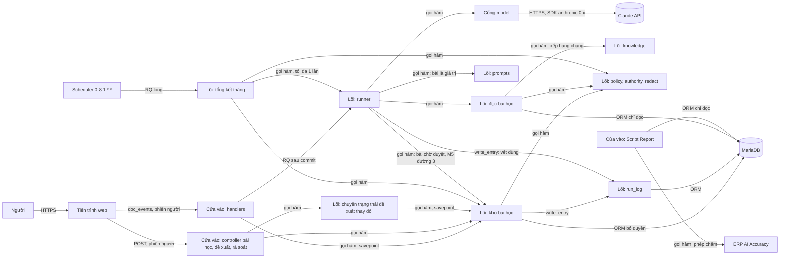

Feature: FEAT-008
Stage: architect
Author-agent: architect
Date: 2026-11-16
Approved-by:
<!-- Cổng: người duyệt điền dòng trên `Approved-by: <tên> <YYYY-MM-DD>`. Không có cổng thì để trống. -->

# Đánh giá tác động kiến trúc FEAT-008

Chế độ `impact` (`docs/team/architecture.md` đã có). G2 tắt (spec A-14); ADR mới ở `proposed`.

## Cơ sở khảo sát (Explore 2026-11-16, `develop` @ `28d35f8`)
- Ghi nhận người sửa chạy đồng bộ trong request, không try/except (`handlers.py:94-133`). Comment gọi bot: `comment_after_insert` (`:217-243`) → ERP AI Message → hàng đợi. Không hook nào bắt đổi người nhận; bot gán ở `runner.py:982-1011`.
- Thẩm quyền: `authority.is_instruction` (`authority.py:65-70`); duyệt đề xuất thay đổi = role Instructor (`erp_ai_change_proposal.py:131-150`); người rà ở `monthly_reviewers`.
- M5: cờ `allow_agent_write` chỉ ở `run_log.py:174`, `tools/propose_change.py:184` (luật `test_architecture.py:4426`). `run_log.write_entry` (`run_log.py:130`) tạo mọi ERP AI Log. Tool đọc/`site_api` từ chối cả module (`read.py:181`, `site_api.py:142`).
- Prompt: `system` cố định có `cache_control`, nhãn "dữ liệu"/"chỉ thị" ở phần người dùng (`prompts.py:427-448`, `:505-593`); `prompts.py` không đọc cấu hình; test byte-for-byte `test_prompts.py:346-360`, `test_run_eval.py:366-385`. "Căn cứ" đã bỏ theo FEAT-007 H-4, test ghim (`prompts.py:325`, `test_prompts.py:151`).
- Xếp hạng tìm CSKT viết liền trong `knowledge.py:53-86`, lặp ở `:89`.
- Cổng model chỉ import ở `runner.py:11`, `eval/run_eval.py:6`, `erp_ai_setting.py:10`; `run_for_ticket` là cửa duy nhất của runner.
- Rà soát tháng: cron `0 8 1 * *` → job `long` (`queue.py:142`) → `monthly_review.py:63`, phiên scheduler.
- Setting: `prompt_override_*` + kiểm (`erp_ai_setting.py:133-138`, `:487`); lịch sử chỉ do `record_prompt_revisions` (`:322`). Không ai `.save()` Setting. **Không mã nào trong `erp_ai/agent/` đọc trường ghi đè.**
- Độ đúng: `label_outcome` (`erp_ai_accuracy.py:168`).

## Module bị chạm
| Module | Thay đổi | Mức |
|---|---|---|
| `erp_ai/erp_ai_agent/doctype/` | 2 DocType mới; trường mới trên Setting, ERP AI Log; Review Month gọi kho; Setting tách hàm kiểm ghi đè và hàm ghi lịch sử | Lớn |
| `erp_ai/agent/` (mới) | Kho bài học (ADR-045), hàm đọc bài (ADR-046), tổng kết tháng (ADR-047) | Lớn |
| `erp_ai/handlers.py` | Gọi kho trong phiên người: sửa phân loại, đổi người nhận, comment dạy | Vừa |
| `erp_ai/agent/runner.py` | Đọc + truyền bài, ghi vết; bài chờ duyệt khi phiếu đóng; cửa tổng kết không gắn phiếu | Vừa |
| `erp_ai/agent/prompts.py` | Tham số bài (giá trị), khối có nhãn ở phần người dùng | Vừa |
| `knowledge.py`, `changes/transitions.py`, `policy.py` | Tách xếp hạng chung; gọi kho sau từ chối/hoàn tác; trường mới, vị từ A-2 | Nhỏ |
| `schedules.py`, `agent/queue.py`, `hooks.py`, `report/` | Job tháng; hook gán; Script Report | Vừa |
| `tests/test_architecture.py` | Luật theo Ràng buộc ADR-045..047 | Vừa |

## Hợp đồng thay đổi
- Schema: chỉ **thêm** (2 DocType, trường Setting/ERP AI Log, có thể thêm giá trị `trigger`); cài đặt điền trường thiếu (ADR-006): tự rút = 0, học = 1.
- Yêu cầu gửi model: thêm khối ở phần người dùng khi có bài; không bài → giống từng byte; `system` không đổi.
- Thêm một `doc_event` bắt đổi người nhận. Ngăn trên phiếu (ADR-010, ADR-044) không đổi. Không hệ thống ngoài, thư viện hay đơn vị triển khai mới.

## NFR bị ảnh hưởng
| NFR | Giải pháp | ADR |
|---|---|---|
| NFR-1 | Vị từ `policy.py` lúc tạo, lúc đọc, trước khi đếm; đầu vào model tổng kết sạch | 045 QĐ 7; 046 QĐ 1; 047 QĐ 2, 3, 6 |
| NFR-2 | Nguồn người 0 lời gọi; phiếu đóng chỉ ở runner sau công tắc; tổng kết ≤ 1 qua cửa runner có chốt ngân sách + dòng chi phí; tra không import Cổng model; trần ở `policy.py` | 045 QĐ 4, 8; 046 QĐ 1, 2; 047 QĐ 3 |
| NFR-3 | `redact.redact_secrets` trên mọi chữ tự do trước khi lưu và trước khi gửi model | 045 QĐ 7; 047 QĐ 3 |
| NFR-4 | Khóa sự kiện duy nhất cùng giao dịch; phép chuyển có điều kiện; khóa kỳ tháng | 045 QĐ 2, 6; 047 QĐ 1 |
| NFR-5 | Mặc định qua cài đặt; một điều kiện "đang dùng"; bài chỉ ở phần người dùng; eval không nhận bài | 046 QĐ 1, 3, 5; 045 QĐ 3, 11 |
| NFR-6 | Một dòng ERP AI Log mỗi lần tạo/chuyển; vết dùng trên dòng classify/reason | 045 QĐ 10; 046 QĐ 6 |
| NFR-7 | Không cần quyết định kiến trúc: mẫu `test_utils.py` sẵn có (BUG-002) | — |

7/7 NFR có dòng.

## Quyết định
- **ADR-045** kho bài học: chủ ghi duy nhất của bài học và đề xuất cải tiến; trạng thái khởi tạo do kho quyết; bài từ người ghi trong phiên người, cùng giao dịch, không làm hỏng lần lưu (ngoại lệ có tên cho ADR-033 QĐ 2); M5 đường 3 chỉ cho bài chờ duyệt từ phiếu đóng; DocType chỉ `read`; vết ở ERP AI Log.
- **ADR-046** dùng bài: một hàm đọc chỉ-đọc, lọc lúc đọc, xếp hạng chung với tìm CSKT; runner truyền bài như giá trị; chỉ ở phần người dùng; nhãn theo nguồn; eval không dùng; vết trên dòng của bước.
- **ADR-047** tổng kết và đề xuất cải tiến: gom tất định; ≤ 1 lời gọi qua cửa runner không gắn phiếu; DocType riêng, quyết theo A-2; áp dụng (b) ghi một trường qua cùng hàm kiểm và hàm lịch sử với form, kiểm dấu giá trị (sửa ADR-004 QĐ 1, ADR-033 QĐ 7); báo cáo dùng phép chấm của ERP AI Accuracy.
- Không ADR cũ nào bị thay; phần sửa ghi ở dòng Trạng thái của ADR mới (cách của ADR-032, ADR-041, ADR-043).

Không chu trình: kho không import runner, gateway, `changes`, handlers; hàm đọc không import kho hay gateway; runner không import tổng kết.

### Quét các chiều
| Chiều | Kết luận |
|---|---|
| Môi trường, deploy | **Đã quyết:** không đơn vị mới; tổng kết trên worker `long`; chỉ `miyano`, prod ngoài phạm vi (G5) |
| Sở hữu dữ liệu | **Đã quyết:** 2 DocType → kho (045); vết dùng → runner qua `write_entry` (046); trường ghi đè → form + một hàm áp dụng; lịch sử prompt → một hàm ghi (047) |
| Đường ghi | **Đã quyết:** phép chuyển có điều kiện, khóa sự kiện, khóa kỳ, phiên theo nguồn (045 QĐ 4) |
| Lỗi, log, cấu hình | **Đã quyết:** nguồn phiên người: savepoint + Error Log; tổng kết không ném ra khỏi job; tham số mới ở Setting, đọc ở `policy.py`. **Để designer:** chữ lỗi |
| Xác thực, phân quyền | **Đã quyết:** A-1 = `is_instruction` trong ngữ cảnh phiếu; A-2 một hàm ở `policy.py`; bot không qua vị từ nào; DocType chỉ `read`; quyết bằng POST. **Câu hỏi mở:** Q-A3 |
| Tích hợp ngoài | **Đã quyết:** không thêm; lời gọi model mới qua Cổng model (ADR-002) |

## Rủi ro
- **FEAT-007 chưa nối trường ghi đè vào runner**: (b) áp dụng được nhưng không đổi hành vi bot tới khi FEAT-007 AC-38 (U7b-U8) vào `develop` (Q-A2).
- **AC-14 đòi mục "Căn cứ"** mà FEAT-007 H-4 đã bỏ và test ghim; AC-21 cấm sửa test đó. Kiến trúc không phụ thuộc (vết do runner ghi, ADR-046 QĐ 6) (Q-A1).
- Lưu phiếu/comment/rà soát thêm vài truy vấn và một savepoint; lỗi kho bị nuốt vào Error Log nên bài có thể mất (đổi lại không chặn người).
- Tách xếp hạng khỏi `knowledge.py` và hai hàm khỏi controller Setting chạm mã FEAT-007; CHG-005/006/007 cùng giữ `runner.py`, `prompts.py` → `/team:plan` xếp theo `team.py sessions`.
- Ngưỡng A-4, A-7, A-9 chưa có số đo.
- **Tự phản biện** — đã thử: (1) dạy bằng comment ghi trong runner → bot tạo bài đang dùng → siết 045 QĐ 4, 8; (2) vết ở DocType riêng còn báo cáo đọc ERP AI Log → 046 QĐ 6; (3) tổng kết tự tính độ đúng → 047 QĐ 6; (4) áp dụng (b) khi người khác đang mở form Setting → 047 QĐ 5 bước 1, 5; (5) phiếu nguồn vào nhóm loại trừ sau khi có bài → 046 QĐ 1; (6) nhãn theo chữ thay vì nguồn → 046 QĐ 4; (7) cửa tổng kết vào phiên agent làm M5 chặn tạo đề xuất → 047 QĐ 3; (8) từ chối đề xuất cải tiến sinh bài → 047 QĐ 4; (9) cấp `create` cho role, REST vượt A-1 → 045 QĐ 9. Không còn tổ hợp xung đột nào tìm được.

## Để designer quyết
- Tên DocType/trường/trạng thái/module; thành phần khóa sự kiện (ràng buộc đã ở 045 QĐ 6).
- Sự kiện bắt đổi người nhận (spec Q-2); điểm gọi kho của hoàn tác — đều trong phiên người (045 QĐ 4).
- Vị trí và chữ khối bài (spec Q-1); dạng lưu vết, miễn lọc được theo bài.
- Gộp hay tách lời gọi rút bài với soạn CSKT (A-12), miễn ≤ 1 lời gọi thêm và ghi qua kho ngoài `tools/`.
- Có dùng lời gọi model ở tổng kết; thứ tự với rà soát tháng; trường đích (b); dấu giá trị; cơ chế chống lưu form cũ; độ dài cắt ngắn; cột báo cáo.
- Spec Q-3: phần kiến trúc đã ở 045 QĐ 4 (handler comment, tác giả = user phiên). Spec Q-4: ngoài phạm vi (046 QĐ 5).

## Câu hỏi mở cho team-leader (không chặn design)
- **Q-A1** (analyst `--amend`): AC-14 "nêu mã bài ở mục Căn cứ" trái FEAT-007 H-4 và AC-21. Gợi ý: bỏ yêu cầu nêu trong comment (AC-17 đã cho vết) hoặc người chọn mục khác.
- **Q-A2** (team-leader): AC-19 (b) cần phần nối runner của FEAT-007 AC-38, chưa có trên `develop`. Chờ FEAT-007, hoặc bỏ (b) (đã trong danh sách bỏ trước).
- **Q-A3** (analyst/designer): A-1 khi không có phiếu (dạy trên form, tắt/bật bài); đề nghị mặc định chỉ role `ERP AI Instructor`.

## Chế độ system
Không áp dụng.
